# OpenSilver.Animations

<p align="center">
  <a href="http://opensilver-animations-library.azurewebsites.net"></a>
</p>

Layout animations for [OpenSilver](https://opensilver.net), declared in XAML. Add an attribute to an element, and the changes your app makes to the layout animate on their own: the element that appears, disappears, moves or changes size, and everything that moves because of it.

How it differs from the animations that XAML frameworks usually provide:

- **Only attributes.** No Storyboard, no trigger, no extra element and no C#. `anim:Animate.Appear="Fade"` is a complete animation, and most attributes need no parameters. Showing a panel, removing an item from a collection or changing a label is enough to play it.
- **The elements around a change follow it.** When a button's label gets longer, the button grows smoothly and the buttons next to it slide along. A collapsed or removed element fades out while the others close the gap.
- **Magic move.** An element can travel from one layout to a completely different one, anywhere in the app: a thumbnail into a details view, a text box into a popup, a step of a wizard into the next.
- **Disappear animations.** An element that is collapsed or removed plays its exit, even though it has already left the layout.
- **Lists, text and the mouse.** Items glide to their new places after a sort, a filter or a refresh. Digits roll, numbers count and letters are typed. Elements react when the mouse is over them or presses them.
- **Designer-friendly.** Each animation is a property value with named settings, so a XAML designer can list it, edit it and preview it. The [XAML.io](https://xaml.io) online designer will support it soon.
- **Your app doesn't change its behavior.** The animations play in the browser's DOM, a layer that OpenSilver keeps apart from the visual tree. The visual tree, the layout and the values of your dependency properties are final from the start, so your code, your bindings, your transforms, and your dependency properties work as they would without the library. The library is "transparent" from the point of view of your app.

<p align="center">
  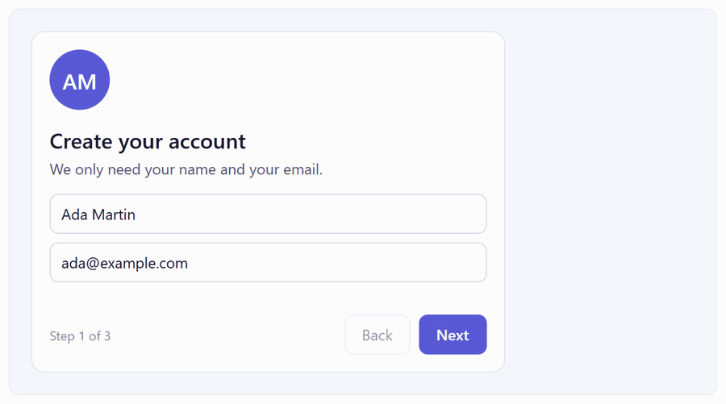
  <br>
  <a href="#steps-that-flow-into-each-other">Steps that flow into each other</a>. The avatar and the heading travel to their places in the next step.
</p>

<p align="center">
  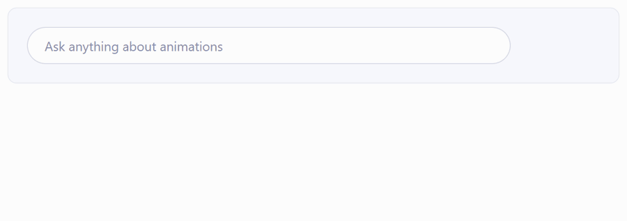
  <br>
  <a href="#a-text-box-that-opens-into-a-popup">A text box that opens into a popup</a>, and shrinks back into place when the popup closes.
</p>

<p align="center">
  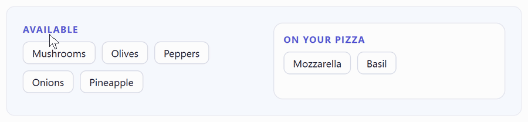
  <br>
  <a href="#between-two-lists">Toppings that travel between two lists</a>, while the chips left behind close the gap.
</p>

<p align="center">
  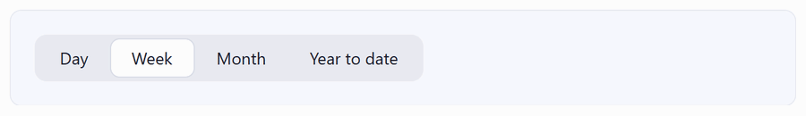
  <br>
  <a href="#a-selection-pill">A selection pill</a> that slides and stretches to the option you click.
</p>

<p align="center">
  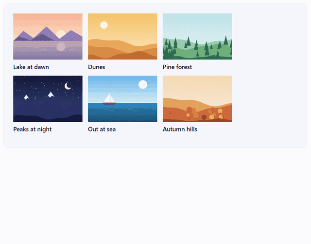
  <br>
  <a href="#a-photo-that-opens-where-it-is">A photo that opens where it is</a>, while the rest of the list fades out and the frame grows.
</p>

<p align="center">
  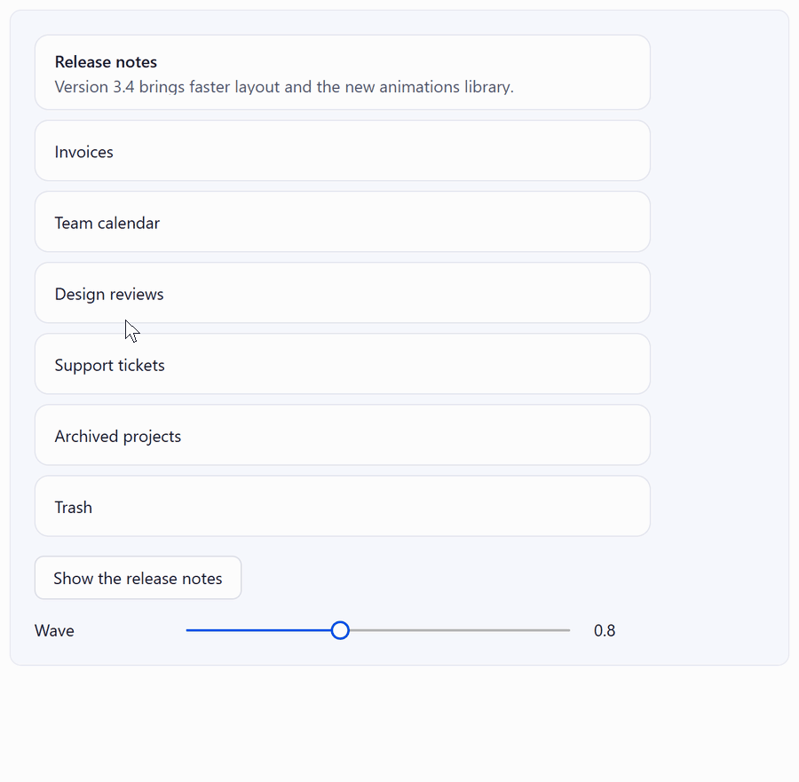
  <br>
  <a href="#wave-and-bouncy">Cards that move like a wave</a> when the card above them grows.
</p>

<p align="center">
  <a href="http://opensilver-animations-library.azurewebsites.net">Live gallery</a> ·
  <a href="#installation">Installation</a> ·
  <a href="#how-it-works-and-why-it-is-built-on-opensilver">How it works</a> ·
  <a href="https://opensilver.net">OpenSilver</a> ·
  <a href="https://xaml.io">XAML.io</a>
</p>

The main properties, one line each:

```xml
<!-- When it is shown, added, hidden or removed -->
<Border anim:Animate.Appear="Slide" anim:Animate.Disappear="Fade" />

<!-- When the layout moves or resizes anything inside it -->
<Grid anim:Animate.MoveAndResize="{anim:Smooth ApplyTo=EverythingInside}" />

<!-- When items are added, removed, sorted, filtered or refreshed -->
<ItemsControl anim:Animate.ItemsAppear="Fade" anim:Animate.ItemsDisappear="Fade" anim:Animate.ItemsMoveAndResize="Smooth" />

<!-- When the text changes -->
<TextBlock Text="{Binding Total}" anim:Animate.TextChange="CountUp" />

<!-- Travels to the element with the same id, in the list or in the details view -->
<Image anim:Animate.MagicMove="{Binding Id, StringFormat='photo-{0}'}" />

<!-- When the content changes, each element travels to the one with the same x:Name -->
<ContentControl anim:Animate.MagicMoveByName="True" />

<!-- Under the mouse, and while pressed -->
<Button anim:Animate.Hover="Grow" anim:Animate.Press="Shrink" />
```

The rest of this page is about their parameters and how they behave.

The [live gallery](http://opensilver-animations-library.azurewebsites.net) is a guided tour in 14 chapters, from a first fade to a small app, and its first three chapters show the main ideas in a few minutes. Every demo shows its XAML and lists what should happen. The gallery is itself an OpenSilver app running in your browser, and its source is in `[samples/](samples)`. Every GIF on this page is a recording of the gallery in Chrome, with the animations slowed down to half speed so that each move is easy to follow.

**Why OpenSilver only.** OpenSilver runs WPF-style XAML and C# in the browser, and renders the XAML as real HTML elements, in a DOM that it keeps apart from the visual tree. The library depends on that separation: it animates what the browser shows, and never touches your elements or their properties. [How it works](#how-it-works-and-why-it-is-built-on-opensilver) explains what that makes possible, and [About OpenSilver](#about-opensilver-and-xamlio) describes OpenSilver if you come from WPF or WinUI.

**Status:** preview, version 0.1, MIT license. It requires OpenSilver 3.4 (in preview for now), and it has been tested in Chromium, the engine of Chrome and Edge. See [Status and limitations](#status-and-limitations).

## Contents

- [A first animation](#a-first-animation)
- [Magic move](#magic-move)
- [Moves and resizes](#moves-and-resizes)
- [Appear and disappear](#appear-and-disappear)
- [Lists](#lists)
- [Hover and press](#hover-and-press)
- [Text](#text)
- [Installation](#installation)
- [From code](#from-code)
- [Settings, reduced motion and debugging](#settings-reduced-motion-and-debugging)
- [Where this library comes from](#where-this-library-comes-from)
- [How it works, and why it is built on OpenSilver](#how-it-works-and-why-it-is-built-on-opensilver)
- [About OpenSilver and XAML.io](#about-opensilver-and-xamlio)
- [What doesn't animate, and why](#what-doesnt-animate-and-why)
- [Status and limitations](#status-and-limitations)
- [Building from source](#building-from-source)
- [License](#license)

## A first animation

```xml
<UserControl xmlns:anim="http://opensilver.net/animations" ...>
    <StackPanel>
        <Button Content="Show details" Click="ToggleDetails" />

        <StackPanel x:Name="Details" Visibility="Collapsed"
                    anim:Animate.Appear="Fade" anim:Animate.Disappear="Fade">
            <TextBlock Text="Wireless headphones: $59.00" />
            <TextBlock Text="Charging cable: $12.40" />
        </StackPanel>

        <TextBlock Text="Payment: card ending in 4242" />
    </StackPanel>
</UserControl>
```

```csharp
private void ToggleDetails(object sender, RoutedEventArgs e)
{
    Details.Visibility = Details.Visibility == Visibility.Visible ? Visibility.Collapsed : Visibility.Visible;
}
```

<p align="center">
  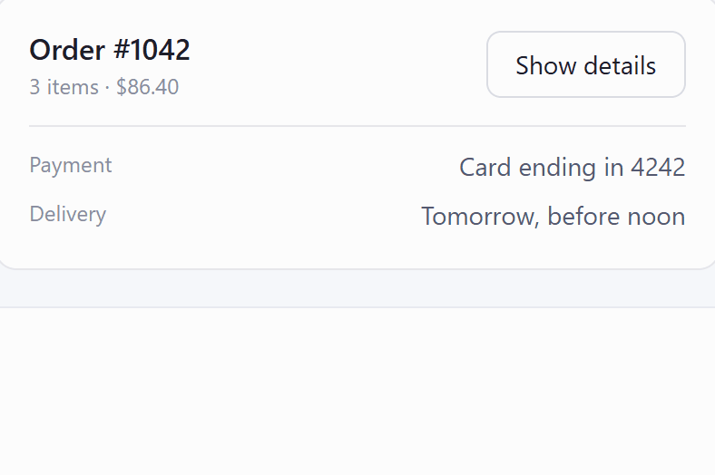
</p>

- There is no Storyboard, no trigger and no call to start anything. The effect plays because the panel's `Visibility` changed. Adding the element to the page, or removing it, plays the same effects.
- When the panel appears, the payment row below it slides down to make room, and the card around it grows, in the same 0.25 seconds as the fade. They have no settings: they move because the change moves them.
- When the panel is collapsed, the layout moves on at once, but the panel stays on screen while it fades out, and the payment row slides up into its space.
- Your code sees the final state right away: `ActualHeight`, bindings, hit testing and focus. The library never animates a dependency property. It animates what the browser shows (see [How it works](#how-it-works-and-why-it-is-built-on-opensilver)). Removing the two attributes changes how the app looks while it changes, and nothing else.

The same works for the elements you add and remove: see [Appear and disappear](#appear-and-disappear).

<details>
<summary>The same panel in WPF, for comparison</summary>

The usual way is a Style trigger on `Visibility` that starts a Storyboard:

```xml
<StackPanel x:Name="Details" Visibility="Collapsed">
    <StackPanel.Style>
        <Style TargetType="StackPanel">
            <Style.Triggers>
                <Trigger Property="Visibility" Value="Visible">
                    <Trigger.EnterActions>
                        <BeginStoryboard>
                            <Storyboard>
                                <DoubleAnimation Storyboard.TargetProperty="Opacity"
                                                 From="0" To="1" Duration="0:0:0.25" />
                            </Storyboard>
                        </BeginStoryboard>
                    </Trigger.EnterActions>
                </Trigger>
            </Style.Triggers>
        </Style>
    </StackPanel.Style>
    <!-- The two lines of items -->
</StackPanel>
```

It fades the panel in, but not out: a collapsed element is gone at once, so fading it out means starting a Storyboard from code and collapsing the panel when it completes. In both directions, the payment row jumps to its new place and the card's height snaps. Animating them too means animating heights, which can't go to `Auto`, and running the layout at every frame.

</details>

## Magic move

Give two elements the same id. When one of them disappears and the other one appears, the old one seems to travel to the new one's place and turn into it: its position, size, corners, colors and content change on the way, while the two cross-fade. There is nothing to call before or after the change: the two elements pair up when the layout hides one and shows the other, wherever they are on the page. Inside a `ContentControl`, the elements of the old and the new content can also pair up by `x:Name`.

### Steps that flow into each other

`MagicMoveByName` on a `ContentControl` or a `Frame`: when its content changes, each element of the old content travels to the element with the same `x:Name` in the new content. The rest of the old content fades out while the new one fades in.

```xml
<ContentControl x:Name="WizardHost" anim:Animate.MagicMoveByName="True" />

<!-- In each step -->
<Border x:Name="Avatar" ... />
<TextBlock x:Name="Heading" ... />
```

<p align="center">
  
</p>

### A text box that opens into a popup

With an id, the two elements can be anywhere, even in a popup. The text box is collapsed while the popup is open, and the card in the popup has the same id:

```xml
<Grid x:Name="AskAnchor" Height="40">
    <!-- Collapsed while the popup is open -->
    <Border anim:Animate.MagicMove="AskBox"
            Visibility="{Binding IsOpen, ElementName=AskPopup,
                                 Converter={StaticResource InverseBooleanToVisibility}}">
        <TextBox GotFocus="AskBox_GotFocus" />
    </Border>

    <Popup x:Name="AskPopup" StayOpen="False" Placement="Bottom" VerticalOffset="-40"
           PlacementTarget="{Binding ElementName=AskAnchor}">
        <Border anim:Animate.MagicMove="AskBox" Width="{Binding ActualWidth, ElementName=AskAnchor}">
            <!-- A larger text box and a Send button -->
        </Border>
    </Popup>
</Grid>
```

<p align="center">
  
</p>

### Between two lists

```csharp
// Each topping has an id of its own
Animate.SetMagicMove(chip, "topping-" + name);

// Moving it: remove it from one list, and add a new one to the other
Available.Children.Remove(chip);
Chosen.Children.Add(CreateChip(name));
```

<p align="center">
  
</p>

### A selection pill

```xml
<!-- In the template of the RadioButton, visible only when it is checked -->
<Border x:Name="Pill" Visibility="Collapsed" anim:Animate.MagicMove="SelectionPill" />
```

<p align="center">
  
</p>

Only one pill is visible at a time. When you check another button, its pill appears and the old one disappears, so the old pill travels to the new one.

### A photo that opens where it is

The ids can be bound, so that each item of a list has its own. The list and the details share a Grid: the rest of the list fades out, and the Grid resizes smoothly to the height of the details.

```xml
<Grid anim:Animate.MoveAndResize="Smooth">
    <ItemsControl x:Name="PhotoList" anim:Animate.Appear="Fade" anim:Animate.Disappear="Fade" />
    <StackPanel x:Name="PhotoDetails" Visibility="Collapsed" anim:Animate.Disappear="Fade" />
</Grid>

<!-- In the list, and in the details: the same ids -->
<Image Source="{Binding Image}" anim:Animate.MagicMove="{Binding Id, StringFormat='photo-{0}'}" />
<TextBlock Text="{Binding Title}" anim:Animate.MagicMove="{Binding Id, StringFormat='title-{0}'}" />
```

<p align="center">
  
</p>

### Parameters and rules

```xml
<Border anim:Animate.MagicMove="{anim:MagicMove Id=SelectionPill, Travel=Behind, Duration=0.4s, Easing=Bouncy}" />
```

- `Travel`: `Automatic` (the default) travels behind the other elements when the element is a background, like a selection pill, and above them otherwise. `Above` travels above everything on the page, even outside the containers that clip their content. `Behind` travels behind the elements it travels between.
- `Duration`: by default, it depends on the distance, from 0.25 s for a short trip to almost twice that for a long one.
- `Easing`: as for the other animations. With `Bouncy`, the size changes without bouncing.
- A bound id uses the default parameters, because a markup extension can't hold a binding.
- The elements are hidden with `Visibility`, or added and removed. A template whose visual states use `Opacity` needs to use `Visibility` instead.
- When several elements could pair, like in the templates of two lists, the two that are the closest in the page travel.
- An element that disappears waits up to 0.3 s for its partner. If none comes, it plays its own `Disappear`.

See [chapter 2](http://opensilver-animations-library.azurewebsites.net/#/chapter/2) of the gallery.

## Moves and resizes

`Animate.MoveAndResize` animates an element when the layout moves it or changes its size: a button whose label gets longer, a sidebar that collapses, a dialog that gets wider, a card whose image loads. Everything that moves or changes size in the same change animates with it, with the same timing.

```xml
<Button Content="{Binding SaveLabel}" anim:Animate.MoveAndResize="Smooth" />

<Border x:Name="Badge" CornerRadius="10" anim:Animate.MoveAndResize="Smooth">
    <TextBlock Text="{Binding UnreadCount}" />
</Border>

<Border x:Name="Sidebar" Width="240" ClipToBounds="True" anim:Animate.MoveAndResize="Smooth">
```

<p align="center">
  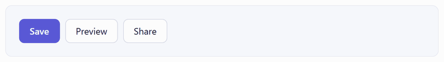
  <br>
  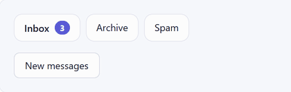
  <br>
  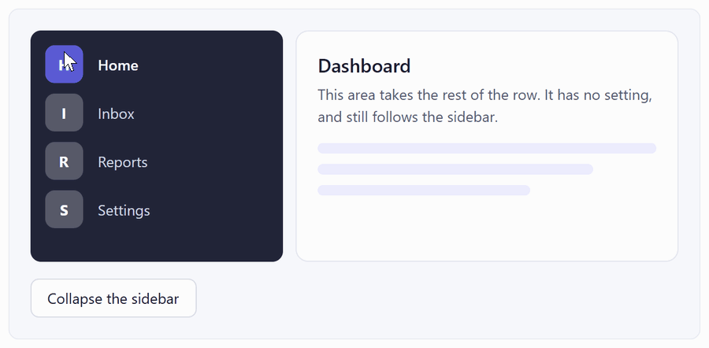
</p>

It animates the result of the layout, so it doesn't matter how a size was computed: `Auto`, star rows and columns, a `WrapPanel` that reflows, a longer label, an image that loads. Nothing has to know the target size in advance. A resize is a real resize: the browser animates the width and the height, so text and borders don't stretch the way they would with a scale transform.

`Smooth` moves and resizes smoothly. `Bouncy` moves with a little bounce at the end, like a spring, while sizes change smoothly. `None` never animates. Their parameters are at the [end of this section](#parameters-of-moveandresize).

### Everything inside

`ApplyTo=EverythingInside` animates every change inside the element, at any depth, including templates, items, and content created later. It is the quickest way to animate a whole form, page or layout:

```xml
<Grid anim:Animate.MoveAndResize="{anim:Smooth ApplyTo=EverythingInside}">
```

<p align="center">
  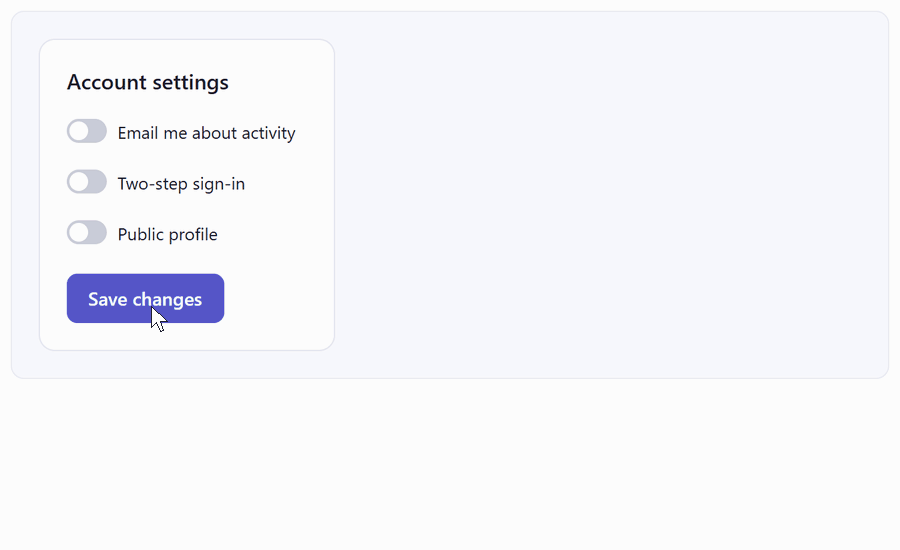
  <br>
  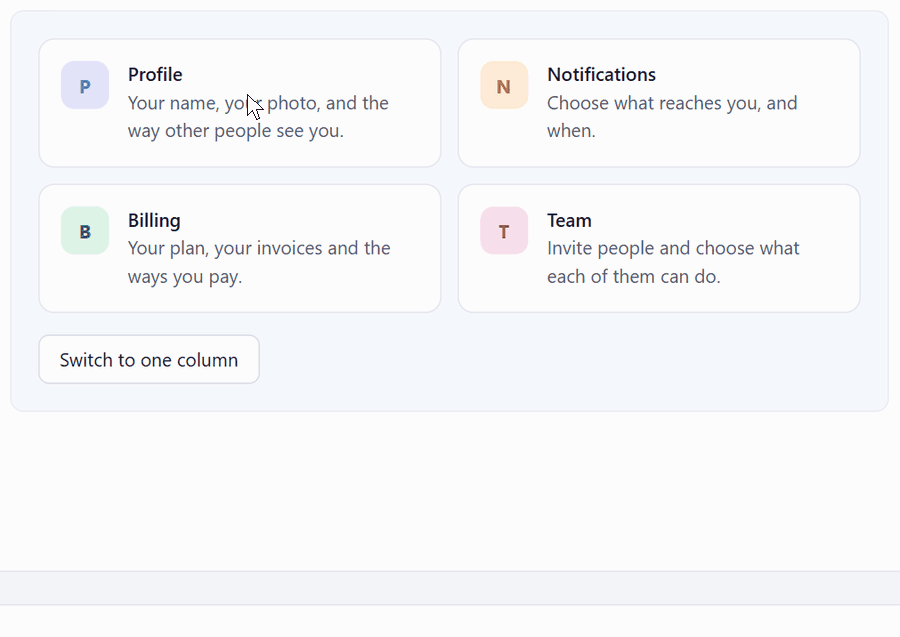
</p>

Inside such an element, the elements that appear or disappear without an effect of their own wipe in from the side where they push the others, or fade in when they push nothing, and they wipe or fade out the same way. `Appear="None"` and `Disappear="None"` turn that off for one element. `MoveAndResize="None"` leaves out an element and everything inside it, like a live chart that redraws itself:

```xml
<Border anim:Animate.MoveAndResize="{anim:Smooth ApplyTo=EverythingInside}">
    <!-- The numbers animate -->
    <Grid x:Name="Chart" anim:Animate.MoveAndResize="None">
        <!-- The bars snap -->
    </Grid>
</Border>
```

When settings are nested, the one nearest to where a change starts gives the timing. A popup, a tooltip or a ChildWindow opened from inside the element isn't part of it: set the property inside the popup.

### Wave and Bouncy

```xml
<StackPanel anim:Animate.MoveAndResize="{anim:Smooth ApplyTo=EverythingInside, Wave=0.8, Duration=0.4s}">

<Border x:Name="Underline" Height="3" anim:Animate.MoveAndResize="Bouncy" />
```

<p align="center">
  
  <br>
  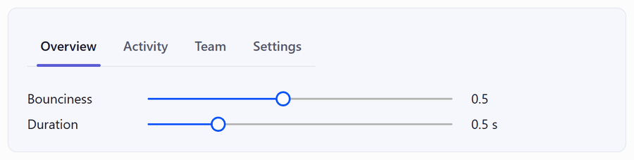
</p>

### A panel that you resize, and the window

While a pointer drags, the layout follows it without delay: a panel resized with a `GridSplitter` follows the pointer exactly. A value of OpenSilver's `{Responsive}` markup extension that switches at a breakpoint still animates, even in the middle of the drag. Here, the profile's layout depends on the width of its own panel:

```xml
<Border x:Name="ProfilePanel" anim:Animate.MoveAndResize="{anim:Smooth ApplyTo=EverythingInside}">
    <StackPanel Orientation="{Responsive ElementName=ProfilePanel, Threshold=220,
                                          Mobile=Vertical, Desktop=Horizontal}">
```

<p align="center">
  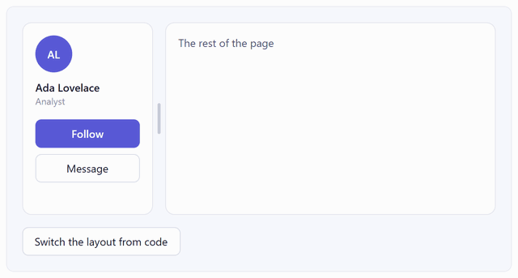
</p>

Resizing the browser window doesn't animate by default, because following the edge of the window with a delay feels laggy. `AlsoOnWindowResize=True` turns it on for an element and everything inside it. A `{Responsive}` value that switches at a breakpoint of the window animates like a click, even while the window is being resized:

```xml
<StackPanel Orientation="{Responsive Threshold=1100, Mobile=Vertical, Desktop=Horizontal}"
            anim:Animate.MoveAndResize="{anim:Smooth ApplyTo=EverythingInside}">
```

### Parameters of MoveAndResize


| Parameter            | Values, and the default                                                                                                                                   |
| -------------------- | --------------------------------------------------------------------------------------------------------------------------------------------------------- |
| `Duration`           | 0.05 to 3 s. Default: 0.25 s, and twice that for `Bouncy`                                                                                                 |
| `Easing`             | For `Smooth`: `Smooth` (default), `Gentle`, `Linear`, `EaseOut`, `EaseIn`, `EaseInOut`, `Overshoot`, or any `IEasingFunction`                             |
| `Bounciness`         | For `Bouncy` and `Easing=Overshoot`: 0.1 to 1. Default: 0.5                                                                                               |
| `Wave`               | 0 to 2. Elements farther from where the change started begin later, like a wave: at 1, the farthest ones start 0.2 s later; at 2, 0.4 s later. Default: 0 |
| `ApplyTo`            | `ThisElement` (default), or `EverythingInside`: see [Everything inside](#everything-inside)                                                               |
| `AlsoOnWindowResize` | `True` to also animate when the change comes from resizing the browser window. Default: `False`                                                           |


See chapters [3](http://opensilver-animations-library.azurewebsites.net/#/chapter/3), [7](http://opensilver-animations-library.azurewebsites.net/#/chapter/7) and [12](http://opensilver-animations-library.azurewebsites.net/#/chapter/12) of the gallery.

## Appear and disappear

`Animate.Appear` plays when an element appears: when it is added to the page, or when its `Visibility` becomes `Visible`. `Animate.Disappear` plays when it disappears: when it is removed, or when its `Visibility` becomes `Collapsed` or `Hidden`. In both cases, the elements around it move to make room or to fill the space, with the same duration.

```xml
<!-- Each note -->
<Border anim:Animate.Appear="Fade" anim:Animate.Disappear="Fade">
```

<p align="center">
  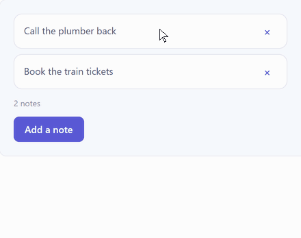
</p>

### Page intros

When elements appear together with their page, a dialog or a card, `StartAfter` makes them appear one after the other:

```xml
<Border x:Name="Photo" anim:Animate.Appear="Pop" />
<TextBlock Text="Alex Martin" anim:Animate.Appear="{anim:Slide From=Left, Distance=Short, StartAfter=0.1s}" />
<TextBlock Text="Product designer" anim:Animate.Appear="{anim:Fade StartAfter=0.2s}" />
<!-- The three figures, at 0.3, 0.4 and 0.5 s -->
<Border anim:Animate.Appear="{anim:Slide Distance=Short, StartAfter=0.3s}" />
<Button Content="Follow" anim:Animate.Appear="{anim:Fade StartAfter=0.6s}" />
```

<p align="center">
  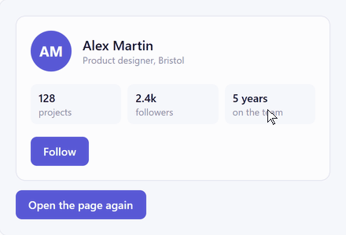
</p>

`OnPageOpen` chooses what an element does when it appears with its page:

- `InPlace` (the default): its space is kept, and it plays its effect there after its `StartAfter`. Nothing else moves.
- `PushOthers`: the page opens without it. After its `StartAfter`, it appears, and the elements around it move to make room.
- `Skip`: it is there when the page opens, without its effect. It still plays its effect when it appears later on its own.

When an element appears later, on its own, with a `StartAfter`, the room for it opens at once, and only its effect waits. See [chapter 4](http://opensilver-animations-library.azurewebsites.net/#/chapter/4) of the gallery.

### Effects

In each animation below, the card disappears, then appears again. The text and the button below it move into its space and back.

<table>
  <tr>
    <td width="25%" align="center" valign="top"><br><b>Fade</b><br>Fades in or out.</td>
    <td width="25%" align="center" valign="top"><br><b>Slide</b><br>Fades while sliding from a side, or to a side.</td>
    <td width="25%" align="center" valign="top">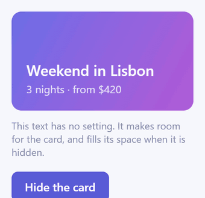<br><b>Zoom</b><br>Fades while growing from 90% of its size, or shrinking to 90%.</td>
    <td width="25%" align="center" valign="top"><br><b>Pop</b><br>Grows from half its size, with a bounce. For Appear.</td>
  </tr>
  <tr>
    <td width="25%" align="center" valign="top"><br><b>Wipe</b><br>Reveals it from an edge, or hides it toward an edge, without fading.</td>
    <td width="25%" align="center" valign="top">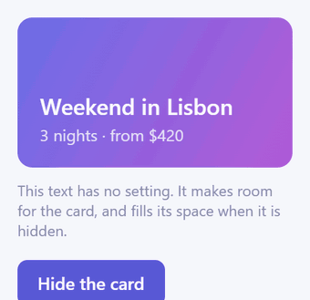<br><b>Blur</b><br>Fades in from an 8-pixel blur, or out into it.</td>
    <td width="25%" align="center" valign="top">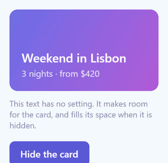<br><b>Custom</b><br>Your own look to start from or to end with.</td>
    <td width="25%" align="center" valign="top"><br><b>None</b><br>No effect: it appears or disappears at once, and only the others move.</td>
  </tr>
</table>

Write the name of an effect, or use it as a markup extension to set parameters:

```xml
<Border anim:Animate.Appear="Pop" anim:Animate.Disappear="Fade" />

<TextBlock x:Name="EmailError" Visibility="Collapsed"
           anim:Animate.Appear="{anim:Slide From=Top, Distance=Short}"
           anim:Animate.Disappear="{anim:Zoom To=0.5, Duration=0.4s, Easing=EaseIn}" />

<Border anim:Animate.Appear="{anim:Custom Opacity=0, OffsetY=20, Zoom=0.8, Rotate=-6}" />
```


| Parameter                                                 | For                                                                | Values, and the default                                                                                                        |
| --------------------------------------------------------- | ------------------------------------------------------------------ | ------------------------------------------------------------------------------------------------------------------------------ |
| `Duration`                                                | Every effect except Typewriter and Backspace, which have a `Speed` | 0.05 to 3 s. Default: 0.25 s, and twice that for Pop, FadeLetters and `Easing=Bouncy`                                          |
| `Easing`                                                  | Every effect except the letter effects                             | `Smooth` (default), `Gentle`, `Linear`, `Bouncy`, `EaseOut`, `EaseIn`, `EaseInOut`, `Overshoot`, or any `IEasingFunction`      |
| `Bounciness`                                              | Pop, `Easing=Bouncy` and `Easing=Overshoot`                        | 0.1 (a little) to 1 (a lot). Default: 0.5                                                                                      |
| `From`, `To`                                              | Slide and Wipe                                                     | `Top`, `Bottom`, `Left` or `Right`. Default: `Bottom`                                                                          |
| `From`, `To`                                              | Zoom                                                               | A size from 0 to 3. Default: 0.9                                                                                               |
| `Distance`                                                | Slide                                                              | `Short` (10 px), `Medium` (30 px, the default), `Long` (100 px), a number of pixels, or a percent of its own size (`100%`)     |
| `Fade`                                                    | Slide and Zoom                                                     | `False` to only slide, or only zoom. Default: `True`                                                                           |
| `Opacity`, `OffsetX`, `OffsetY`, `Zoom`, `Rotate`, `Blur` | Custom                                                             | The look it starts from, or ends with. Defaults: 0, 0, 0, 1, 0 degrees, 0 px                                                   |
| `StartAfter`                                              | Every effect                                                       | A wait before it starts, from 0 to 10 s. Default: 0                                                                            |
| `OthersMove`                                              | Every effect                                                       | When the elements around it move: `While` (default), `Before` it appears, or `After` it disappears (the default for Backspace) |
| `OthersDuration`                                          | Every effect                                                       | How long the elements around it take to move. Default: the effect's `Duration`                                                 |
| `OnPageOpen`                                              | Appear                                                             | What it does when it appears together with its page: `InPlace` (default), `PushOthers` or `Skip`                               |


Times are written `0.3s`, `300ms`, `300` (milliseconds) or `00:00:00.3`.

### When the others move

<p align="center">
  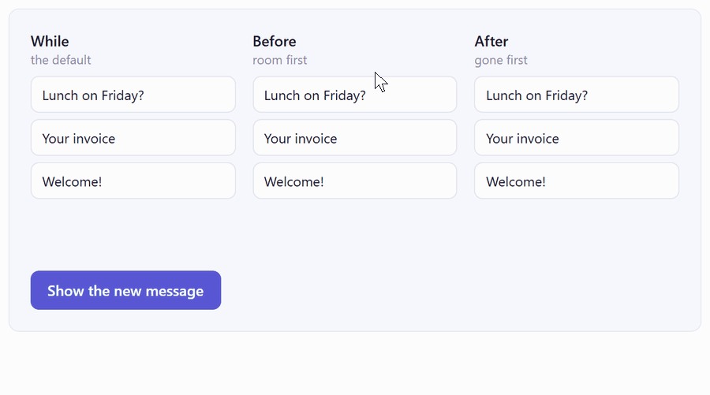
</p>

```xml
<!-- While (the default): they move while it fades -->
<Border anim:Animate.Appear="Fade" anim:Animate.Disappear="Fade" />
<!-- Before: they make room first, and it appears in the empty space -->
<Border anim:Animate.Appear="{anim:Fade OthersMove=Before}" />
<!-- After: it disappears first, then they move into its place -->
<Border anim:Animate.Disappear="{anim:Fade OthersMove=After}" />
```

A slightly longer `OthersDuration` makes the others follow the element softly. See chapters [1](http://opensilver-animations-library.azurewebsites.net/#/chapter/1), [9](http://opensilver-animations-library.azurewebsites.net/#/chapter/9) and [11](http://opensilver-animations-library.azurewebsites.net/#/chapter/11) of the gallery.

## Lists

The item properties go on an `ItemsControl`, for its items, or on a `Panel`, for its children. Each item behaves as if it had the setting itself, and an item's own setting wins. The collection stays the only source of truth: remove an item from it, and its effect plays. There is no animation to wait for before removing it, and nothing to change in the view model.

```xml
<ItemsControl ItemsSource="{Binding Tasks}"
              anim:Animate.ItemsAppear="{anim:Slide From=Top, Distance=Short}"
              anim:Animate.ItemsDisappear="Fade"
              anim:Animate.ItemsMoveAndResize="Smooth"
              anim:Animate.ItemsCascade="0.05s" />
```

<p align="center">
  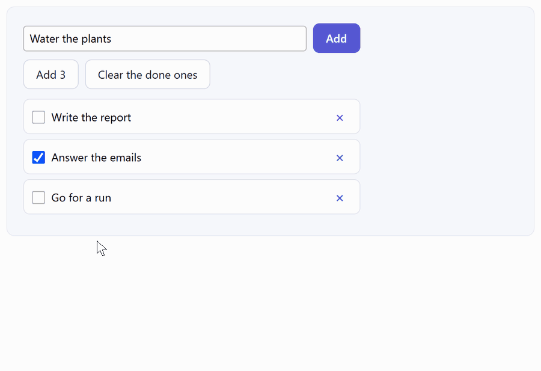
</p>

### Sorting, filtering and refreshing

The library keeps track of which data item each container shows, and where it was. When the list is sorted, filtered, refreshed with a `Reset` notification, or an item is moved, the items that stay glide from their old places to their new ones, instead of disappearing and appearing again. This works with any `ItemsSource`: there is no special list control, and nothing to subscribe to. A `Reset` never shows an empty list for a frame.

<p align="center">
  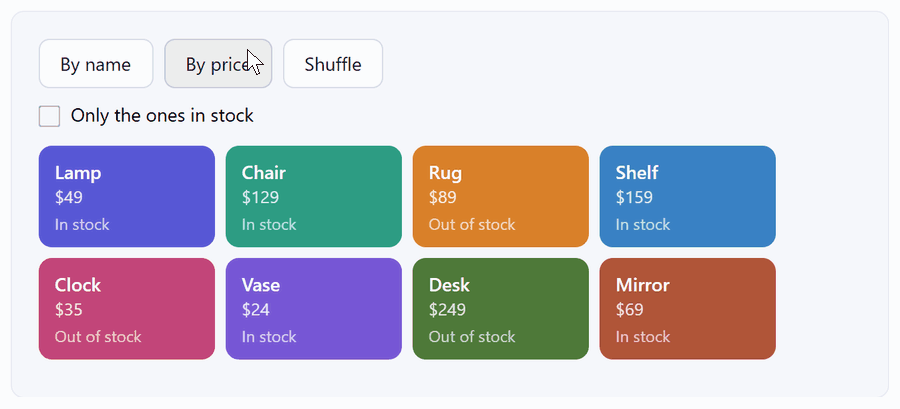
</p>

### Drag to reorder

When the app reorders the items during a drag, the items that change places glide, and the dragged item follows the pointer. In the gallery, the dragged step follows the pointer with a `TranslateTransform`, and each step it passes is moved around it in the `ObservableCollection`:

```xml
<ItemsControl ItemsSource="{Binding Steps}" anim:Animate.ItemsMoveAndResize="Smooth" />
```

<p align="center">
  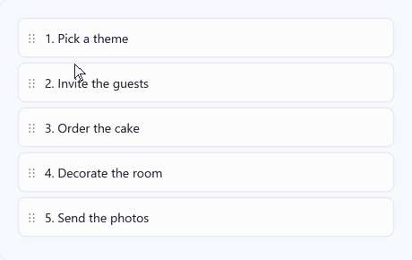
</p>

### Panels, cascades and virtualization

The same properties work on the children of a panel:

```xml
<StackPanel x:Name="Toasts"
            anim:Animate.ItemsAppear="{anim:Slide From=Right}"
            anim:Animate.ItemsDisappear="Fade"
            anim:Animate.ItemsMoveAndResize="Smooth" />
```

<p align="center">
  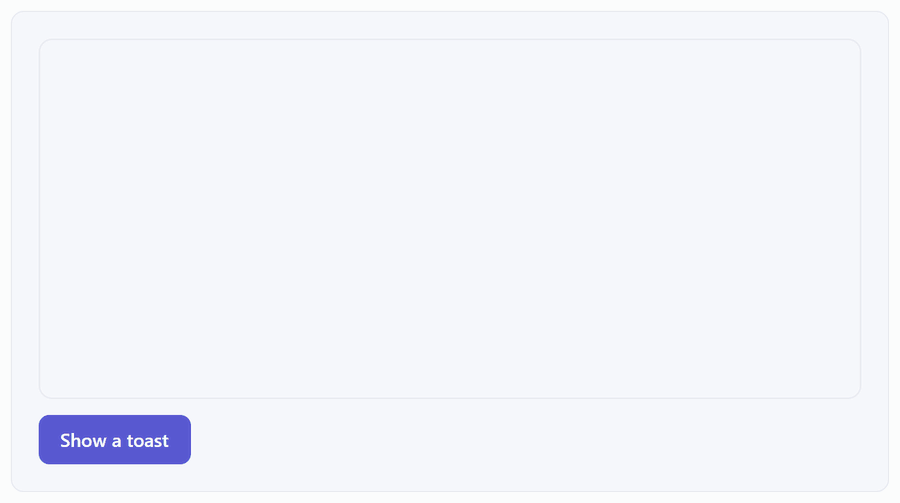
</p>

- **Cascades.** `ItemsCascade`, from 0 to 0.3 s, plays the effects of items that appear or disappear together one after the other. The whole cascade lasts at most 0.6 s: with many items, they come closer together.
- **Virtualization.** The containers that a virtualizing panel creates or removes while you scroll don't play any effect.

See [chapter 6](http://opensilver-animations-library.azurewebsites.net/#/chapter/6) of the gallery, which also has a streaming chat and a long list that scrolls.

## Hover and press

```xml
<Border anim:Animate.Hover="Nudge" />

<Button Content="Buy now" anim:Animate.Hover="Grow" anim:Animate.Press="Shrink" />
<Button Content="Save" anim:Animate.Hover="Lift" />
<Button Content="Bouncy" anim:Animate.Hover="{anim:Grow Zoom=1.1, Easing=Bouncy}" />

<Border Style="{StaticResource Card}" anim:Animate.Hover="{anim:Lift Distance=6}" anim:Animate.Press="Shrink" />
```

<p align="center">
  
  <br>
  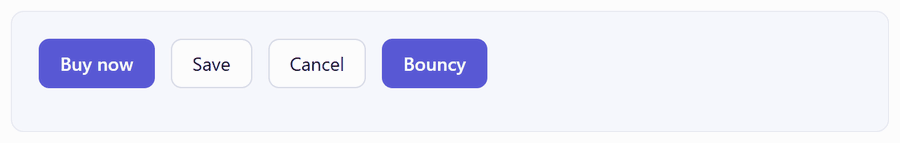
</p>


| Reaction | What it does                                                                                                                                                                | Parameters                                                                        |
| -------- | --------------------------------------------------------------------------------------------------------------------------------------------------------------------------- | --------------------------------------------------------------------------------- |
| `Grow`   | Grows a little around its center, until the mouse leaves or the element is released.                                                                                        | `Zoom`, 0.5 to 2. Default: 1.05                                                   |
| `Shrink` | Shrinks a little, like a button pushed in.                                                                                                                                  | `Zoom`. Default: 0.96                                                             |
| `Lift`   | Rises a little.                                                                                                                                                             | `Distance`. Default: 4 px                                                         |
| `Nudge`  | For Hover: when the mouse comes over it, it is pushed a little in the direction the mouse moves, turns a little, and springs back. The faster the mouse, the more it moves. | `Distance`, 0 to 20 px (3 by default), and `Tilt`, 0 to 15 degrees (2 by default) |


The icons above were recorded with a larger `Distance` and `Tilt` than the defaults, set with the gallery's sliders. Every reaction also takes `Duration` (the default duration, twice that with `Easing=Bouncy`, and 0.4 s for Nudge), `Easing` (ignored by Nudge, which always springs back) and `Bounciness`. Hover does nothing on a touch screen, which has no mouse, and Press works with a mouse, a finger or a pen. Disabled elements don't react. See [chapter 5](http://opensilver-animations-library.azurewebsites.net/#/chapter/5) of the gallery.

## Text

### When the text changes

`Animate.TextChange` plays when the text of a TextBlock changes, whether you set `Text` in code or a binding changes it.


| Effect      | What it does                                                                                                                                            |
| ----------- | ------------------------------------------------------------------------------------------------------------------------------------------------------- |
| `Roll`      | The characters that change roll in, like the digits of a counter. A number rolls up when it grows, and down when it gets smaller. For one line of text. |
| `CrossFade` | The old text fades out while the new one fades in.                                                                                                      |
| `Scramble`  | The characters show random letters and digits, then settle on the new text from left to right.                                                          |
| `Retype`    | The old text is erased letter by letter, then the new one is typed, with a cursor. The beginning they share stays.                                      |
| `CountUp`   | The number counts from its old value to the new one, in the format of the new text: `$1,250.50`, `4.2%` or `12 items`.                                  |


```xml
<Border CornerRadius="10" anim:Animate.MoveAndResize="Smooth">
    <TextBlock Text="{Binding UnreadCount}" anim:Animate.TextChange="Roll" />
</Border>

<TextBlock Text="{Binding Revenue}" anim:Animate.TextChange="CountUp" />

<TextBlock Text="{Binding Tagline}" anim:Animate.TextChange="Retype" />
```

<p align="center">
  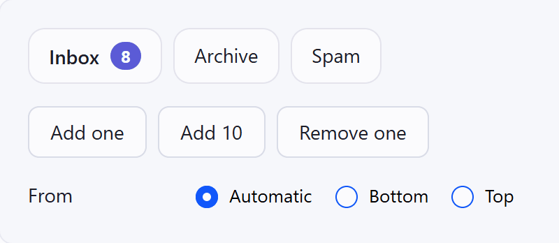
  <br>
  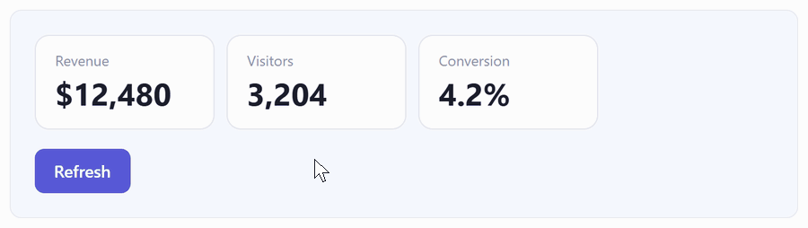
  <br>
  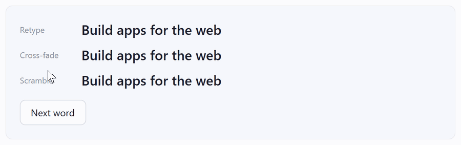
</p>

The TextBlock takes its new size at once. Put `MoveAndResize` on it, or on its container like the badge above, so that what is around it follows smoothly. `Roll` and `CrossFade` last 0.25 s, and `Scramble` and `CountUp` four times that. `Retype` has a `Speed` in letters per second (30 by default), a `Cursor`, and a `BlinkFirst` time.

### Text that appears and disappears

Three Appear and Disappear effects play on the letters of a TextBlock:

- `Typewriter` types the letters one after the other. A cursor blinks first where the first letter goes (`BlinkFirst`, 0.8 s by default), follows the letters, then blinks twice and fades away. `Speed` goes from 5 to 200 letters per second (30 by default), and a long text types faster, so that it never takes more than 10 seconds.
- `Backspace` erases the letters from the last one, with a cursor. The elements around it move after that, because its `OthersMove` is `After` by default.
- `FadeLetters` fades the letters in, or out, one after the other.

```xml
<TextBlock Text="Your order has shipped. It arrives on Friday."
           anim:Animate.Appear="Typewriter"
           anim:Animate.Disappear="Backspace" />
```

<p align="center">
  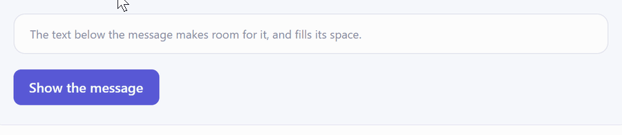
</p>

See [chapter 8](http://opensilver-animations-library.azurewebsites.net/#/chapter/8) of the gallery.

## Installation

You need an OpenSilver app. If you don't have one, [About OpenSilver](#about-opensilver-and-xamlio) shows how to create one in three commands.

1. **OpenSilver 3.4.** The library uses hooks that were added to OpenSilver in [pull request #1112](https://github.com/OpenSilver/OpenSilver/pull/1112). Use version `3.4.0-preview-2026-10-29-113513-38ba1092` or later for every OpenSilver package of your solution (`OpenSilver`, `OpenSilver.WebAssembly`, `OpenSilver.Simulator`, and so on). Until OpenSilver 3.4 is released, these versions are on the OpenSilver preview feed. Projects created from the OpenSilver templates already list it in their `nuget.config`. Otherwise, add it:

   ```xml
   <configuration>
     <packageSources>
       <add key="nuget.org" value="https://api.nuget.org/v3/index.json" />
       <add key="OpenSilver previews" value="https://www.myget.org/F/opensilver/api/v3/index.json" />
     </packageSources>
   </configuration>
   ```

2. **The package.** Preview builds of `OpenSilver.Animations` are published on the same feed. The package isn't on NuGet.org yet. Add it to the project that holds your XAML:

   ```xml
   <PackageReference Include="OpenSilver.Animations" Version="0.1.0-preview-*" />
   ```

   To use a build of your own, see [Building from source](#building-from-source).

3. **The namespace.** Add `xmlns:anim="http://opensilver.net/animations"` to your XAML files. There is nothing to initialize: the library starts the first time one of its properties is set.

The package targets .NET Standard 2.0.

## From code

Every property has a setter, which takes an object or a name:

```csharp
Animate.SetAppear(toast, new Slide { From = Side.Right, Distance = Distance.Short });
Animate.SetMoveAndResize(card, "Smooth");
```

Two functions animate, or don't animate, one change:

```csharp
// Glides, even for elements without settings, with the default duration or the one you give
Animate.Changes(() => ChangesBox.Width = 360);
Animate.Changes(() => ChangesBox.Width = 360, AnimationTime.FromSeconds(0.6));

// Instant, even for elements with settings
Animate.Skip(() => SkipPanel.Width = 400);
```

## Settings, reduced motion and debugging

The settings apply to the whole app. Declare them in `App.xaml`, or change them in code at any time:

```xml
<Application.Resources>
    <anim:AnimationSettings x:Key="AnimationSettings" Speed="1" DefaultDuration="0.25s" />
</Application.Resources>
```

```csharp
AnimationSettings.Current.IsEnabled = false;
```


| Setting                 | What it does                                                                                                                                                    | Default |
| ----------------------- | --------------------------------------------------------------------------------------------------------------------------------------------------------------- | ------- |
| `IsEnabled`             | Turns all animations on or off.                                                                                                                                 | `True`  |
| `RespectReducedMotion`  | When the user asked their device for less motion, moves and resizes don't animate, effects become a short fade, and Magic moves cross-fade in place.            | `True`  |
| `SimulateReducedMotion` | Behaves as if the user had asked for less motion, to test it.                                                                                                   | `False` |
| `Speed`                 | Plays every animation faster or slower: 2 is twice as fast, 0.5 half as fast.                                                                                   | 1       |
| `DefaultDuration`       | The duration of the animations that don't set one.                                                                                                              | 0.25 s  |
| `LogForDebugging`       | Writes to the browser console, in plain language, why each change animated or not. The same messages are raised by the static `AnimationSettings.Logged` event. | `False` |
| `ShowWhatAnimates`      | Outlines the elements that animate together while they animate, with the element where the change started in another color.                                     | `False` |


The messages say what changed, what it did, how many elements followed, and which setting gave the timing. These are the gallery's messages for the first example and for the Save button above:

```text
[OpenSilver.Animations] Details appeared; it fades in, and 28 elements animate together (Smooth, 0.25 s, from the Appear of Details).
[OpenSilver.Animations] Details disappeared; it fades out, and 28 elements animate together (Smooth, 0.25 s, from the Disappear of Details).
[OpenSilver.Animations] TextBlock "Saving..." changed size; 10 elements animate together (Smooth, 0.25 s, from the MoveAndResize of SaveButton).
```

In any app that uses the library, the same settings can be changed from the browser console, until the page is reloaded:

```js
osAnimations.slowMotion(4)                // 4 times slower; 1 for the normal speed
osAnimations.showWhatAnimates(true)
osAnimations.logForDebugging(true)
osAnimations.simulateReducedMotion(true)
osAnimations.isEnabled(false)

osAnimations.slowMotion()                 // Without a value, each one says what the setting is
```

## Where this library comes from

[XamlFlair](https://github.com/XamlFlair/XamlFlair), a library we have liked for a long time, showed that an animation in XAML can be a single attached property, with no Storyboard and no trigger. OpenSilver.Animations started from that idea and was written from scratch, with a different engine: its animations follow the layout, instead of being started by events. That is what makes possible what is usually hard in XAML:

- **Disappear animations.** An element that is collapsed or removed plays its exit, even though it has already left the layout.
- **The elements around a change.** They make room or close the gap with the same timing, instead of jumping to their new places.
- **Moves and resizes**, whatever computed the size: `Auto`, star columns, a `WrapPanel` that reflows, a longer label.
- **Lists that keep track of their items**, which glide to their new places after a sort, a filter or a `Reset`.
- **Magic move**, and text that rolls, counts or is typed.

Blend's `FluidMoveBehavior`, which OpenSilver also includes, and the theme transitions and connected animations of UWP and WinUI cover parts of this. OpenSilver.Animations puts it all behind one set of attached properties, and treats each change as a whole: everything the change moves or resizes animates together, with one timing.

It's also our case for XAML. A XAML layout is a description of the UI: what is inside what, aligned how, sized how. Because the layout system works from that description, a library can see each change the layout makes, and animate it without the app's help. And because an animation is a property value with named settings, it can be written in markup, set in a template, bound to data, and, once XAML.io supports it, picked and previewed in a designer.

## How it works, and why it is built on OpenSilver

OpenSilver reimplements the WPF API for the web. Your C# code runs on WebAssembly, the layout is computed in C# as in WPF, and every element is rendered as a real HTML element, not as pixels on a canvas. So an OpenSilver app has two trees: the visual tree that your code, the bindings and the layout system work with, and the DOM that the browser paints. In WPF, the elements of the visual tree are what gets drawn. To show an element somewhere other than where the layout put it, you change its own properties, like a transform or its opacity. And once an element is removed from the tree, there is nothing left to draw.

The library works in the space between the two trees:

1. **It watches the layout.** OpenSilver tells the library when an element is measured, arranged, shown, hidden or detached, and when a layout pass ends. These hooks (`InternalHooks`, merged in [pull request #1112](https://github.com/OpenSilver/OpenSilver/pull/1112)) are a few dozen lines in OpenSilver. From them, the library finds where each change started, which elements it moved or resized, and which settings apply.
2. **The layout jumps, the page glides.** OpenSilver writes the final positions and sizes to the DOM, as usual. In the same JavaScript batch, before the browser paints, the library starts Web Animations that play the difference: each element starts at its old place and size, and goes to the new one. The layout runs once per change, not once per frame, and no C# runs while the animations play.
3. **Your app never sees an in-between state.** No dependency property is animated, so `ActualWidth`, bindings, hit testing and your own code work with the final layout from the start.
4. **Elements can leave after they are gone.** When an element is collapsed or removed, the library copies its DOM, in the same place, and plays the Disappear effect on the copy, while the visual tree and the elements around it have already moved on. Magic move uses the same copies: a layer made of the old and the new element travels above the page, or behind the elements it travels between, and cross-fades from one to the other.
5. **One clock per change.** All the elements of a change share their start time, duration and curve, and start from one JavaScript call. Being inside a parent is a set of linear inequalities between edges, so a child that is inside its parent before and after the change stays inside it at every frame.

On a framework where the element tree is what gets drawn, doing the same would mean running the layout at every frame, writing the animations into your elements' own properties, or keeping removed elements alive in the tree, with the cost and the side effects of each. Because OpenSilver keeps the two trees apart, the library can be a separate layer that only works on what the browser shows, and that your app never sees.

**Why not CSS transitions on the generated elements?** They would also animate what should snap (window resizes, scrolling, drags, typing). They can't animate an element that is gone. And the containers of a list that is sorted or refreshed are new or moved DOM elements, with no old place to start from. Deciding what animates needs what only the C# side knows: the visual tree, the settings, the element that each change started from, and the data items behind the containers.

**What it costs:**

- Until one of its properties is set, the library does nothing, and OpenSilver's hooks cost one null check each.
- While the layout runs, the library notes the old and new box of each element that is arranged. That adds some work to each layout pass, which still runs once per change.
- Each change then costs one batch and one JavaScript call, and the browser plays the animations without calling back into C#.
- Elements that are out of view before and after a change are left out, and a change that would move more than about 300 elements snaps.
- The assembly is about 250 KB, including its script, and its only dependency is OpenSilver.

The details are in [docs/architecture.md](docs/architecture.md) (how the engine works) and [docs/design.md](docs/design.md) (the specification and its decisions).

## About OpenSilver and XAML.io

[OpenSilver](https://opensilver.net) is a free and open-source (MIT) reimplementation of the WPF API for the web, by Userware. If you know WPF, you already know most of it: the same namespaces, XAML, data binding, styles, templates, commands and MVVM patterns, in C#, VB.NET or F#. It runs on .NET for WebAssembly. It isn't an emulator, and it needs no plug-in.

- **Real HTML, not a canvas.** A `TextBox` is a `<textarea>`, an `Image` an ``, a `MediaElement` a `<video>`. Text selection, Ctrl+F, screen readers, browser translation, search engines and UI test tools work as they do on any web page. It's also what lets this library animate the page without touching your elements.
- **Static files.** A build is a folder of static files that any web server can host, such as Azure, AWS or GitHub Pages.
- **Beyond the browser.** The same code runs on Android, iOS, Windows and macOS through .NET MAUI Hybrid, on native .NET instead of WebAssembly, and on Linux through Photino.
- **The .NET and web ecosystems.** Any non-UI .NET package that works in Blazor WebAssembly, Blazor components (from MudBlazor, Radzen, DevExpress and others) inside XAML, and any JavaScript library through interop.
- **Tools.** Project templates and a drag-and-drop XAML designer, for Visual Studio and for VS Code, including on macOS and Linux.
- **Existing apps.** Silverlight applications move over with few changes (99% of the API is covered), and WPF applications with more work (more than 70%, and growing).

A new app, from the command line:

```bash
dotnet new install OpenSilver.Templates
dotnet new opensilverapp -n MyApp
cd MyApp && dotnet run --project MyApp.Browser
```

[Getting started](https://doc.opensilver.net/documentation/general/getting-started-tour.html) · [Documentation](https://doc.opensilver.net) · [200+ live samples](https://opensilverShowcase.com) · [OpenSilver on GitHub](https://github.com/OpenSilver/OpenSilver)

[XAML.io](https://xaml.io) is an online IDE for OpenSilver: a drag-and-drop XAML designer, and C# code that builds and runs in the browser, with nothing to install. A project started there can be downloaded as a Visual Studio solution. XAML.io will soon support OpenSilver.Animations, in its designer too: since each animation is a property with named settings, you will be able to pick one, set its parameters and preview it on the design surface.

## What doesn't animate, and why

Some changes are better instant, and the library leaves them out on purpose:

- **Window resizes**, except for the elements with `AlsoOnWindowResize`, and `{Responsive}` values that switch.
- **Scrolling**: content that moves because it is scrolled, and the items that a virtualizing panel creates or removes while scrolling.
- **Dragging**: while a pointer drags (more than 4 pixels with a button held), everything snaps, except list items that move because their order changed and `{Responsive}` switches. The dragged element always follows the pointer.
- **Typing**: changes that start inside the content of the focused text box. The text box's own size still animates.
- **Settling**: for 0.5 s after an element appears (a page, a dialog, new items), the changes that start inside it snap: scroll bars showing up, fonts and images loading.
- **Too many elements**: an element is left out when it is out of view before and after the change, and a change that moves more than about 300 elements snaps as a whole, rather than risking overlaps. The log says so.
- Elements under `MoveAndResize="None"`, changes inside `Animate.Skip`, the design surface of a XAML designer, `IsEnabled="False"`, and reduced motion.

[Chapter 14](http://opensilver-animations-library.azurewebsites.net/#/chapter/14) of the gallery shows each case.

## Status and limitations

This is a preview. The API may still change, and these parts are not verified yet:

- **Browsers:** it is tested in Chromium, the engine of Chrome and Edge. Safari and Firefox are not verified. The library relies on Web Animations with `composite: 'add'`, on CSS `linear()` curves (with a fallback that isn't tested yet), and on the SVG geometry properties of CSS.
- **Hosts:** OpenSilver's MAUI Hybrid and Photino hosts are not tested. In the Simulator, the JavaScript batches can arrive a frame apart.
- **XAML:** effects declared as resources or in Style setters aren't tested yet.

Known limitations:

- A text that wraps re-wraps at the current width while its box changes width, so words can hop between lines.
- `Path` geometry, clips other than the element's own box, and the offset of `RenderTransformOrigin` snap to their final values.
- App code that positions elements from `ActualWidth` or `SizeChanged` makes them jump, because these report the final values at once.
- What disappears is a copy of the element as it was: nothing inside it changes while it fades out. Videos and frames in it are blank, and it fades out in 0.15 s.
- Items are told apart with `Equals`. With the same string twice in a list, removing one of them plays no effect while the other stays.
- An element without a `Background` only reacts to Hover and Press while the pointer is over its content.

The full lists are in [docs/roadmap.md](docs/roadmap.md).

## Building from source

The library targets .NET Standard 2.0. The gallery needs the .NET 10 SDK.

```powershell
git clone https://github.com/OpenSilver/OpenSilver.Animations.git
cd OpenSilver.Animations
dotnet build OpenSilver.Animations.slnx -c Release
dotnet run --project samples\OpenSilver.Animations.Gallery.Browser\OpenSilver.Animations.Gallery.Browser.csproj -c Release --no-build
```

To try your own build in an app, `build\Build_Local_Package.bat` packs `OpenSilver.Animations` `0.1.0-preview-local` into `build\local-packages`. Add that folder as a package source of the app. The script needs Visual Studio's `msbuild` in the PATH, for example in a Developer PowerShell. [docs/development.md](docs/development.md) has the details, including how to build with a local OpenSilver.

## License

MIT. See [LICENSE.txt](LICENSE.txt).

Copyright (c) 2026 Userware.