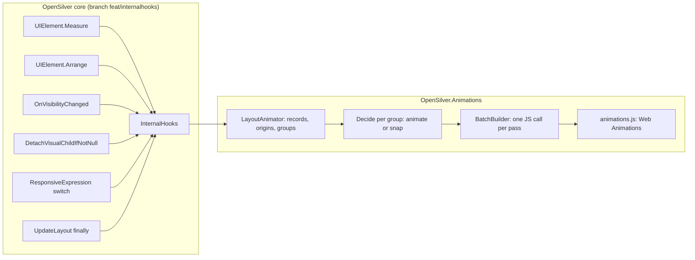

# Architecture: how the built part works

This file describes the code as it is: phase 2 (MoveAndResize, with Bouncy and Wave), phase 3 (Appear and Disappear with their presets and OthersMove, the automatic effects of elements that appear or disappear inside an area, StartAfter and OnPageOpen, the item properties, and Hover and Press), phase 5 (the text effects) and phase 7 (Magic move). The full specification, including the phases not built yet, is in [design.md](design.md).

## The two halves

The library needs to see every layout pass, so OpenSilver gets a small extensibility hook. Everything else lives in this repository.




## The OpenSilver core changes

They are on branch `feat/internalhooks` (first called `feat/layout-observer`) of the OpenSilver repository (`C:\VSProjects\UserwareSource\OpenSilver`): commit `547adac2`, then the `{Responsive}` hook, then the change that made them internal, then the rename of `LayoutObserver` to `InternalHooks`, asked for in the PR review. They don't change any behavior when no observer is registered: each call site is one null check.

`InternalHooks` is internal. OpenSilver's `Properties/AssemblyInfo.cs` has `[assembly: InternalsVisibleTo("OpenSilver.Animations")]`, as the OpenSilver owner asked while the API is not stable, so the library is the only assembly outside OpenSilver that sees it. Its overrides are `protected internal override`. OpenSilver isn't strong-named, so the attribute names the assembly without a public key, and the library's assembly name must stay `OpenSilver.Animations`.


| File (under `src/Runtime/`)                            | Change                                                                                                                                                                |
| ------------------------------------------------------ | --------------------------------------------------------------------------------------------------------------------------------------------------------------------- |
| `Runtime/OpenSilver/InternalHooks.cs`                  | New internal abstract class with virtual no-op methods. `Register(observer)` registers it for the lifetime of the app. Observers are kept in a copy-on-write array.   |
| `Runtime/Properties/AssemblyInfo.cs`                   | `InternalsVisibleTo("OpenSilver.Animations")`.                                                                                                                        |
| `Runtime/System.Windows/UIElement.Layout.cs`           | `NotifyMeasured` in `Measure`, `NotifyArranging` and `NotifyArranged` in `Arrange`.                                                                                   |
| `Runtime/System.Windows/UIElement.cs`                  | `NotifyVisibilityChanged` at the very end of `OnVisibilityChanged`.                                                                                                   |
| `Runtime/Core/Rendering/INTERNAL_VisualTreeManager.cs` | `NotifyDetaching` in `DetachVisualChildIfNotNull`, before `InternalDetachVisual`.                                                                                     |
| `Runtime/System.Windows/LayoutManager.cs`              | `NotifyLayoutPassCompleted` in the `finally` block of `UpdateLayout`, before `UIRenderer.ProcessRenderQueue(true)`.                                                   |
| `Runtime/System.Windows/ResponsiveExpression.cs`       | `NotifyResponsiveValueChanged` in `OnSourceElementSizeChanged`, after the new value is applied, when it differs from the previous one.                                |
| `Runtime/Runtime.OpenSilver.csproj`                    | Compiles `InternalHooks.cs`.                                                                                                                                          |
| `Scripts/cshtml5.js`                                   | `osjs.createVisual` skips children marked `data-os-foreign` when it resolves an insertion index.                                                                      |


What each hook guarantees:

- `OnMeasured(element, sameAvailableSize, previousDesiredSize, isFirstMeasure)` is called only when the element was really measured, right after its new `DesiredSize` is stored. The library uses each parameter: `isFirstMeasure` leaves new elements out, `sameAvailableSize` tells a change that starts inside the element from its parent giving it a new size, and `previousDesiredSize` tells whether the change goes up to the parent.
  - Collapsed elements return earlier and are never reported.
  - Neither are elements whose measure is still valid for the same size.
- `OnArranging(element, finalRect, previousFinalRect, isFirstArrange)` is called only when the arrange is invalid or the final rect changed, just before `ArrangeCore`. An element whose parent arranges it again in the same rect, without its arrange being invalid, is not reported.
- `OnArranged(element, previousVisualRect, visualRect, rendered)` is called after `RenderLayout`.
  - The rects are relative to the visual parent: `VisualOffset` plus `RenderSize`, before and after.
  - `rendered` is false for elements whose box is not written to the DOM. These are the elements with `BypassLayoutPolicies`: `Window`, `PopupRoot`, `WindowHost` and taskbar items.
  - It is not in a `finally` block, so an exception during an arrange leaves an `OnArranging` without its pair. The pass still ends with `OnLayoutPassCompleted`, which resets the library.
- `OnVisibilityChanged` is called after the DOM display change is queued, before the element's next layout pass. The library uses it to recognize elements shown again, and to copy the elements that are collapsed or hidden (see "Elements that appear and disappear"). Only the element whose own Visibility changed is reported, not its descendants.
- `OnDetaching` is called for the element removed from its parent, not for its descendants. The library forgets the element's running animation, and copies it if it has an effect to play. When it is called, the DOM of the element still exists, and its removal runs after any JavaScript the observer queues, so the copy is made from the element on screen.
- `OnResponsiveValueChanged(element, target, property)` is called when a `{Responsive}` value switches because the width it watches crossed a breakpoint, after the new value is applied. Its first value, and a recomputation that gives the same value, are not reported.
  - `element` is the element the value applies to, or the element that owns its target, for example the Grid of a ColumnDefinition.
  - It runs in the `SizeChanged` handler of the watched element (the Window, or the `ElementName`/`RelativeSource` element). So it is inside `UpdateLayout`, between two layout rounds, when no element is being arranged.
- `OnLayoutPassCompleted` is called once per `UpdateLayout`, before the pending JavaScript is flushed. So JavaScript queued there with `ExecuteJavaScriptVoidAsync` runs in the same flush as the layout's own writes: the browser never paints the new layout without its animations.
- The measure and arrange hooks run inside `Dispatcher.DisableProcessing()`. Observers only record data there. Anything that needs the dispatcher, such as raising the `Logged` event, is posted with `BeginInvoke`.

The library repository gets these changes through locally built OpenSilver packages; see [development.md](development.md).

## Files of the library


| File (under `src/OpenSilver.Animations/`) | Role                                                                                                                                                      |
| ----------------------------------------- | --------------------------------------------------------------------------------------------------------------------------------------------------------- |
| `Animate.cs`                              | The public entry point: the `MoveAndResize`, `Appear` and `Disappear` attached properties, the item properties (`ItemAppear`, `ItemDisappear`, `ItemMoveAndResize`, `ItemCascade`), `Hover` and `Press`, `TextChange`, `MagicMove` and `MagicMoveByName`, `Animate.Changes` and `Animate.Skip`. |
| `MagicMove.cs`                            | `MagicMove` (a `MarkupExtension` with `Id`, `Travel`, `Duration` and `Easing`), the `MagicMoveTravel` enum and `MagicMoveConverter`.                     |
| `TextTransition.cs`                       | `TextTransition` (abstract, a `MarkupExtension`), the presets `Roll`, `CrossFade`, `Scramble`, `Retype` and `CountUp`, `TextTransition.None` and `TextTransitionConverter`. |
| `Reaction.cs`                             | `Reaction` (abstract, a `MarkupExtension`), the presets `Grow`, `Lift`, `Shrink` and `Nudge`, `Reaction.None` and `ReactionConverter`.                   |
| `Movement.cs`                             | `Movement` (abstract, a `MarkupExtension`), `Smooth`, `Bouncy`, `Movement.None`, `MovementConverter`, the `AnimationScope` enum.                          |
| `Transition.cs`                           | `Transition` (abstract, a `MarkupExtension`), the presets `Fade`, `Slide`, `Zoom`, `Pop`, `Wipe`, `Blur` and `Custom`, the TextBlock presets `Typewriter`, `FadeLetters` and `Backspace`, `Transition.None`, `TransitionConverter`, the `Side`, `OthersMove` and `PageOpen` enums, the `Distance` struct and its converter, and the internal `EffectLook`. |
| `AnimationTime.cs`                        | A readable duration (`0.3s`, `300ms`, `300`), with its type converter.                                                                                    |
| `Easings.cs`                              | The curves `Smooth`, `Gentle`, `Linear`, `Bouncy`, `EaseOut`, `EaseIn`, `EaseInOut` and `Overshoot`, and `EasingConverter`. The internal `CubicBezierEasing`, `LinearEasing`, `SpringEasing` and `OvershootEasing` classes. |
| `AnimationSettings.cs`                    | App-wide settings, the `Logged` event and `AnimationLoggedEventArgs`.                                                                                     |
| `AssemblyInfo.cs`                         | `XmlnsDefinition` and `XmlnsPrefix` for `http://opensilver.net/animations` with the prefix `anim`.                                                        |
| `Engine/LayoutAnimator.cs`                | The `InternalHooks` observer. It collects the pass, groups, decides, culls, emits and logs. Most of the logic is here.                                            |
| `Engine/LayoutAnimator.MagicMove.cs`      | The Magic moves: the elements that disappear and wait for a partner (`Departure`), the contents swapped in containers with `MagicMoveByName` (`NameSwap`), pairing, the timing of each trip, the waits and their timer. |
| `Engine/PageOpenHolds.cs`                 | Holds the elements with `OnPageOpen=PushOthers` out of the layout while their page opens, and releases them after their `StartAfter`.                     |
| `Engine/Reactions.cs`                     | Sends the `Hover` and `Press` of elements to the script, again when they are loaded or enabled or disabled, and the settings they use.                   |
| `Engine/TextChanges.cs`                   | Watches the `Text` of TextBlocks that have a `TextChange`, through a private attached property bound to it. Also the columns of a Roll, and `TextNumber`, which finds the number in a text and its format. |
| `Engine/Timing.cs`                        | The duration and curve of a group, and their JSON form.                                                                                                   |
| `Engine/BatchBuilder.cs`                  | Builds the JavaScript object sent once per pass.                                                                                                          |
| `Engine/BrowserBridge.cs`                 | Loads `animations.js` and runs the batch, the holds, the ghosts, the Magic move captures and the text holds. It keeps `IsDragging` and `PrefersReducedMotion` up to date through JavaScript callbacks. |
| `Engine/ElementNames.cs`                  | Names elements in messages: their `x:Name`, or their type and a bit of their text. Items are named by their text and their list: `Item "Buy milk" of Tasks`. |
| `Scripts/animations.js`                   | Embedded resource (`OpenSilver.Animations.animations.js`). It plays the batch with Web Animations, plays the text effects in an overlay, plays the hover and press reactions, and tracks dragging and reduced motion. |


## Public API (built)

```xml
<UserControl xmlns:anim="http://opensilver.net/animations">
    <Button Content="Save" anim:Animate.MoveAndResize="Smooth" />
    <Border anim:Animate.MoveAndResize="{anim:Smooth Duration=0.4s, Easing=Gentle}" />
    <Border anim:Animate.MoveAndResize="{anim:Bouncy Bounciness=0.7}" />
    <StackPanel anim:Animate.MoveAndResize="{anim:Smooth ApplyTo=EverythingInside, Wave=0.8}" />
    <WrapPanel anim:Animate.MoveAndResize="{anim:Smooth ApplyTo=EverythingInside, AlsoOnWindowResize=True}" />
    <Grid anim:Animate.MoveAndResize="None" />  <!-- carved out of an area -->
    <StackPanel anim:Animate.Appear="Fade" anim:Animate.Disappear="Fade" />
    <TextBlock anim:Animate.Appear="{anim:Slide From=Top, Distance=Short}" />
    <Border anim:Animate.Appear="{anim:Fade OthersMove=Before}" anim:Animate.Disappear="{anim:Wipe To=Top, Duration=0.4s}" />
    <Border anim:Animate.Disappear="None" />  <!-- no automatic effect inside an area -->
    <TextBlock anim:Animate.Appear="{anim:Fade StartAfter=0.2s}" />
    <Border anim:Animate.Appear="{anim:Slide From=Top, StartAfter=0.6s, OnPageOpen=PushOthers}" />
    <ItemsControl anim:Animate.ItemAppear="{anim:Slide From=Top, Distance=Short}" anim:Animate.ItemDisappear="Fade"
                  anim:Animate.ItemMoveAndResize="Smooth" anim:Animate.ItemCascade="0.05s" />
    <StackPanel anim:Animate.ItemAppear="{anim:Slide From=Right}" />  <!-- the children of a Panel are its items -->
    <Button anim:Animate.Hover="Grow" anim:Animate.Press="Shrink" />
    <Border anim:Animate.Hover="{anim:Lift Distance=6}" />
    <Border anim:Animate.Hover="{anim:Nudge Distance=6, Tilt=5}" />
    <TextBlock Text="{Binding UnreadCount}" anim:Animate.TextChange="Roll" />
    <TextBlock Text="{Binding Revenue}" anim:Animate.TextChange="{anim:CountUp Duration=1.5s}" />
    <TextBlock Text="Welcome" anim:Animate.Appear="{anim:Typewriter Speed=40, BlinkFirst=1.5s}" anim:Animate.Disappear="Backspace" />
    <Border anim:Animate.MagicMove="SelectionPill" />
    <Image anim:Animate.MagicMove="{Binding Id, StringFormat='photo-{0}'}" />
    <Border anim:Animate.MagicMove="{anim:MagicMove Id=Card, Travel=Above, Duration=0.4s, Easing=Bouncy}" />
    <ContentControl anim:Animate.MagicMoveByName="True" />
</UserControl>
```

```csharp
Animate.SetMoveAndResize(card, new Smooth { Duration = AnimationTime.FromSeconds(0.4) });
Animate.SetMoveAndResize(card, "Smooth");                  // implicit conversion from string
Animate.SetAppear(note, new Slide { From = Side.Left, Distance = 60 });
Animate.SetDisappear(note, "Fade");
Animate.SetHover(icon, new Nudge { Distance = 6, Tilt = 5 });
Animate.SetTextChange(badge, new Roll { From = Side.Top });
Animate.SetMagicMove(chip, "topping-" + name);              // implicit conversion from string
Animate.Changes(() => Details.Visibility = Visibility.Collapsed);          // animates everything
Animate.Changes(() => Box.Width = 400, AnimationTime.FromSeconds(0.6));
Animate.Skip(() => RestoreLayout());                       // nothing animates
AnimationSettings.Current.Speed = 0.5;
AnimationSettings.Logged += (s, e) => Debug.WriteLine(e.Message);
```

- `Animate.MoveAndResize` (attached, type `Movement`, not inherited).
  - Setting it starts the engine: it registers the observer and loads the script, once. The engine never starts in a designer (`DesignerProperties.IsInDesignTool`).
  - A value with `ApplyTo=EverythingInside`, or `None`, turns on the area lookup (`LayoutAnimator.AnyAreas`). Until then, ancestors are never searched.
- `Movement` **parameters.**
  - `Duration` (`AnimationTime?`): clamped to 0.05 to 3 s when used. The default is `AnimationSettings.DefaultDuration`, doubled for `Bouncy`.
  - `Easing` (`IEasingFunction`, names through `EasingConverter`): used by `Smooth`.
  - `Bounciness` (0.1 to 1, default 0.5): used by `Bouncy`, and by `Smooth` with `Easing=Bouncy` or `Easing=Overshoot`.
  - `Wave` (0 to 1, default 0).
  - `ApplyTo` (`ThisElement` or `EverythingInside`).
  - `AlsoOnWindowResize` (default false).
- **Value forms.** A `Movement` is a `MarkupExtension` whose `ProvideValue` returns itself. So it works as a string (`"Smooth"`, through `MovementConverter`), as a markup extension with parameters, as an element, and as a resource. `Movement.Parse` accepts `Smooth`, `Bouncy`, `None` and the empty string.
- `Animate.Appear` and `Animate.Disappear` (attached, type `Transition`, not inherited).
  - Setting one starts the engine and turns on the effect paths (`LayoutAnimator.AnyEffects`). The value is checked once (`CheckEffect`): a parameter that doesn't apply, like `OthersMove=After` on an Appear, `OnPageOpen` on a Disappear, `Pop` as a Disappear, `To` on an Appear or `Bounciness` without a bounce or an overshoot, writes a warning to the console and the `Logged` event, and is ignored.
  - `Transition` works like `Movement`: a string through `TransitionConverter` (`Fade`, `Slide`, `Zoom`, `Pop`, `Wipe`, `Blur`, `Custom`, `None`; an unknown name throws), a markup extension, an element or a resource.
  - **Parameters** on every preset: `Duration`, `OthersDuration`, `Easing`, `Bounciness`, `OthersMove`, `StartAfter` (clamped to 10 s when set) and `OnPageOpen` (`PageOpen.InPlace`, `PushOthers` or `Skip`). `Slide` has `From`, `To`, `Distance` and `Fade`; `Zoom` has `From` and `To` (sizes, 0 to 3, default 0.9) and `Fade`; `Wipe` has `From` and `To`; `Custom` has `Opacity`, `OffsetX`, `OffsetY`, `Zoom`, `Rotate` and `Blur`.
  - `Distance` is a struct: `Distance.Short` (10 px), `Medium` (30 px, the default) and `Long` (100 px), a number of pixels, from XAML (`Distance=Short`, `Distance=60`) or from a `double`, or a percent of the element's size (`Distance=50%`, `Distance.FromPercent(50)`, 0 to 1000). A percent sets `Percent` and leaves `Pixels` at 0. Slide turns it into `EffectLook.RelX` or `RelY`, fractions of the element's width or height, which the script multiplies by the size of the element or its ghost. Lift and Nudge send their default pixels instead, with a warning from `Reactions.Check`.
  - `Fade=False` on Slide and Zoom sets the look's opacity to 1, so the effect only moves or zooms.
  - **The TextBlock presets.** `Typewriter` and `Backspace` have `Speed` (5 to 200 letters per second, default 30), `Cursor` (default true) and `BlinkFirst` (0 to 10 s; 0.8 s on Typewriter and 0 on Backspace by default, `HasBlinkFirst` once set); `FadeLetters` has `Duration` (twice `DefaultDuration` by default). `IsText` and `HasSpeed` tell them apart, `ShowsCursor` and `BlinkFirstTime` read the cursor, and `Backspace` defaults to `OthersMove=After` (`DefaultOthersMove`). `CheckEffect` warns about a text preset on an element that isn't a TextBlock or on the items of an ItemsControl, `Typewriter` as a Disappear, `Backspace` as an Appear, `Duration` with `Speed`, `Easing`, and `BlinkFirst` with `Cursor=False`. See "Text" below.
  - **Duration.** The default is `AnimationSettings.DefaultDuration`, doubled for `Pop` and for `Easing=Bouncy`. Bouncy effects play a spring sampled with `Bounciness`, and `Overshoot` a `BackEase` sampled with it.
  - **The others' timing** (`Timing.ForOthers`). The elements around an effect take its timing, except that they never bounce or overshoot: Smooth next to a bouncy effect, EaseOut next to `Overshoot`. `OthersDuration`, when set, replaces the duration (clamped and divided by `Speed` like the others).
  - **The fade curve.** `Timing.FromEffect` sets `FadeEasing` (`fe` in the JSON) to Smooth for a bouncy effect and to EaseOut for `Overshoot`. The script then plays the opacity in a second animation on that curve (see "The script" below).
- **The item properties** (attached, not inherited), on a Panel for its children, or on an ItemsControl for its items. The engine reads them from the items panel, or else from the ItemsControl it hosts the items of, so setting them on the items panel in a template works too.
  - `ItemAppear` and `ItemDisappear` (`Transition`) work as if each item had this `Appear` or `Disappear`. `ItemMoveAndResize` (`Movement`) works as if each item had this `MoveAndResize`, without `ApplyTo`. An item's own setting wins.
  - `ItemCascade` (`AnimationTime`, default zero) is the time between items that play their effect in the same change, at most 0.3 s, and 0.6 s for the whole cascade.
  - Setting one turns on `LayoutAnimator.AnyItems`; a `Transition` also turns on `AnyEffects`, and `None` on `AnyAreas`, because each item is then carved out. `CheckItemSetting` warns about a value that doesn't apply.
- `Animate.Hover` and `Animate.Press` (attached, type `Reaction`, not inherited) don't start the layout engine: they only load the script (`Reactions`).
  - `Reaction` works like `Transition`: a string through `ReactionConverter` (`Grow`, `Lift`, `Shrink`, `Nudge`, `None`), a markup extension, an element or a resource.
  - **Parameters** on every preset: `Duration`, `Easing` and `Bounciness`. `Grow` and `Shrink` have `Zoom` (0.5 to 2); `Lift` has `Distance`; `Nudge` has `Distance` (at most 20 px when used) and `Tilt` (0 to 15 degrees).
  - `Reactions.Check` warns about `Nudge` on Press, `Easing` on Nudge, `Bounciness` without a bounce or an overshoot, and a `Distance` in percent, with `LayoutAnimator.Warn`.
  - `Timing.FromReaction` samples the reaction spring for `Easing=Bouncy` (see "Curves" below). It leaves the duration at 0 when none is set, and doesn't divide it by `Speed`: the script applies the default duration and the speed when a reaction plays, so that changing them in `AnimationSettings` applies at once.
- `Animate.TextChange` (attached, type `TextTransition`, not inherited) starts the engine and watches the TextBlock's `Text` (`TextChanges.Watch`). `CheckTextChange` warns about a value on an element that isn't a TextBlock, `Duration` on `Retype`, `BlinkFirst` on `Retype` with `Cursor=False`, and `From=Left` or `Right` on `Roll`.
  - `TextTransition` works like `Transition`: a string through `TextTransitionConverter` (`Roll`, `CrossFade`, `Scramble`, `Retype`, `CountUp`, `None`; an unknown name throws), a markup extension, an element or a resource.
  - **Parameters:** `Duration` on every preset (default `DefaultDuration`, four times that for `Scramble` and `CountUp`), `From` on `Roll` (automatic until it is set: `HasFrom`), and `Speed`, `Cursor` (default true) and `BlinkFirst` (default 0) on `Retype`.
- `Animate.MagicMove` (attached, type `MagicMove`, not inherited) starts the engine and turns on the Magic move paths (`LayoutAnimator.AnyMagic`). Until then, the elements that appear or disappear are never checked for an id. A value without an `Id` writes a warning (`OnMagicMoveSet`), and is ignored.
  - `MagicMove` is a `MarkupExtension` like `Movement`, with a `TypeConverter` (`MagicMoveConverter`) and an implicit conversion from `string`, so a string, a binding to a string, and `{anim:MagicMove Id=...}` all work. `HasParameters` is true when `Travel`, `Duration` or `Easing` is set.
  - **Parameters:** `Travel` (`MagicMoveTravel.Automatic`, `Above` or `Behind`), `Duration` (`AnimationTime?`, clamped to 0.05 to 3 s) and `Easing` (Smooth by default). `Timing.FromMagicMove` computes the default duration from the distance (see "Magic move" below).
- `Animate.MagicMoveByName` (attached, `bool`) starts the engine and turns on `AnyMagic` too. On an element that isn't a `ContentControl`, it writes a warning (`CheckMagicMoveByName`). A `Frame` is a `ContentControl`.
- `Animate.Changes(action, duration?)` first runs `UpdateLayout()`, so that pending layout is attributed to earlier changes. Then it runs the action and `UpdateLayout()` again, inside a scope where every change animates, even without settings, with the Smooth curve.
- `Animate.Skip(action)` does the same with a scope where nothing animates.
- **Nested scopes:** the inner one applies until it exits, then the outer one applies again.
- `AnimationSettings`:
  - `Current` is read lazily. The first time, it comes from the application resource with the key `"AnimationSettings"`, if there is one (the gallery declares `<anim:AnimationSettings x:Key="AnimationSettings" />` in App.xaml).
  - Properties: `IsEnabled`, `RespectReducedMotion`, `SimulateReducedMotion`, `Speed` (0.05 to 20), `DefaultDuration` (0.25 s), `LogForDebugging` and `ShowWhatAnimates`.
  - It implements `INotifyPropertyChanged`, so the gallery's toolbar binds to it.
  - The static `Logged` event carries the same messages as `LogForDebugging`, raised with `BeginInvoke` after the pass.
- **Curves.**
  - `Easings.Smooth` is `cubic-bezier(0.2, 0, 0, 1)`, the default. It starts at zero speed: 16% of the way at 10% of the time, against 27% for `EaseOut`.
  - `Easings.Gentle` is `cubic-bezier(0.45, 0, 0.55, 1)`.
  - `Easings.Linear`.
  - The classic curves, for apps that come from WPF or Silverlight, are the usual CSS approximations of `CubicEase`: `EaseOut` is `cubic-bezier(0.33, 1, 0.68, 1)`, `EaseIn` is `cubic-bezier(0.32, 0, 0.67, 0)` and `EaseInOut` is `cubic-bezier(0.65, 0, 0.35, 1)`.
  - `Easings.Overshoot` is `OvershootEasing`, the `BackEase` ease-out: `1 - g(1 - t)` with `g(u) = u³ - a·u·sin(πu)`, the amplitude `a` being the `Bounciness` of the setting that uses it. It goes about 13% past the end at 0.5, and 38% at 1. `Timing.SetCurve` samples it into 33 points.
  - `Easings.Bouncy` is a damped spring. Its damping ratio is `1 - 0.8 × Bounciness`, and it is within 0.1% of the target at the end of the duration.
  - On Hover and Press, `Bouncy` is `SpringEasing.ForReaction`: a damping ratio of `0.45 - 0.25 × Bounciness`, within 2% of the target at the end. At the default 0.5 and 0.5 s, it peaks at 1.34 of the change at 140 ms, then 0.885 and 1.039. It settles to 2% rather than 0.1% so that it doesn't ring faster as it bounces more: about 6 times a second at Bounciness 1, instead of 10.
  - Any other `IEasingFunction` is sampled into 33 points.


## One layout pass, step by step

`LayoutAnimator` keeps per-pass state in reused arrays and dictionaries, and clears them at the end of every pass (`Reset`). The terms below are used everywhere in the code and in the messages.

### 1. Measure: finding where a change started

`OnMeasured` ignores first measures. For the others:

- `_measured` records every element measured in the pass. A second measure of the same element in the same pass is "measured again".
- **A scrolled element is ignored.** This is an `IScrollInfo` whose offsets changed since the last check (`IsScrolled`, which stores offsets in a `ConditionalWeakTable` and caches the answer per pass).
- **A different available size means the element is a consequence**, not where the change started, so it is ignored.
- **Carriers.** When the desired size changed, the layout parent goes into `_carriers`. A carrier is only passing its child's change upward.
- **Measure origins.** An element measured with the same available size, for the first time in the pass, that is not a carrier, goes into `_measureOrigins`.
  - Example: a Button whose label got longer. The TextBlock is the origin, and the Button and its panel are carriers.
  - Example: a Border whose `Width` was set. The Border is the origin; its parent is a carrier.
  - Only the first measure counts, because a later measure in the same pass is the layout settling: a ScrollViewer measures its content again after showing a scroll bar.


### 2. Arrange: records, stack and groups

`OnArranging` pushes a **record** on a stack. The record holds the element, its parent record (the element below it on the stack), its old and new rects, flags and a group id.

- **Appearing elements** get `Appears`. They are the elements arranged for the first time, and the elements shown again: their Visibility went back to Visible since the last pass (`_shown`, filled by `OnVisibilityChanged`).
  - Their descendants arranged for the first time in the same pass get no record at all: everything inside an element that appears, appears with it.
  - The time it appeared is stored in `_appeared`, for the settling rule below.
  - An element shown again still has the box it had before it was collapsed, so its own rects say nothing. When it is a measure origin, its parent becomes the origin instead: showing the details of an option is a change of the form that holds them.
- **Scrolled elements** get `Scrolled`.
- **Origins** get `Origin`: a measure origin, or an element arranged again in the same rect without being measured (an arrange-only change, such as `Grid.Column` or an alignment), or an element where a `{Responsive}` value switched. A window-resize pass has no origins at all, except for these switches (see below).

`OnArranged` pops the record.

- It keeps the first old rect of the pass and the last new rect.
- It sets `NotRendered` when the rect changed but nothing was written (`rendered` false). Such elements are never animated.
- An origin creates a **Change group**.
- A Change group then joins the parent record's group (union-find: `NewGroup`, `Find`, `Union`). So a change climbs through every ancestor that was arranged again. A WindowResize group never climbs.
- **A change never crosses** `None`**.** When the element or its parent has `MoveAndResize=None`, the group doesn't climb from one to the other. A change inside a carved-out chart stays inside it and snaps; the elements it pushes outside the chart are arranged by the parent's own group, or by none, and snap too. Without this rule, when the same Refresh also changed the size of a number card, the chart's change climbed through the dashboard and joined the numbers' change, and the bars glided with them. That's why "Leave the chart out" in chapter 7 seemed to work only on the first Refresh.

When the stack is empty, the arrange session is over. `EndArrangeSession` walks the session's records in arrange order (pre-order):

- A record without a group takes its parent's group, unless the parent is scrolled. So everything arranged by a member of a group belongs to it.
- A record still without a group whose rect changed, and whose effective movement has `AlsoOnWindowResize`, starts a **WindowResize group**.
- When a Change group and a WindowResize group merge, the Change group wins: the change keeps its own timing.


### 3. End of the pass: deciding per group

`OnLayoutPassCompleted` prunes `_appeared`, gives the page-open holds loaded since the last pass their release time (see "Page open with PushOthers"), and does nothing more if there are no records and no scope. Otherwise `CompletePass` runs, inside a `try`/`catch` that writes any exception to the console and never breaks the app.

1. **Global snap reason**, checked first. If any of these holds, every group snaps:
  - `Animate.Skip`;
  - `IsEnabled` is false;
  - a designer;
  - reduced motion, real (the `prefers-reduced-motion` media query, if `RespectReducedMotion`) or simulated (`SimulateReducedMotion`);
  - `BrowserBridge.IsDragging`, except for the groups of `{Responsive}` switches (see below), and the groups with items shown in new places (see "Lists and their items").
2. **Buckets.** For each record that changed or is an origin, except appearing ones:
  - without a group, a change snaps;
  - otherwise it goes into its group's bucket, as an origin and/or a member (a member is a record whose rect changed).
  - An appearing record goes into the `Appearing` list of its parent's bucket (`AddAppearing`) when it has an `Appear` effect, or when the parent is in a Change group inside an `EverythingInside` area and the element itself doesn't have `None`.
  - Each disappearance captured since the last pass joins the bucket of its parent's record, in `Ghosts`. See "Elements that appear and disappear".
3. `ProcessGroup` for each bucket that has members or appearing elements:
  - **A WindowResize group** (no origins) animates with the timing of the element that opted in.
  - **A Change group** goes through `Decide`, described below.
  - **Culling and budget** (`CullAndCount`). A member is left out when both its old and new absolute rects are outside the window, with a margin of 100 px; an appearing element, when its new rect is. If more than 300 remain, the whole group snaps. If none remain, nothing happens.
  - `Emit` adds the moves and the reveals to the batch, or `Snap` cancels the running animations of the members.
4. **The batch** is sent with one `ExecuteJavaScriptVoidAsync` call: moves, reveals, cancels, outlines and releases.
5. **Messages** are published (see "Messages").


### Decide: does a Change group animate, and with which timing?

It goes through the origins. When not inside `Animate.Changes`, an origin is excluded for any of these reasons, in this order:

- **Typing.** The origin is strictly inside the focused `TextBox`, `PasswordBox` or `RichTextBox`. The text box itself growing is not excluded: it is a member, not the origin.
- **Scroll chrome** (silent). The origin is a `ScrollBar` or inside one, up to 8 levels up, or its `TemplatedParent` is a `ScrollViewer`. These parts only change as a consequence of the content.
- **Settling** (silent). The origin, or one of its ancestors, appeared less than 500 ms ago. Right after a page, a dialog or new items appear, scroll bars show up and fonts and images load. An origin marked `Released` is never settling (see "Page open with PushOthers").
- **Carved out.** The origin's area is `None`.

If every origin is excluded, the group snaps with the last reason. Otherwise the group animates when one of these gives a timing, checked in this order:

1. `Animate.Changes`: its duration, or the default, with the Smooth curve.
2. **The nearest setting** (`FindNearestMovement`), going up from each eligible origin. The first of these wins:
  - the origin's own setting. It counts even when the origin's own box doesn't change. That's needed for a ChildWindow, whose `Width` change resizes its template while the ChildWindow itself keeps the page size;
  - an ancestor with `EverythingInside`;
  - an ancestor with another setting that is a member (`IsMember`). An ancestor that stays in place doesn't count, because `ThisElement` is about its own box. Example: the Save button resizes because its label grew, so the button's setting gives the timing.
   The walk stops at `None`, and at a popup's root. Among the origins, the setting found the fewest levels up wins; on a tie, an origin of the page beats a part of a control template. Each walk stops at the best level found so far.
3. **The member with an effective setting that is the fewest tree hops away** from the origin (`FindNearestMemberMovement`, through the records' parent chains). Example: a tab underline with `Bouncy` moves because its Grid rearranged its columns.

Otherwise it snaps: "no element involved has MoveAndResize".

So a `ThisElement` setting on an element inside an area gives the timing to the changes that start inside that element and move or resize it: it is nearer than the area. Before this rule, the area won.

The origin named in messages, and used for the wave, is the origin whose walk found the setting, if any. Otherwise it is the first eligible origin, preferring an element of the page over a part of a control template (`IsTemplatePart`: `TemplatedParent != null`).

### Areas

`GetArea(element)` walks up `VisualTreeHelper.GetParent` until it finds one of:

- `EverythingInside`: the element is inside that area, with its movement;
- `None`: the element is carved out;
- the root: no area.

`ThisElement` settings are passed over: the area says whether an element is inside one, while the timing comes from the nearest setting (see "Decide"). Results are memoized per pass for every element on the walked path (`_areaCache`), so each element is visited at most once per pass. Popups are boundaries, because `GetParent` returns null at a popup's root.

`GetEffectiveMovement(element)` is the element's own setting (null for `None`), or else its area's movement. Members use it, so a change that starts outside an area but moves something inside it animates.

### Elements that appear and disappear

An element that appears or disappears is a change of its parent: the elements around it make room or fill its place, and it plays its effect with them, so that it never overlaps them while they move. Its effect is its own `Appear` or `Disappear`, or, inside an `EverythingInside` area, an automatic wipe or fade.

- **The hold.** The core changes the DOM display as soon as Visibility goes back to Visible, but arranges the element only in the next layout pass, at Render priority. In between, the browser can paint it with the box it had before it was collapsed. So `OnVisibilityChanged` calls `BrowserBridge.Hold` for an element with an `Appear`, or inside an area without `Appear=None` (`IsInsideArea`, which walks up without memoizing, because it runs outside the passes). `animations.js` keeps it at opacity 0, for at most a second. Hidden to Visible keeps the box, so it needs no hold: the effect plays at once.
- **The release.** Every held element gets a release entry in the batch of the next pass (`_held`). One that plays an effect or is revealed is released by it. One whose group snaps is simply shown, at its final place. `ReleaseHeld` also runs when the pass has no records, and after an exception.
- **The timing.** When not `_switchOnly`, a bucket with an effect (the first one found: `Effect`, `EffectElement`, `EffectAppears`) takes its timing from it in `Decide`, before any setting, with `Timing.ForOthers`: a bouncy effect moves the others Smooth, an overshooting one EaseOut, and `OthersDuration` replaces the duration. The message names it: "from the Appear of Details".
- **Explicit appear effects.** `Emit` plays them with their own timing (`PlayAppearEffect`, batch key `e`). With `OthersMove=Before`, and when others move, the effect waits for the others' duration. While others move, the element is raised above its siblings.
- **Keeping it in place** (`KeepInPlace`, batch key `k`). An element that appears moves with its ancestors that animate in the group (`_animatedNow`, the bucket's animated records). When an ancestor's move on an axis is the share of its growth that its alignment gives (`GetAlignmentMove`: half for Center and Stretch, all of it for Right and Bottom, within a pixel), it re-centers because of the element, which would drift with it while it grows or slides in. The element gets the opposite move, with the group's timing and the wave delay of the nearest such ancestor, so that it stays where it ends on screen. A move along the stacking axis of a `StackPanel` or `VirtualizingStackPanel`, or in a `Canvas`, is a push, not a re-centering, so the element follows it. Not under reduced motion.
- **Automatic reveals.** `Emit` reveals the other appearing elements of an animated group, with the group's timing and the size curve, so that the revealed part keeps up with the elements it pushes. `GetRevealEdge` picks how:
  - the side it pushes its siblings away from: when the siblings below move down, it wipes from its top;
  - when it pushes no sibling but its container grows, the top edge (or the left edge, when the container grew more in width);
  - otherwise, a fade.
- **The wave.** A revealed element starts with the element it follows (the sibling or container that `GetRevealEdge` returns), so it doesn't open before the space does.
- **With the container.** An explicit Appear inside an element that appears, or on an element visible when the page opens, gets the `WithContainer` flag. It plays in its place, after its `StartAfter`, and doesn't make room: "2 elements appeared with their container, and play their effects, like Border". Under a scrolled parent, nothing plays. With `OnPageOpen=Skip`, it is marked `Played` without an effect: "SkipBanner appeared with its container, without its effect, as OnPageOpen=Skip asks."
- **StartAfter.** `GetWaitMs` (`StartAfter` divided by `Speed`) is added to the delay of the element's own effect, everywhere it plays: `PlayAppearEffect`, `PlayGhost`, `PlayAtOnce` (Hidden), and the quick fades of reduced motion. The others don't wait for it, except with `OthersMove=After`, where they wait for the wait and the ghost's duration. `KeepGhosted` extends `_ghostedUntil` by the wait. The messages say "it slides in after 0.3 s" (`After`), and the bucket keeps the wait of its own effect in `EffectWait` for `DescribeAnimated`.
- **Disappearances.** `CaptureDisappearing` runs from `OnVisibilityChanged` (Visible to Collapsed or Hidden) and from `OnDetaching` (a visible element). It copies the element in the browser (`BrowserBridge.Ghost`) when it has a `Disappear` (or its list has an `ItemDisappear`), or, inside an area, when it doesn't have `Disappear=None`, isn't Hidden, and fewer than 40 automatic ones were captured in the pass. An item that is still moving is copied in any case, without an effect, for its item to go on from there (see "Lists and their items").
  - A Hidden element keeps its space, so no layout pass comes: its ghost plays at once (`PlayAtOnce`), with the message "X was hidden; …".
  - The others wait in `_disappearing` and join their parent's bucket at the end of the pass. An explicit ghost plays its own effect (`PlayGhost`, batch key `g`); an automatic one wipes toward the side its neighbors come from (`GetDisappearEdge`), or fades, with the group's timing and the size curve.
  - With `OthersMove=After`, the rest of the group waits for the ghost's duration.
  - `_ghostedUntil` remembers the elements whose ghost may still be on screen (3 s). When such an element is shown again without a hold, its ghost is removed (batch key `x`).
- **Snapped groups** still play their explicit effects (`PlayEffectsAlone`): "X appeared; it fades in (Smooth, 0.25 s, from its Appear), and nothing else animated because …". `PlayRemainingEffects` plays the explicit effects that no group played, and removes the ghosts that have nothing to play.
- **When effects play** (`_effectsPlay`): when nothing makes every group snap, under reduced motion (as a 0.15 s fade, `_quickFades`), and for the `{Responsive}` switches of a drag. Under reduced motion, the automatic effects snap with the rest.
- **`{Responsive}` splits.** `_disappearing` is set aside during the pre-switch `CompletePass`, so that the ghosts play with the switch. `EmitSwitches` gives each ghost to the owner that contains its parent.
- **Outside areas**, an element without an effect appears at once in its place and disappears at once, and only the others move. It is not held, so the one-frame flash of the old box can happen there.

### Page open with PushOthers

`PageOpenHolds` keeps an element with `OnPageOpen=PushOthers` collapsed while its page or container opens, then shows it, so that it appears on its own and pushes the others.

- **Start.** `Animate.OnEffectChanged` calls `HoldForPageOpen`, which sets `AnyPushOthers` and holds the element when it isn't loaded yet. Generated XAML sets attached properties before adding the element to its parent, so the hold comes before any layout pass. When a container is shown again, `OnVisibilityChanged` calls `HoldDescendants`, which holds the PushOthers elements inside it without going into them; the ones inside a held element are held when it is released. `StartHold` doesn't hold when a global snap reason applies, except dragging: the element then plays like `InPlace`.
- **The hold.** A `Storyboard` sets `Visibility` to `Collapsed` with a zero `Duration` (it holds its value without asking for frames), applied at once with `Begin()` and `SeekAlignedToLastTick(TimeSpan.Zero)`. The hold is registered before `Begin()`, so that `OnVisibilityChanged` ignores the changes it makes (`IsHolding`).
- **The pass after Loaded.** A Loaded handler puts the hold in `_waitingForPass`. At the end of the next pass, before the records are reset, `AppearsWithContainer` looks for the nearest ancestor with a record: if it appeared, the element opened with its page, and it is released `StartAfter` later. Otherwise, it was added on its own, and it is released at once, to appear like any element added at runtime.
- **Release.** `ReleaseDue` runs from `Dispatcher.BeginInvoke` or a `DispatcherTimer`, never during a pass, and releases together the holds due within 20 ms. `Stop()` gives the element back its own Visibility. An element that opened with its page, and is still loaded and visible, goes into `_released`. When its container is hidden and shown again before the release, `Start` moves the hold back to `_waitingForPass`, so that the wait starts again.
- **The next pass.** `OnArranging` marks the released element `Released`, and its parent `Origin | Released`: the parent is where the change starts, even if the element wasn't a measure origin, and `Decide` doesn't apply the settling rule to it. Its effect plays at once, without waiting for `StartAfter` again: "PushOthersBanner appeared 0.6 s after its page opened, as OnPageOpen=PushOthers asks; it slides in, and 3 elements animate together (…)" (`DescribeAppeared`). Off screen, the group is culled like any other, and only the effect plays.
- **The app shows it while it's held**, like the Showcase menu, made Visible when the window is wide enough. A local value wins over an animation until the animation applies its value again, so `OnVisibilityChanged` calls `Reapply`, which begins the Storyboard again: the element stays out of the layout until its release, and then gets the Visibility the app set.
- **Its Appear changes** from a PushOthers effect to another one, like the Showcase menu that gets a faster effect on small screens before its release. `Animate.OnEffectChanged` calls `LayoutAnimator.CancelHold`, and `PageOpenHolds.Cancel` releases it at once, as an element that didn't open with its page: it gets its own Visibility back, and appears like any element if it's Visible.
- An element that is never added keeps nothing alive: the holds are in a `ConditionalWeakTable`, and the Loaded handler is on the element.

### Lists and their items

- **Lists.** `GetList(panel)` gives an `ItemList` for a Panel with item settings, for the items panel of an ItemsControl that has them (`ItemsControl.GetItemsOwner`), and for the items panel of an ItemsControl inside an area, which only uses it for pairing. The answer is memoized per pass in `_listCache`, and the lists are kept in a `ConditionalWeakTable` (`_lists`). `ItemList` reads each setting from the panel, or else from the ItemsControl (`Owner`).
- **The lookups.** `GetAppearEffect`, `GetDisappearEffect`, `HasNoEffect` and `GetOwnMovement` return the element's own setting, or else the setting of the list it is an item of (`GetListOf`, its visual parent). So everything that works for an `Appear`, a `Disappear` or a `MoveAndResize` works for items. `ItemMoveAndResize=None` makes `GetArea` carve the item out; its `ApplyTo` is not used (`fromItems`).
- **Tracking.** `OnArranged` stores, for every container of a list, its data item in `ItemOf` (`ItemFromContainer`: the generator's item, or the container itself for the children of a Panel) and the item's container and rect in `Slots`, also for the containers that appear with their list and get no record. `OnDetaching` adds each removed container to `_removedItems`, and `ForgetRemovedItems` drops them at the end of the pass, unless the container is back in its list with the same item.
- **Pairing.** `TryPair` runs in `OnArranging`, for a container arranged for the first time under a parent that didn't scroll: when `Slots` has its item in a container that has left the panel since then, or in the same container, the record takes the item's old rect and the `Paired` flag, instead of `Appears`. Its content is not recorded, so no effect plays inside it. The old container's ghost is marked `Paired` and plays nothing, and `_pairedGhosts` keeps its id for `Emit`.
  - OpenSilver always detaches the containers it removes or recycles, and a new or re-attached div always gets a new id (`NewId()`), so a container never shares its id with its old ghost.
  - A `Reset` unlinks the containers before the panel removes them, so `OnDetaching` finds their item in `ItemOf`, not in the generator.
- **Refreshes.** On a `Reset`, like a new `ItemsSource` or a `Clear()`, OpenSilver unlinks every container while it's still in its panel: it clears its `DataContext`, and a `ListBox` first clears its content. A ghost made at `OnDetaching` would be empty, and the list would show nothing until the next pass. So the containers are copied when the first one is emptied:
  - The signals: `OnArranged` subscribes to `DataContextChanged` on each container of an ItemsControl, the first time it tracks it. `OnDetaching` looks for a container a few levels above removed content (`FindContainer`, `MaxContainerDepth`). `FrameworkElement` raises `DataContextChanged` before the new value reaches the bindings inside, so both signals come before the empty values are written.
  - `CopyBeforeRemoval` checks that the container is still in its panel but no longer linked to its item (`ItemFromContainer` gives `UnsetValue`). Only a refresh does that: a remove, a move, and a virtualizing panel unlink a container after its panel removes it. It then copies the visible containers of the list in one call (`ghostInView`), and keeps their ids in `_copiedBeforeRemoval`.
  - `OnDetaching` uses that copy instead of making one (`copied`). Without an effect, the copy is kept with `NoEffect`, like with `keepOffset`, so that a paired move starts from it; when `CaptureDisappearing` keeps nothing, it is removed at once. The copies of containers that weren't removed are removed at the end of the next pass.
- **From the ghost.** When a container is detached while it's still moving (`_runningUntil`), `CaptureDisappearing` copies it even without an effect (`keepOffset`, then `NoEffect`), so that its ghost keeps where it is on screen. A paired move carries the ghost's id (`fromGhost`, the 11th value of a move): the script adds the ghost's current offset to the move's start, then removes the ghost. A ghost that nothing uses is removed by `PlayRemainingEffects`.
- **Virtualization.** A `VirtualizingStackPanel` removes its containers in `CleanupContainers`, while it measures, before `VerifyScrollingData` updates its offset. So at `OnDetaching` the scroll can't be seen yet. `CompletePass` decides instead: a disappearance whose parent scrolled in the pass, or whose item is still in `Owner.Items`, has its effect dropped (`NoEffect`), and its ghost is removed. Containers realized under a scrolled parent are marked `Scrolled`, like before. An `IScrollInfo` that appears has its offsets stored at once (`IsScrolled`), so that its first scroll is seen as a scroll.
- **Dragging to reorder.** A bucket with paired members (`bucket.Paired`) is not stopped by the dragging reason. In `Emit`, while something is dragged, the element that holds the mouse capture, its ancestors (`_capturedChain`) and its descendants snap, and are left out of the count of the message: the dragged item follows the pointer while the others glide out of its way.
- **Cascade.** `CountCascades` counts, per list, the items that play their `ItemAppear`, and those that play their `ItemDisappear`, in the pass. `NextCascadeDelay` gives each one `index × step`, where the step is `min(ItemCascade, 600 ms / (count - 1))`, divided by `Speed`. The cascade is used in `Emit`, `PlayEffectsAlone` and `PlayRemainingEffects`. The page-open message only mentions it when all the items that open with the page are items of the same list (`firstList`).
- **Names.** `NameOf(element, parent)` passes the data item to `ElementNames.Of`, so an item whose container lost its text, like after a `Reset`, is named by its item's `ToString`, unless that is only the type name.


### Window-resize passes

`IsWindowResizePass` compares `Application.Current.Host.Content.ActualWidth`/`ActualHeight` with the size seen at the previous pass. The Host's ResizeObserver updates it before the layout pass runs. It is evaluated lazily, once per pass, from `OnArranging`.

In such a pass there are no origins: everything follows the window. Only the elements that set `AlsoOnWindowResize`, and their content, form WindowResize groups. With `ItemMoveAndResize` and `AlsoOnWindowResize`, each item that moves forms its own group, and the groups with the same setting share one timing in the batch (`_windowTimings`). Without this rule, the scroll bar parts that measure again in a resize pass would look like changes. Their group would climb to the root and snap the whole page, or animate it.

### `{Responsive}` switches

A `{Responsive}` value that switches is a change, like a click, even in the middle of a resize: a layout that switches at a width animates, while the rest of the resize snaps. `OnResponsiveValueChanged` adds the element the value applies to, and its visual parent, to `_switches`, because a value like `Grid.Row` or `Margin` changes where the parent puts its children. `OnArranging` makes them origins, and messages start with "{Responsive} switched the Orientation of StackPanel".

In a pass that isn't following anything, that's all: the switches are origins like the others. In a **following pass**, a window resize or a pass while something is dragged, the first switch splits the pass:

- **The part before the switch** follows the resize. Its records are completed as a pass of their own (`CompletePass(releaseHeld: false)`, the held elements wait for the end of the real pass), then reset (`ResetRecords`).
- **The rest of the pass is switch-only** (`_switchOnly`):
  - only the switches are origins: no measure origins, arrange-only changes or shown parents;
  - the dragging reason doesn't stop a group that has origins;
  - `Decide` only uses the settings found going up from the origins, at any level, and never the nearest member: in a resize, the members also follow the resize, so their settings say nothing about the switch;
  - the elements whose settings are found are the **owners** (`_owners`), each with the switches that found it. `EmitSwitches` gives each member and appearing element to the nearest owner that contains it, and the others snap, like the rest of the resize. Each owner then animates its part with its own timing, and writes its own message: at 960 px in chapter 14, the three shape boxes and the wrapping text box write four messages, each naming its own switch and setting. A part with several different switches says so: "{Responsive} switched the Width of RectangleBox, and 2 other values";
  - `InvolvesSettings` only looks at the origins, so switches with no settings around them, like the gallery's own font sizes and paddings, write no message.
- **The animations go on through the resize.** `_runningUntil` remembers which animations came from a switch (`FromSwitch`). In the next following passes, such an element is not cancelled when it snaps (`_keepRunning`): its size animation is retargeted to its new size instead (`AddRetarget`, batch key `s`). So it follows the resize at once, and what is left of the switch plays on top. Other animations are cancelled as before, so the elements that were animating when the drag started follow the edge.


### Wave

When the timing has `Wave > 0`, each member gets a delay.

- **The formula** is `Wave × 200 ms × min(1, distance / 600 px)`, divided by `Speed`. The distance is between the absolute rects of the member and the origin: 0 when they overlap.
- **Delays are inherited.** A member inside another member shares that member's delay. The origins and their descendants start at once.
- **The origin's ancestors pass nothing down** (`_chainStamp`), so the elements next to the origin each get their own delay.
- `_waveStamp` changes for each emitted group, so that stamps don't leak between groups.


### Text

- **Watching.** `TextChanges.Watch` binds a private attached property to the TextBlock's `Text`, once per TextBlock (a `ConditionalWeakTable`). Its callback gives the old text to `LayoutAnimator.OnTextChanged`.
- **The hold.** OpenSilver writes the new text to the page in the property's callback, before the bindings update. So `HoldOldText` asks the script to show the old text at once (`BrowserBridge.TextHold`), in the same flush of JavaScript as the write. It does nothing for a TextBlock without a `TextChange`, with `None`, not loaded, or without its div.
  - A snap reason (see "Messages") sends `textStop` instead, with the message "The text of X changed at once, because …".
  - A second change before the pass keeps the first old text (`_textChanges`), and sends the hold again: the write of the new text would otherwise end it.
- **The pass.** `PlayTextChanges` runs at the end of every pass, also when nothing else changed. For each held TextBlock, it adds a `w` entry (`AddTextChange`). It adds a release instead when the text is back to the old one, the setting was removed, or a snap reason applies. An exception releases them all.
  - `AddTextChange` picks the kind. CrossFade when the content isn't a single Run. Roll with its columns (`TextChanges.GetRollColumns`) and direction. Scramble with the new text. Retype with its time per letter, `min(1000 / Speed, MaxRetypeMs / steps) / AnimationSettings.Speed`, and with a cursor, its blinking time (`CursorBlinkMs`) and `BlinkFirst`, both divided by `AnimationSettings.Speed`. CountUp with the old number, or 0, and the new number and its format (`TextNumber`), or CrossFade when the new text has no number.
  - Roll's direction is `From` when it is set to Top or Bottom. Otherwise it is -1 (from above) when both texts have comparable numbers (the same text around them) and the new one is smaller, and 1 otherwise.
  - Roll's columns: comparable numbers align their prefix on the left, their digits on the right and their suffix on the left; other text aligns on the left. Equal characters merge into one string; a column that changes is `[old, new]`, either side possibly empty.
- **Letter effects.** `GetEffectLook` adds to the look of a TextBlock the letter kind (`EffectLook.Text`: type, fade or erase), the time per letter, and with a cursor, its blinking time (`CursorBlinkMs`) and `BlinkFirst` (`BlinkFirstMs`), both divided by `AnimationSettings.Speed`; other elements get the plain fade look. `GetEffectMs` is the effect's length, which `OthersMove=After` waits for: for Typewriter and Backspace, `BlinkFirst` plus the letters (`StringInfo` text elements) times the time per letter. The time per letter is `min(1000 / Speed, cap / letters) / AnimationSettings.Speed`, with a cap of 10 s for typing (`MaxTypingMs`) and 3 s for erasing (`MaxErasingMs`).

### Magic move

The code is in `LayoutAnimator.MagicMove.cs`. Nothing in it runs until `AnyMagic` is set.

- **Departures.** An element with a Magic move that disappears becomes a `Departure`: its id (`Key`), its outer div's id, where it is in the window (`TransformToVisual(null)`), its visual ancestors, its `MagicMove`, and whether it is a background (`IsBackground`) or a TextBlock. There are two ways to get one:
  - **It disappears itself** (Collapsed, or removed). `CaptureDisappearing` copies it like a ghost, even without a Disappear, and marks the `Disappearance` `Magic`, so that it joins no bucket. `Depart` keeps the ghost in the departure.
  - **It is inside a container that disappears**, or it is a named element of the old content of a `MagicMoveByName` container. `DepartInside` runs before the container's own ghost, from `OnVisibilityChanged` (Collapsed) and `OnDetaching`. `FindMagicInside` finds the visible elements with an id, without going into them, and `CollectNames` the named elements (no control-template parts, and none with their own id). Those that intersect the window get a departure, at most `MaxCaptures`, and `BrowserBridge.Capture(containerId, ids)` copies them in the browser. These departures have no ghost (`TravelFromCapture` in the batch).
  - A departure for an element that already had one replaces it.
- **Swaps.** `OnDetaching` of the content of a `MagicMoveByName` host (the host itself, or the `ContentPresenter` of its template) starts a `NameSwap` (`StartSwap`), before `DepartInside`. The old content's ghost is the swap's `Ghost` when it has no Disappear of its own (`swapFade`). A second swap before the new content came is ignored: the first old content goes on.
- **Holds.** An element with an id that is shown again is held until the pass, like one with an Appear, and so are the elements with an id inside a container shown again (`HoldMagicInside`). Its travel then hides it until its layer arrives.
- **Pairing, first in `CompletePass`** (`PlayMagicMoves`), so that the elements that travel play nothing else:
  - The **arrivals** are the records that appeared in the pass, not under a scrolled parent, with an id; and for each swap whose new content shows, the named elements of the new content (`CollectNames`).
  - `Pair` makes a candidate for each arrival and departure with the same key and the same swap (none, or the same one). The same element ranks first (-1), then the fewest tree hops to the nearest common ancestor (`FindCommonAncestor`, through the departure's ancestors). Candidates are taken in rank order, each arrival and each departure once. A trip whose departure is inside the departure of another trip is dropped: it travels inside that one's copy.
  - `PlayTrip` marks the arrival's record `Magic` (no Appear, no bucket) and the ghost `Handled`. With a global snap reason, the copy is removed and the element appears at once. Under reduced motion, the ghost fades out and the element fades in, in 0.15 s (`QuickFadeTiming`). Otherwise it adds a travel (`v`) with `Timing.FromMagicMove`.
  - **Settings:** the arrival's `MagicMove` when `HasParameters`, otherwise the departure's.
  - **Duration:** `DefaultDuration × (1 + 0.8 × clamp((d − 150) / 750, 0, 1))` (`NearTrip`, `FarTrip`, `FarTripFactor`), twice that with Bouncy, then divided by `Speed`; `d` is the length of (largest left or right edge move, largest top or bottom edge move). With Bouncy, the sizes play the Smooth cubic-bezier (`se`).
  - **Behind** when `Travel=Behind`, or `Automatic` and both elements are backgrounds (`IsBackground`: the first of at least two children, and at least `BackgroundShare` of the parent's width and height), and the common ancestor has a div. Otherwise Above.
- **Waits** (`SettleWaits`). At the end of its first pass, a departure without a partner waits until `now + MagicWaitMs`, with its ghost `Handled`, and a swap whose new content didn't show waits the same. `StartMagicTimer` runs a `DispatcherTimer` to the first end of a wait; `OnMagicTimerTick` settles them outside a pass, in a batch of its own.
  - A departure that waited in vain plays its own Disappear with `PlayGhost` (`GiveUp`), or its copy is removed.
  - A swap whose new content came (`FinishSwap`) fades its old content's ghost out and its new content in (`FadeLook`), Smooth, for as long as its longest travel (`Timing.FromMilliseconds`), or `DefaultDuration` without one. A new content with an Appear of its own plays it instead. A swap that waited in vain fades out its old content (`GiveUpSwap`).
  - Dropped departures, and those of a finished swap that found no partner, have their copy removed.
- **Errors.** An exception in `PlayMagicMoves` or in the timer removes every copy and forgets the waits: the elements appear and disappear without them.

### Absolute positions

`ComputeAbsolute` adds the record rects along the parent chain. For the root of an arrange session, it adds `TransformToVisual(null)` of its visual parent. Scroll offsets are included, because a `ScrollContentPresenter` arranges its content at the negative offset. Positions are computed only for culling and the wave, and memoized with `_stamp`.

### Running animations and cancels

`_runningUntil` remembers, for each animated element, when its animation ends (delay plus duration plus 50 ms), and whether it came from a `{Responsive}` switch.

- When such an element changes again and snaps, its animation is cancelled in the same batch, so it doesn't fight the new position. The exception is an animation of a switch while a resize goes on: it is retargeted (see "`{Responsive}` switches").
- Entries are removed on detach, and swept every 2 s.
- In the browser, a new animation on an element that is still animating starts from where the element is on screen.


### Messages

Messages are produced only when `LogForDebugging` is on or `Logged` has handlers.

- **An animated group:** "TextBlock "Saving..." changed size; 10 elements animate together (Smooth, 0.25 s, from the MoveAndResize of SaveButton)."
  - With elements that appear: "FormFields changed size; 27 elements animate together, and TwoStepDetails wipes in (Smooth, 0.25 s, from the EverythingInside of SettingsForm)." Several give "3 elements wipe in", "fade in" or "wipe or fade in", and those that disappear "wipe out" or "fade out".
- **An effect:** "Details appeared; it fades in, and 30 elements animate together (Smooth, 0.25 s, from the Appear of Details)."
  - With `OthersMove`: "2 elements animate together, then it fades in", "it fades out, then 2 elements animate together".
  - With `StartAfter`: "GiftMessage appeared; it slides in after 0.3 s, and 15 elements animate together (…)".
  - With the page: "12 elements appeared with their container, and play their effects, like TextBlock "CHAPTER 4"", and the `OnPageOpen` messages (see "Page open with PushOthers").
  - With another effect in the same change: "Body1 appeared; it wipes in, Body0 wipes out, and 17 elements animate together (…)". More than one give "2 other elements play their effects".
  - Under reduced motion: "Details appeared; it fades in quickly, because reduced motion is simulated (AnimationSettings.SimulateReducedMotion), and nothing else animated."
  - On letters: "LetterMessage appeared; it is typed in, and 24 elements animate together (…)", "it is erased letter by letter, then 24 elements animate together", "it fades in letter by letter". A title alone: "it is typed in after 0.1 s (30 letters per second, after its cursor blinks for 0.8 s, from its Appear)".
- **A text change:** "The text of BadgeCount changed; it rolls up (0.25 s, from its TextChange)." Also "rolls down", "cross-fades", "scrambles", "is retyped (30 letters per second, …)", with ", after its cursor blinks for 0.5 s" when it has a `BlinkFirst`, "counts up" and "counts down", with "because it has several runs of text" or "because CountUp is for numbers" when it cross-fades instead. A snap: "The text of BadgeCount changed at once, because reduced motion is simulated (AnimationSettings.SimulateReducedMotion)."
- **Items:** "Item "Buy milk" of Tasks appeared; it slides in, 2 other items follow, one every 0.05 s, and 4 elements animate together (Smooth, 0.25 s, from the ItemAppear of Tasks)."
  - A sort, a filter or a refresh: "The items of Products changed order; 8 elements animate together (…, from the ItemMoveAndResize of Products)", or "The items of Products changed" when some appear or disappear too.
  - With the page, and a cascade: "3 elements appeared with their container, and play their effects, one after the other (every 0.05 s), like Item "Buy milk" of Tasks."
- **A Magic move:** "Pill of RadioButton "Month" appeared as Pill of RadioButton "Week" disappeared, with the same Magic move "SelectionPill"; it travels from where that one was, behind the elements around it (Smooth, 0.25 s for the distance)." `NameOfMagic` adds the control whose template the element is part of. Items: "Item "Basil" of ChosenToppings appeared as Item "Basil" of AvailableToppings disappeared, with the same Magic move "topping-Basil"; …, above the page (…)". The same element, moved to another parent: "SaveButton moved, with its Magic move "save"; it travels to its new place, above the page (…)". Two elements with the same name, like the photos of chapter 11: "Image appeared as another Image disappeared, with the same Magic move "photo-1"; …". With `Travel=Behind` and no common ancestor: "above the page, because the two elements are in no container together". Without a partner: "SaveButton disappeared, and no element with its Magic move "save" appeared within 0.3 s; it fades out (…)", or "it disappears at once". Under reduced motion: "they cross-fade in place quickly, because …".
  - `MagicMoveByName` writes one message per swap, not per element: "The content of WizardHost changed (MagicMoveByName): 2 elements with the same x:Name in both travel to their new places, like Avatar (Smooth, 0.25 s for the distance), while the old content fades out and the new one fades in (Smooth, 0.25 s)." Also "no element has the same x:Name in both", "changed at once (MagicMoveByName), because …", and "was removed, and no new content came within 0.3 s (MagicMoveByName); it fades out (…)".
- **A window-resize group:** "The window was resized; SidePanel follows it (Smooth, 0.25 s, from the AlsoOnWindowResize of SidePanel)." For items: "The window was resized; the items of FollowingTiles follow it (Smooth, 0.25 s, from the ItemMoveAndResize of FollowingTiles)." At most one per second.
- **A switch:** "{Responsive} switched the Orientation of StackPanel; 17 elements animate together (Smooth, 0.25 s, from the EverythingInside of ProfilePanel)." For a target that isn't an element: "{Responsive} switched the Width of a ColumnDefinition in ProfileGrid".
- **A snap:** "SliderBar changed size; nothing animated because something is being dragged."
  - Only snaps that would otherwise have animated are explained: inside `Animate.Changes`, or when an origin or a member has an effective setting (`InvolvesSettings`).
  - Scroll chrome and settling snap silently.
  - The same message is written at most once per second (typing and dragging repeat it).
- The snap reasons are: `Animate.Skip was used`, `AnimationSettings.IsEnabled is false`, `the app runs in a designer`, `the device asks for reduced motion`, `reduced motion is simulated (AnimationSettings.SimulateReducedMotion)`, `something is being dragged`, `it came from resizing the window or from outside the elements that have settings`, `the change came from typing in X`, `the change started inside X, which has MoveAndResize=None` (or `in X` when X is where it started), `no element involved has MoveAndResize`, and `more than 300 elements would animate at once`.
- `LogForDebugging` writes to the console with the prefix `[OpenSilver.Animations]`. The `Logged` event is raised with `Dispatcher.BeginInvoke` after the pass, so handlers can change the page. A handler that changes an animated element starts a new pass. Avoid logging into a list that is inside an animated area, or each message would cause another one.


### Constants

These are at the top of `LayoutAnimator`:


| Constant              | Value | Meaning                                               |
| --------------------- | ----- | ----------------------------------------------------- |
| `MaxAnimatedElements` | 300   | The budget per group, after culling.                  |
| `MaxWaveDelayMs`      | 200   | The delay at full wave and full distance.             |
| `WaveDistance`        | 600   | The distance (px) that gets the full delay.           |
| `CullMargin`          | 100   | The margin (px) around the window for culling.        |
| `Tolerance`           | 0.05  | Two lengths closer than this (px) are equal.          |
| `SettleMs`            | 500   | How long, after appearing, changes count as settling. |
| `MaxAutomaticGhosts`  | 40    | The automatic Disappear effects per pass.             |
| `GhostLifetimeMs`     | 3000  | How long a ghost may stay on screen, for `_ghostedUntil`. |
| `MaxTypingMs`         | 10000 | The longest typing of a Typewriter.                   |
| `MaxErasingMs`        | 3000  | The longest erasing of a Backspace.                   |
| `MaxRetypeMs`         | 3000  | The longest Retype, erasing and typing together.      |
| `CursorBlinkMs`       | 2000  | How long the cursor blinks after the last letter typed; each blink is on, or off, for a fifth of it. |

And at the top of `LayoutAnimator.MagicMove.cs`:

| Constant          | Value | Meaning                                                                                 |
| ----------------- | ----- | --------------------------------------------------------------------------------------- |
| `MagicWaitMs`     | 300   | How long an element that disappeared waits for a partner, and a swap for its new content. |
| `NearTrip`        | 150   | A trip up to this distance (px) takes `DefaultDuration`.                                 |
| `FarTrip`         | 900   | A trip from this distance (px) takes `FarTripFactor` times as long.                      |
| `FarTripFactor`   | 1.8   | See `FarTrip`.                                                                           |
| `BackgroundShare` | 0.9   | The share of its parent's width and height that a background covers.                     |
| `MaxCaptures`     | 100   | The elements copied inside a container that disappears, at most.                         |


## The browser side (`Scripts/animations.js`)

`osAnimations.init(dragStarted, dragEnded, reducedMotionOn, reducedMotionOff)` runs once and installs:

- **The drag tracker.** Capture listeners on `window` for `pointerdown`, `pointermove`, `pointerup` and `pointercancel`. A drag starts when a button is held and the pointer moved more than 4 px. The same listeners press and release the elements that react, and record the last positions of the mouse or pen (`trail`), for Nudge.
- **The reduced-motion listener**, on `matchMedia('(prefers-reduced-motion: reduce)')`. When it turns on, reactions go back to rest at once.

`osAnimations.run(batch)` plays one pass. The batch is a JavaScript object literal built by `BatchBuilder`:

```text
{ t: [ { d: durationMs, e?: cssEasing, s?: [samples], se?: sizeEasing, fe?: fadeEasing } ],
  m: [ [id, timingIndex, delayMs, dx, dy, oldWidth, oldHeight, newWidth, newHeight, flags, fromGhost?] ],
  a: [ [id, timingIndex, delayMs, edge] ],
  e: [ [id, timingIndex, delayMs, opacity, x, y, zoom, rotate, blur, wipe, relX, relY, raise, letters?, letterMs?, cursorMs?, blinkFirstMs?] ],
  k: [ [id, timingIndex, delayMs, dx, dy] ],
  g: [ [id, timingIndex, delayMs, opacity, x, y, zoom, rotate, blur, wipe, relX, relY, sizeCurve, letters?, letterMs?, cursorMs?, blinkFirstMs?] ],
  x: [ ids whose ghost to remove ],
  c: [ ids to cancel ],
  s: [ [id, newWidth, newHeight] ],
  o: [ [id, durationMs, delayMs, isOrigin] ],
  r: [ ids to release ],
  w: [ [id, kind, timingIndex, ...] ],
  v: [ [fromId, toId, timingIndex, behind, ancestorId, flags] ] }
```

- `v` holds the Magic moves. `behind` is 1 for Behind, and then `ancestorId` is the common ancestor. The flags are 1 (`TravelFromCapture`: from a capture, not a ghost), 2 (`TravelOldText`: the element that disappeared is a TextBlock) and 4 (`TravelNewText`: the one that appears is).

- `letters` is 1 to type, 2 to fade the letters and 3 to erase them, for the TextBlock presets. `cursorMs` is 0 without a cursor, and then `blinkFirstMs` is 0 too.
- `w` holds the text changes. The kinds are:
  - 0, release;
  - 1, Roll: `direction` (1 from below, -1 from above), then `columns`, each a string that stays or an `[old, new]` pair;
  - 2, CrossFade;
  - 3, Scramble: `newText`;
  - 4, Retype: `letterMs, oldText, newText, cursorMs, blinkFirstMs`;
  - 5, CountUp: `from, to, decimals, prefix, suffix, groupSeparator, decimalSeparator`.

They run in this order: cancels, the preparation of the travels, retargets, moves, reveals, effects, keep-in-place moves, ghosts, ghost removals, outlines, releases, text changes, then the travels. `osAnimations.hold(id)`, `osAnimations.ghost(id)`, `osAnimations.ghostInView(ids)` and `osAnimations.capture(containerId, ids)` are called on their own, from the hooks, and `osAnimations.textHold(id, oldText)` and `osAnimations.textStop(id)` when a text changes.

- **Elements** are found by the id of their outer div (`Interop.GetDiv(element).Uid`).
- **Moves.** The core has already written the final `left`/`top`/`width`/`height`. The library only animates on top of them, and never touches a dependency property.
  - Position: `translate` from `(dx, dy)` to 0 with `composite: 'add'`.
  - Size: `width`/`height` from the old size to the new one.
  - Delays use `fill: 'backwards'`, so a delayed element shows its old place until it starts.
  - `fromGhost`, for an item shown again in a new container: the offset of that ghost is added to the start, and the ghost is removed. The new container then starts from where the old one was on screen.
- **Flags.**
  - `1` (`ClipOwnBox`): the element's clip is exactly its own box, as with `ClipToBounds` or a `ScrollContentPresenter`: a `RectangleGeometry` the size of the element, with no transform or an identity one. The size animation holds `clip-path: inset(0px)` so that the clip follows the animated box. Without the flag, the core's clip has the final size at once: a sidebar that narrows looks like it snaps, and the content of a dialog that narrows is cut.
  - `2` (`Rectangle`) and `4` (`Ellipse`): a shape with `Stretch=Fill`. Its SVG geometry (`width`/`height`, or `rx`/`ry`/`cx`/`cy`) is animated too, where the browser supports these CSS properties. `Path` geometry always snaps.
- **Curves.** A CSS easing (`cubic-bezier`, `linear`), or samples. Samples play as CSS `linear(...)` where supported, and are otherwise baked into keyframe offsets. `Bouncy` moves use spring samples, and its sizes use the Smooth cubic-bezier (`se`), so content doesn't wobble.
- **Start time.** Every new animation starts at the next frame (`startAtNextFrame`): its `startTime` is set when it is made, then again in the next `requestAnimationFrame`. Without this, the browser dates it from the frame its batch runs in. A batch can run late in a frame, after a long window resize, or in the middle of a long task, when OpenSilver flushes its pending JavaScript before a synchronous call. The browser then counted that time as played, and a 0.25 s animation that came after a 0.4 s layout pass ended before it was ever painted.
- **Retargets.** The element snapped to a new size while its size animation goes on. Both ends of the size keyframes move by the difference (`effect.setKeyframes`), as do the shape's. Where `setKeyframes` isn't supported, the animation is cancelled.
- **Interruptions.** Running animations are kept per element in a `WeakMap`. A new animation reads the eased progress of the previous one (`getComputedTiming().progress`) and starts from the current offset and size, then cancels the previous one.
- **Reveals.** The edge is `0` for a fade, then `1` to `4` for a wipe from the top, left, bottom or right. A wipe animates `clip-path: inset(...)` and a fade animates `opacity` up to the element's current opacity, both with the size curve and `fill: 'backwards'`. A reveal first releases the element's hold.
- **Holds.** `hold` runs an opacity 0 animation of one second on the element, kept in a `WeakMap`; `release` cancels it.
- **Effects** (`appear`). The look (`e`) is where the element starts: an opacity as a fraction of its own, an offset (plus `relX` times its width and `relY` times its height, for a `Distance` in percent), a zoom and a rotation around its center (through `translate`, because elements turn around their top left corner), a blur added to its filter, and a wipe edge (`clip-path`, with the same edge numbers as reveals). Rotations are sampled into 12 keyframes. `raise` adds a `z-index` to the keyframes. Effects use `fill: 'backwards'`, so a delayed effect hides the element until it starts.
  - **The fade curve.** When the timing has `fe` and the look changes the opacity, `animateLook` plays the opacity in a second animation on that curve, kept in the `fade` property of the first. `track`, `vanish` and `cancelEffect` start and cancel both. A look that changes nothing but the opacity plays in one animation on the fade curve. The ghosts of media, and ghosts on the size curve, don't use it.
- **Keep-in-place moves** (`k`) play after the effects, as a move with `composite: 'add'` (`animateBox`), so they add to the `translate` of a zoom or a slide.
- **Ghosts.** `ghost(id)` deep-clones the element and inserts the copy before it, so it stacks the same way, and keeps it for 1.5 s at most.
  - The copy has no ids, no `uielement-collapsed` or `uielement-hidden` class, `data-os-foreign` (so that the core skips it when it inserts children), and `pointer-events: none`. Canvases and form values are copied.
  - Media, frames and plugins become empty boxes of the same size, so that they don't load or play again, and that ghost fades out in 0.15 s whatever its effect.
  - It starts from what was on screen: the progress of a running effect, and the offset and size of a running move.
  - `vanish` (batch key `g`) animates it from there to the look, with `fill: 'both'`, then removes it. A percent offset is measured on the ghost's size. `removeGhost` (key `x`) removes it at once.
  - `ghostInView(ids)`, for a list that is refreshed, reads where all the elements are first, then copies those less than 100 px from the window (`VIEW_MARGIN`).
  - When the element appears again while its ghost plays, `appear` and `reveal` start from what the ghost showed (`takeGhost`).
- **Outlines** (`ShowWhatAnimates`) animate `outline` on the element: orange for the origin, pink for members. They last at least 700 ms.
- **Text effects.** Each TextBlock with a text effect has a state in a `WeakMap` (`texts`). The effect plays in an overlay div (`data-os-foreign data-os-text`), over the real text, which stays in place, hidden.
  - The overlay is absolute over the whole TextBlock, with its padding and background, because OpenSilver measures a TextBlock by copying its `innerHTML` (`measureTextView`). The TextBlock gets `visibility: hidden` and `overflow: visible`; the old values are kept in the state and in the overlay's `data-os-visibility` and `data-os-overflow`.
  - A `MutationObserver` ends the effect when the real content changes in another way. `textHold` drops its pending records, as the new text was just written by the same script.
  - `textHold(id, oldText)` shows the old text in an empty copy of the first Run (`plainLayer`), for at most 1 s. When an effect is playing, it keeps playing instead, marked `held`: at its end it keeps its last frame (`finishText`) until the change plays.
  - `playText` (key `w`) starts from what the held state shows (`shown()`), and CountUp from the number it shows (`value`). Without a held state, or with kind 0, it releases.
  - Roll makes a column per change: an inline-block clipped with `clip-path: inset(0 -0.5em)`, which holds the incoming character, in the flow, and the outgoing one, absolute. The incoming one comes from 100% below or above and fades in, the outgoing one leaves the other way, and the column's width goes from the old character's to the new one's. With more than one line box, it cross-fades instead.
  - CrossFade fades a copy of the old text out while a copy of the real content fades in (`TOP_LAYER_STYLE`). Scramble and CountUp write the text of their layer at each frame.
  - Retype splits the old text and the new one into letters, each in its own layer, the new one on top (`TOP_LAYER_STYLE`), so that the old text is erased in its own layout and the new one is typed in its final layout. Step k plays at `blinkFirst + k × letterMs`: the old letters hide from the last one, then the old layer hides as the new one shows, with its letters hidden until their time. `shown()` reads the step from the clock of `endTextAfter`.
  - **Letters** (`appear` and `vanish` with `e[13..16]` and `g[13..16]`). The letters are split into spans (`splitLetters`, by grapheme through `Intl.Segmenter`): in a copy of the content for an Appear, and in the ghost for a Disappear. Typing hides each letter until its time, after `blinkFirst`, with `fill: 'backwards'` because of `startAtNextFrame`. Erasing hides them from the last one, after `blinkFirst`, with `fill: 'forwards'`. FadeLetters gives each letter half the duration, staggered over the other half.
  - **The cursor** (`makeCursor`, `playCursor`) is an absolute span, a tenth of the first letter's computed font size wide and in its color, because OpenSilver puts the font on the Run, not on the TextBlock's div. It goes where the letters are (`offsetLeft` and `offsetTop`, from the same padding edge as its own `left: 0; top: 0`) with `steps(1, end)` keyframes: one position per step, before the first letter at the start. It blinks there for `blinkFirst`, on and off for a fifth of `cursorMs` each, stays on while the letters change, then, after typing, blinks twice in `cursorMs` and fades out. It has no fill, so nothing shows during `StartAfter`. Backspace's cursor is in the ghost, and goes with it.
  - `ghost` ends the element's text effect and removes the overlays from its copy (`removeTextOverlays`), so a ghost shows the real text.
- **Magic move.**
  - **Captures.** `capture(containerId, ids)` copies the elements inside a container that disappears (`captureOne`), with where they are on screen (`getBoundingClientRect`), their opacity and their look (`lookOf`, below), before the core hides or removes the container. A collapsed container loses its `uielement-collapsed` class while they are measured, in the same task, so the browser never paints it. The copies wait in `captures` for 1.5 s at most. Each element gets `data-os-magic-src`, which the container's ghost turns into `data-os-magic` in its copy (`copyOf`), so that the travel can hide that copy once it starts. An element that is still travelling is captured from its layer, stopped where it is (`freezeTravel`).
  - **Preparation** (`prepareTravels`), before the batch moves anything: each travel takes its copy out of `ghosts` or `captures`, so the rest of the batch leaves it alone, and measures where the element it goes to is (`end`) and its look (`endLook`), and the common ancestor for Behind. A travel to an element that already has one ends that one.
  - **The layer** (`startTravel`, after the batch): a div with `data-os-foreign` and `pointer-events: none`, holding the old copy, placed at the start. Above, it goes in `travelOverlay`, a fixed div on `body` at `z-index: 2147483000`; Behind, it is the first child of the ancestor, in the ancestor's padding box without its scale on screen (`boxIn`). The copies keep the inherited text styles of their element (`keepInherited`), since they leave it. The element that arrives is hidden with an opacity 0 animation (`hide`). The state of the travel is in `travels`, per element it goes to.
  - **Waiting for a size** (`startTravels`). When every end has a size, all the travels leave at once (`fly`). Otherwise they wait as a group: a `ResizeObserver` on the elements they go to, and a timer of `TRAVEL_SIZE_WAIT` (300 ms). They leave together, with their ends measured again, when all have a size, or at the timer; those without a size then end. A travel that stops while waiting leaves the group (`stopWaiting`).
  - **Looks** (`lookOf`). What a travel needs of an element besides its rectangle: its own size (`offsetWidth`, without its scale on screen), its corners and borders (computed style), and for a TextBlock, the rectangle of its letters (a `Range` over its content, `textRectOf`) and its `text-align`. For a box, its content (`contentOf`): the letters of its TextBlocks, its images and its shapes (`img`, `video`, `canvas`, `svg`), or its child elements when it has none of these, and its largest font size, read on the Runs. The old look is read at capture time, or from the ghost before it leaves; the new one at preparation, or again after a wait for a size.
  - **The flight** (`fly`). The new copy goes on top of the old one (`copyOf`, with media replaced). The layer animates `translate` (the move curve) and `width` and `height` (the size curve); everything else plays on the size curve, so that it keeps up with the size.
    - **Boxes** fill the layer (`fitCopy`). When their corners or borders differ, both copies animate `borderRadius` and `borderWidth` from the old ones to the new ones: the corners the browser shows (`cornersOf`, scaled down when two of them don't fit along a side, like a `CornerRadius` of 999), times the copy's scale on screen. Their child elements go into a wrapper (`zoomContent`, at the padding box, `transform-origin: 0 0`) that animates `translate` and `scale`. The content goes from where the old content is in the old box to where the new one is in the new box, anchored on each axis at its center where it is centered in both boxes (`centered`, within 1 px), and at its start otherwise; its translate takes off the borders, which move the padding box. Its scale changes by the ratio of the largest font sizes, or, without letters at both ends, by `zoomOf` of the content sizes: the ratio of the side that changes least, and 1 when one side grows and the other shrinks. A content that doesn't move or zoom isn't wrapped.
    - **TextBlocks** keep their own size (`fitCopy` with their look), with `transform-origin: 0 0`, and animate `translate` and `scale` (`textFrames`): their letters go from the old letters' rectangle to the new letters', anchored by `text-align`. The scale is uniform, from the heights, or stretched to the width when both texts are the same and their aspect ratios are within 15%, so that the two copies cover each other exactly. A TextBlock without letters travels by its box.
    - **Opacity.** With `PLUS_LIGHTER` (`CSS.supports('mix-blend-mode', 'plus-lighter')`), the layer has `isolation: isolate` and the copies `mix-blend-mode: plus-lighter`, so they add up in the layer only, and their opacities are `oldOpacity × (1 − q)` and `newOpacity × q`, q being the size progress. Without it, the old copy stays until 0.5 and the new one is complete at 0.5. Two different texts take turns either way, the old one gone by 0.6 and the new one from 0.4.
    - Every animation, wrappers included, is in `travel.animations`. At the end, or after the duration plus 1 s in case it never finishes, the layer is removed and the element shown (`endTravel`).
  - **Interruptions.** `freezeTravel` commits the styles of the running animations, cancels them, and places the layer where it was on screen; the layer is then the copy that travels on, or disappears. Layers have `data-os-layer`: as the old copy of a new travel, a stopped layer has the look of its top copy, no letters and no content, so its content isn't wrapped again.

**Hover and press.** `osAnimations.react(id, hover, press, enabled)` is called by `Reactions` when `Hover` or `Press` changes, when the element is loaded (its div is new each time), and when it is enabled or disabled. `osAnimations.reactSettings(on, speed, defaultMs, respect, simulate)` is called when `AnimationSettings` change.

```text
hover, press: { k: 1 Nudge | 2 Grow or Shrink | 3 Lift, t: timing (d is 0 for the default),
                b: bounciness, bo?: 1 when Easing=Bouncy, z?: zoom, dist?: pixels, a?: tilt } or null
```

- **State.** Per element, in a `WeakMap`: the two reactions, whether the element is enabled and hovered, one level for the hover and one for the press, and the running nudge. A level is `{ from, to, animation, curve }`: 0 is the element at rest, 1 is its reaction. Elements found by `react` get `pointerenter` and `pointerleave` listeners; both reactions set to null remove them.
- **Levels.** `setLevel` reads where the level is, from the eased progress of its animation, cancels it, and plays from there to the target with `composite: 'add'`. Grow and Shrink animate `scale`, and `translate` by `(1 - scale)` times the center, measured from the computed `transform-origin`. Lift animates `translate`. The levels of the hover and the press add up.
  - A level held at 1 has `fill: 'forwards'` and is made persistent (`animation.persist()`). Otherwise the browser removes it as soon as a later animation of the same properties ends, like the press over a hover, although they add up.
- **Hover.** `pointerenter` plays the hover, except for touch. `pointerleave` takes it back to 0, unless the pointer is still where the element rests (`isOverRestBox`), as when a lifted element leaves the pointer under it: the element is then `lingering` until a `pointermove` leaves that box, or the pointer leaves the window.
- **Press.** `pointerdown` (on `window`) presses every element under the pointer, from the target up, whose press is set and which is enabled. `pointerup` and `pointercancel` release them all.
- **Nudge.** On `pointerenter`, the velocity comes from the `trail` sample 20 to 150 ms before the event. The strength is the speed in px/ms, at most 1. The tilt is the cross product of the direction from the center to the entry point and the direction of the mouse. 24 sampled keyframes: out with a quadratic ease in 30% of the time, then back with a back ease (`1.6 × Bounciness`, 0.8 by default), with the rotation kept on the center.
- **Durations.** `t.d`, or 400 ms for Nudge, or `defaultMs` (twice with `bo`), divided by `speed`.
- **Off.** Under reduced motion (`respect` and the media query or `simulate`) and when `on` is false, nothing plays, and the elements that react go back to rest at once. A disabled element goes back to rest and ignores the pointer.


## Things to know before changing the engine

- **The hot path.** The hooks are called for every measured and arranged element of every pass. Keep them to set and dictionary operations, with no allocations and no tree walks. Tree walks (areas, typing, settling, scroll chrome, ancestors) only happen in `CompletePass`, for origins and members. The exceptions are outside the layout hooks: `OnVisibilityChanged` walks the content of a container that is shown again only once an app uses `OnPageOpen=PushOthers` (`AnyPushOthers`), and the page-open holds look up the ancestors of the few elements they hold.
- **Magic move walks** what disappears and what is shown again, once an app uses a Magic move (`AnyMagic`): `OnVisibilityChanged` and `OnDetaching` look for the elements with an id inside the container (`FindMagicInside`), and for the named elements of a swapped content (`CollectNames`). `OnDetaching` can run during a measure, when a virtualizing panel removes its containers, so these walks are the exception to the hot path rule: they go through the visual tree of what disappears, and allocate nothing when they find nothing.
- **Final values are reported at once.** `ActualWidth`, `TransformToVisual` and `SizeChanged` report final values immediately. Anything that app code positions from them jumps to its final place.
- **ChildWindow.**
  - While it's open, its `Width` reads as the width of the page (`UpdateOverlaySize`). Code that toggles it must keep its own state, as `ResizableDialog` does.
  - When its size changes, it keeps its top-left corner in place with a `TranslateTransform` on its `ContentRoot`, as in Silverlight. To stay centered, `ResizableDialog` sets that offset back to 0 in its own `SizeChanged` handler on the `ContentPresenter` part, which runs after the ChildWindow's.
- **DOM order.** Children created through `osjs.createLayout`, such as the containers of an `ItemsControl`, are always appended. So DOM order can differ from visual order, for example in the gallery's log, where new entries are inserted at the top. That's existing OpenSilver behavior. Don't rely on DOM order.
- **Element classes.** In Debug builds of an app (`Features.DOM.AssignClass`), each element's div also has its type name as a CSS class, for example `System.Windows.Controls.Slider`. Release builds don't have them.
- **The Simulator.** JavaScript batches can arrive a frame apart there, so an animation can start one frame late.

