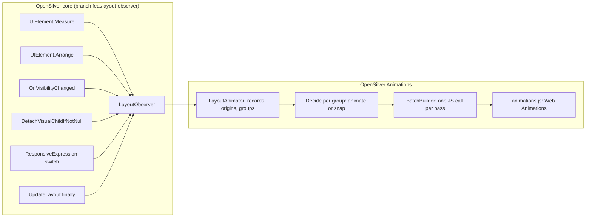

# Architecture: how the built part works

This file describes the code as it is: phase 2 (MoveAndResize, with Bouncy and Wave), and the first step of phase 3 (Appear and Disappear with their presets and OthersMove, and the automatic effects of elements that appear or disappear inside an area). The full specification, including the phases not built yet, is in [design.md](design.md).

## The two halves

The library needs to see every layout pass, so OpenSilver gets a small extensibility hook. Everything else lives in this repository.




## The OpenSilver core changes

They are on branch `feat/layout-observer` of the OpenSilver repository (`C:\VSProjects\UserwareSource\OpenSilver`): commit `547adac2`, then the `{Responsive}` hook. They don't change any behavior when no observer is registered: each call site is one null check.


| File (under `src/Runtime/`)                            | Change                                                                                                                                                                |
| ------------------------------------------------------ | --------------------------------------------------------------------------------------------------------------------------------------------------------------------- |
| `Runtime/OpenSilver/LayoutObserver.cs`                 | New public abstract class with virtual no-op methods. `Register(observer)` returns an `IDisposable` that unregisters it. Observers are kept in a copy-on-write array. |
| `Runtime/System.Windows/UIElement.Layout.cs`           | `NotifyMeasured` in `Measure`, `NotifyArranging` and `NotifyArranged` in `Arrange`.                                                                                   |
| `Runtime/System.Windows/UIElement.cs`                  | `NotifyVisibilityChanged` at the very end of `OnVisibilityChanged`.                                                                                                   |
| `Runtime/Core/Rendering/INTERNAL_VisualTreeManager.cs` | `NotifyDetaching` in `DetachVisualChildIfNotNull`, before `InternalDetachVisual`.                                                                                     |
| `Runtime/System.Windows/LayoutManager.cs`              | `NotifyLayoutPassCompleted` in the `finally` block of `UpdateLayout`, before `UIRenderer.ProcessRenderQueue(true)`.                                                   |
| `Runtime/System.Windows/ResponsiveExpression.cs`       | `NotifyResponsiveValueChanged` in `OnSourceElementSizeChanged`, after the new value is applied, when it differs from the previous one.                                |
| `Runtime/Runtime.OpenSilver.csproj`                    | Compiles `LayoutObserver.cs`.                                                                                                                                         |
| `Scripts/cshtml5.js`                                   | `osjs.createVisual` skips children marked `data-os-foreign` when it resolves an insertion index.                                                                      |


What each hook guarantees:

- `OnMeasured(element, availableSize, sameAvailableSize, previousDesiredSize, isFirstMeasure)` is called only when the element was really measured, right after its new `DesiredSize` is stored.
  - Collapsed elements return earlier and are never reported.
  - Neither are elements whose measure is still valid for the same size.
- `OnArranging(element, finalRect, previousFinalRect, isFirstArrange)` is called only when the arrange is invalid or the final rect changed, just before `ArrangeCore`. An element whose parent arranges it again in the same rect, without its arrange being invalid, is not reported.
- `OnArranged(element, previousVisualRect, visualRect, rendered)` is called after `RenderLayout`.
  - The rects are relative to the visual parent: `VisualOffset` plus `RenderSize`, before and after.
  - `rendered` is false for elements whose box is not written to the DOM. These are the elements with `BypassLayoutPolicies`: `Window`, `PopupRoot`, `WindowHost` and taskbar items.
  - It is not in a `finally` block, so an exception during an arrange leaves an `OnArranging` without its pair. The pass still ends with `OnLayoutPassCompleted`, which resets the library.
- `OnVisibilityChanged` is called after the DOM display change is queued, before the element's next layout pass. The library uses it to recognize elements shown again, and to copy the elements that are collapsed or hidden (see "Elements that appear and disappear"). Only the element whose own Visibility changed is reported, not its descendants.
- `OnDetaching` is called for the element removed from its parent, not for its descendants. The library forgets the element's running animation, and copies it if it has an effect to play. When it is called, the DOM of the element still exists, and its removal runs after any JavaScript the observer queues, so the copy is made from the element on screen.
- `OnResponsiveValueChanged(element, target, property)` is called when a `{Responsive}` value switches because the width it watches crossed a breakpoint, after the new value is applied. Its first value, and a recomputation that gives the same value, are not reported.
  - `element` is the element the value applies to, or the element that owns its target, for example the Grid of a ColumnDefinition.
  - It runs in the `SizeChanged` handler of the watched element (the Window, or the `ElementName`/`RelativeSource` element). So it is inside `UpdateLayout`, between two layout rounds, when no element is being arranged.
- `OnLayoutPassCompleted` is called once per `UpdateLayout`, before the pending JavaScript is flushed. So JavaScript queued there with `ExecuteJavaScriptVoidAsync` runs in the same flush as the layout's own writes: the browser never paints the new layout without its animations.
- The measure and arrange hooks run inside `Dispatcher.DisableProcessing()`. Observers only record data there. Anything that needs the dispatcher, such as raising the `Logged` event, is posted with `BeginInvoke`.

The library repository gets these changes through locally built OpenSilver packages; see [development.md](development.md).

## Files of the library


| File (under `src/OpenSilver.Animations/`) | Role                                                                                                                                                      |
| ----------------------------------------- | --------------------------------------------------------------------------------------------------------------------------------------------------------- |
| `Animate.cs`                              | The public entry point: the `MoveAndResize`, `Appear` and `Disappear` attached properties, `Animate.Changes` and `Animate.Skip`.                          |
| `Movement.cs`                             | `Movement` (abstract, a `MarkupExtension`), `Smooth`, `Bouncy`, `Movement.None`, `MovementConverter`, the `AnimationScope` enum.                          |
| `Transition.cs`                           | `Transition` (abstract, a `MarkupExtension`), the presets `Fade`, `Slide`, `Zoom`, `Pop`, `Wipe`, `Blur` and `Custom`, `Transition.None`, `TransitionConverter`, the `Side`, `OthersMove` and `PageOpen` enums, the `Distance` struct and its converter, and the internal `EffectLook`. |
| `AnimationTime.cs`                        | A readable duration (`0.3s`, `300ms`, `300`), with its type converter.                                                                                    |
| `Easings.cs`                              | The curves `Smooth`, `Gentle`, `Linear` and `Bouncy`, and `EasingConverter`. The internal `CubicBezierEasing`, `LinearEasing` and `SpringEasing` classes. |
| `AnimationSettings.cs`                    | App-wide settings, the `Logged` event and `AnimationLoggedEventArgs`.                                                                                     |
| `AssemblyInfo.cs`                         | `XmlnsDefinition` and `XmlnsPrefix` for `http://opensilver.net/animations` with the prefix `anim`.                                                        |
| `Engine/LayoutAnimator.cs`                | The `LayoutObserver`. It collects the pass, groups, decides, culls, emits and logs. Most of the logic is here.                                            |
| `Engine/PageOpenHolds.cs`                 | Holds the elements with `OnPageOpen=PushOthers` out of the layout while their page opens, and releases them after their `StartAfter`.                     |
| `Engine/Timing.cs`                        | The duration and curve of a group, and their JSON form.                                                                                                   |
| `Engine/BatchBuilder.cs`                  | Builds the JavaScript object sent once per pass.                                                                                                          |
| `Engine/BrowserBridge.cs`                 | Loads `animations.js` and runs the batch. It keeps `IsDragging` and `PrefersReducedMotion` up to date through JavaScript callbacks.                       |
| `Engine/ElementNames.cs`                  | Names elements in messages: their `x:Name`, or their type and a bit of their text.                                                                        |
| `Scripts/animations.js`                   | Embedded resource (`OpenSilver.Animations.animations.js`). It plays the batch with Web Animations, and tracks dragging and reduced motion.                |


## Public API (built)

```xml
<UserControl xmlns:anim="http://opensilver.net/animations">
    <Button Content="Save" anim:Animate.MoveAndResize="Smooth" />
    <Border anim:Animate.MoveAndResize="{anim:Smooth Duration=0.4s, Easing=Gentle}" />
    <Border anim:Animate.MoveAndResize="{anim:Bouncy Bounciness=0.7}" />
    <StackPanel anim:Animate.MoveAndResize="{anim:Smooth ApplyTo=EverythingInside, Wave=0.8}" />
    <WrapPanel anim:Animate.MoveAndResize="{anim:Smooth ApplyTo=EverythingInside, AlsoOnWindowResize=True}" />
    <Grid anim:Animate.MoveAndResize="None" />  <!-- carved out of an area -->
    <StackPanel anim:Animate.Appear="Fade" anim:Animate.Disappear="Fade" />
    <TextBlock anim:Animate.Appear="{anim:Slide From=Top, Distance=Short}" />
    <Border anim:Animate.Appear="{anim:Fade OthersMove=Before}" anim:Animate.Disappear="{anim:Wipe To=Top, Duration=0.4s}" />
    <Border anim:Animate.Disappear="None" />  <!-- no automatic effect inside an area -->
    <TextBlock anim:Animate.Appear="{anim:Fade StartAfter=0.2s}" />
    <Border anim:Animate.Appear="{anim:Slide From=Top, StartAfter=0.6s, OnPageOpen=PushOthers}" />
</UserControl>
```

```csharp
Animate.SetMoveAndResize(card, new Smooth { Duration = AnimationTime.FromSeconds(0.4) });
Animate.SetMoveAndResize(card, "Smooth");                  // implicit conversion from string
Animate.SetAppear(note, new Slide { From = Side.Left, Distance = 60 });
Animate.SetDisappear(note, "Fade");
Animate.Changes(() => Details.Visibility = Visibility.Collapsed);          // animates everything
Animate.Changes(() => Box.Width = 400, AnimationTime.FromSeconds(0.6));
Animate.Skip(() => RestoreLayout());                       // nothing animates
AnimationSettings.Current.Speed = 0.5;
AnimationSettings.Logged += (s, e) => Debug.WriteLine(e.Message);
```

- `Animate.MoveAndResize` (attached, type `Movement`, not inherited).
  - Setting it starts the engine: it registers the observer and loads the script, once. The engine never starts in a designer (`DesignerProperties.IsInDesignTool`).
  - A value with `ApplyTo=EverythingInside`, or `None`, turns on the area lookup (`LayoutAnimator.AnyAreas`). Until then, ancestors are never searched.
- `Movement` **parameters.**
  - `Duration` (`AnimationTime?`): clamped to 0.05 to 3 s when used. The default is `AnimationSettings.DefaultDuration`, doubled for `Bouncy`.
  - `Easing` (`IEasingFunction`, names through `EasingConverter`): used by `Smooth`.
  - `Bounciness` (0.1 to 1, default 0.5): used by `Bouncy`, and by `Smooth` with `Easing=Bouncy`.
  - `Wave` (0 to 1, default 0).
  - `ApplyTo` (`ThisElement` or `EverythingInside`).
  - `AlsoOnWindowResize` (default false).
- **Value forms.** A `Movement` is a `MarkupExtension` whose `ProvideValue` returns itself. So it works as a string (`"Smooth"`, through `MovementConverter`), as a markup extension with parameters, as an element, and as a resource. `Movement.Parse` accepts `Smooth`, `Bouncy`, `None` and the empty string.
- `Animate.Appear` and `Animate.Disappear` (attached, type `Transition`, not inherited).
  - Setting one starts the engine and turns on the effect paths (`LayoutAnimator.AnyEffects`). The value is checked once (`CheckEffect`): a parameter that doesn't apply, like `OthersMove=After` on an Appear, `OnPageOpen` on a Disappear, `Pop` as a Disappear, `To` on an Appear or `Bounciness` without a bounce, writes a warning to the console and the `Logged` event, and is ignored.
  - `Transition` works like `Movement`: a string through `TransitionConverter` (`Fade`, `Slide`, `Zoom`, `Pop`, `Wipe`, `Blur`, `Custom`, `None`; an unknown name throws), a markup extension, an element or a resource.
  - **Parameters** on every preset: `Duration`, `Easing`, `Bounciness`, `OthersMove`, `StartAfter` (clamped to 10 s when set) and `OnPageOpen` (`PageOpen.InPlace`, `PushOthers` or `Skip`). `Slide` has `From`, `To` and `Distance`; `Wipe` has `From` and `To`; `Custom` has `Opacity`, `OffsetX`, `OffsetY`, `Zoom`, `Rotate` and `Blur`.
  - `Distance` is a struct: `Distance.Short` (10 px), `Medium` (30 px, the default) and `Long` (100 px), or a number of pixels, from XAML (`Distance=Short`, `Distance=60`) or from a `double`.
  - **Duration.** The default is `AnimationSettings.DefaultDuration`, doubled for `Pop` and for `Easing=Bouncy`. Bouncy effects play a spring sampled with `Bounciness`; the elements around them move Smooth, with the same duration (`Timing.ForOthers`).
- `Animate.Changes(action, duration?)` first runs `UpdateLayout()`, so that pending layout is attributed to earlier changes. Then it runs the action and `UpdateLayout()` again, inside a scope where every change animates, even without settings, with the Smooth curve.
- `Animate.Skip(action)` does the same with a scope where nothing animates.
- **Nested scopes:** the inner one applies until it exits, then the outer one applies again.
- `AnimationSettings`:
  - `Current` is read lazily. The first time, it comes from the application resource with the key `"AnimationSettings"`, if there is one (the gallery declares `<anim:AnimationSettings x:Key="AnimationSettings" />` in App.xaml).
  - Properties: `IsEnabled`, `RespectReducedMotion`, `SimulateReducedMotion`, `Speed` (0.05 to 20), `DefaultDuration` (0.25 s), `LogForDebugging` and `ShowWhatAnimates`.
  - It implements `INotifyPropertyChanged`, so the gallery's toolbar binds to it.
  - The static `Logged` event carries the same messages as `LogForDebugging`, raised with `BeginInvoke` after the pass.
- **Curves.**
  - `Easings.Smooth` is `cubic-bezier(0.2, 0, 0, 1)`, the default.
  - `Easings.Gentle` is `cubic-bezier(0.45, 0, 0.55, 1)`.
  - `Easings.Linear`.
  - `Easings.Bouncy` is a damped spring. Its damping ratio is `1 - 0.8 × Bounciness`, and it is within 0.1% of the target at the end of the duration.
  - Any other `IEasingFunction` is sampled into 33 points.


## One layout pass, step by step

`LayoutAnimator` keeps per-pass state in reused arrays and dictionaries, and clears them at the end of every pass (`Reset`). The terms below are used everywhere in the code and in the messages.

### 1. Measure: finding where a change started

`OnMeasured` ignores first measures. For the others:

- `_measured` records every element measured in the pass. A second measure of the same element in the same pass is "measured again".
- **A scrolled element is ignored.** This is an `IScrollInfo` whose offsets changed since the last check (`IsScrolled`, which stores offsets in a `ConditionalWeakTable` and caches the answer per pass).
- **A different available size means the element is a consequence**, not where the change started, so it is ignored.
- **Carriers.** When the desired size changed, the layout parent goes into `_carriers`. A carrier is only passing its child's change upward.
- **Measure origins.** An element measured with the same available size, for the first time in the pass, that is not a carrier, goes into `_measureOrigins`.
  - Example: a Button whose label got longer. The TextBlock is the origin, and the Button and its panel are carriers.
  - Example: a Border whose `Width` was set. The Border is the origin; its parent is a carrier.
  - Only the first measure counts, because a later measure in the same pass is the layout settling: a ScrollViewer measures its content again after showing a scroll bar.


### 2. Arrange: records, stack and groups

`OnArranging` pushes a **record** on a stack. The record holds the element, its parent record (the element below it on the stack), its old and new rects, flags and a group id.

- **Appearing elements** get `Appears`. They are the elements arranged for the first time, and the elements shown again: their Visibility went back to Visible since the last pass (`_shown`, filled by `OnVisibilityChanged`).
  - Their descendants arranged for the first time in the same pass get no record at all: everything inside an element that appears, appears with it.
  - The time it appeared is stored in `_appeared`, for the settling rule below.
  - An element shown again still has the box it had before it was collapsed, so its own rects say nothing. When it is a measure origin, its parent becomes the origin instead: showing the details of an option is a change of the form that holds them.
- **Scrolled elements** get `Scrolled`.
- **Origins** get `Origin`: a measure origin, or an element arranged again in the same rect without being measured (an arrange-only change, such as `Grid.Column` or an alignment), or an element where a `{Responsive}` value switched. A window-resize pass has no origins at all, except for these switches (see below).

`OnArranged` pops the record.

- It keeps the first old rect of the pass and the last new rect.
- It sets `NotRendered` when the rect changed but nothing was written (`rendered` false). Such elements are never animated.
- An origin creates a **Change group**.
- A Change group then joins the parent record's group (union-find: `NewGroup`, `Find`, `Union`). So a change climbs through every ancestor that was arranged again. A WindowResize group never climbs.
- **A change never crosses** `None`**.** When the element or its parent has `MoveAndResize=None`, the group doesn't climb from one to the other. A change inside a carved-out chart stays inside it and snaps; the elements it pushes outside the chart are arranged by the parent's own group, or by none, and snap too. Without this rule, when the same Refresh also changed the size of a number card, the chart's change climbed through the dashboard and joined the numbers' change, and the bars glided with them. That's why "Leave the chart out" in chapter 7 seemed to work only on the first Refresh.

When the stack is empty, the arrange session is over. `EndArrangeSession` walks the session's records in arrange order (pre-order):

- A record without a group takes its parent's group, unless the parent is scrolled. So everything arranged by a member of a group belongs to it.
- A record still without a group whose rect changed, and whose effective movement has `AlsoOnWindowResize`, starts a **WindowResize group**.
- When a Change group and a WindowResize group merge, the Change group wins: the change keeps its own timing.


### 3. End of the pass: deciding per group

`OnLayoutPassCompleted` prunes `_appeared`, gives the page-open holds loaded since the last pass their release time (see "Page open with PushOthers"), and does nothing more if there are no records and no scope. Otherwise `CompletePass` runs, inside a `try`/`catch` that writes any exception to the console and never breaks the app.

1. **Global snap reason**, checked first. If any of these holds, every group snaps:
  - `Animate.Skip`;
  - `IsEnabled` is false;
  - a designer;
  - reduced motion, real (the `prefers-reduced-motion` media query, if `RespectReducedMotion`) or simulated (`SimulateReducedMotion`);
  - `BrowserBridge.IsDragging`, except for the groups of `{Responsive}` switches (see below).
2. **Buckets.** For each record that changed or is an origin, except appearing ones:
  - without a group, a change snaps;
  - otherwise it goes into its group's bucket, as an origin and/or a member (a member is a record whose rect changed).
  - An appearing record goes into the `Appearing` list of its parent's bucket (`AddAppearing`) when it has an `Appear` effect, or when the parent is in a Change group inside an `EverythingInside` area and the element itself doesn't have `None`.
  - Each disappearance captured since the last pass joins the bucket of its parent's record, in `Ghosts`. See "Elements that appear and disappear".
3. `ProcessGroup` for each bucket that has members or appearing elements:
  - **A WindowResize group** (no origins) animates with the timing of the element that opted in.
  - **A Change group** goes through `Decide`, described below.
  - **Culling and budget** (`CullAndCount`). A member is left out when both its old and new absolute rects are outside the window, with a margin of 100 px; an appearing element, when its new rect is. If more than 300 remain, the whole group snaps. If none remain, nothing happens.
  - `Emit` adds the moves and the reveals to the batch, or `Snap` cancels the running animations of the members.
4. **The batch** is sent with one `ExecuteJavaScriptVoidAsync` call: moves, reveals, cancels, outlines and releases.
5. **Messages** are published (see "Messages").


### Decide: does a Change group animate, and with which timing?

It goes through the origins. When not inside `Animate.Changes`, an origin is excluded for any of these reasons, in this order:

- **Typing.** The origin is strictly inside the focused `TextBox`, `PasswordBox` or `RichTextBox`. The text box itself growing is not excluded: it is a member, not the origin.
- **Scroll chrome** (silent). The origin is a `ScrollBar` or inside one, up to 8 levels up, or its `TemplatedParent` is a `ScrollViewer`. These parts only change as a consequence of the content.
- **Settling** (silent). The origin, or one of its ancestors, appeared less than 500 ms ago. Right after a page, a dialog or new items appear, scroll bars show up and fonts and images load. An origin marked `Released` is never settling (see "Page open with PushOthers").
- **Carved out.** The origin's area is `None`.

If every origin is excluded, the group snaps with the last reason. Otherwise the group animates when one of these gives a timing, checked in this order:

1. `Animate.Changes`: its duration, or the default, with the Smooth curve.
2. **The nearest setting** (`FindNearestMovement`), going up from each eligible origin. The first of these wins:
  - the origin's own setting. It counts even when the origin's own box doesn't change. That's needed for a ChildWindow, whose `Width` change resizes its template while the ChildWindow itself keeps the page size;
  - an ancestor with `EverythingInside`;
  - an ancestor with another setting that is a member (`IsMember`). An ancestor that stays in place doesn't count, because `ThisElement` is about its own box. Example: the Save button resizes because its label grew, so the button's setting gives the timing.
   The walk stops at `None`, and at a popup's root. Among the origins, the setting found the fewest levels up wins; on a tie, an origin of the page beats a part of a control template. Each walk stops at the best level found so far.
3. **The member with an effective setting that is the fewest tree hops away** from the origin (`FindNearestMemberMovement`, through the records' parent chains). Example: a tab underline with `Bouncy` moves because its Grid rearranged its columns.

Otherwise it snaps: "no element involved has MoveAndResize".

So a `ThisElement` setting on an element inside an area gives the timing to the changes that start inside that element and move or resize it: it is nearer than the area. Before this rule, the area won.

The origin named in messages, and used for the wave, is the origin whose walk found the setting, if any. Otherwise it is the first eligible origin, preferring an element of the page over a part of a control template (`IsTemplatePart`: `TemplatedParent != null`).

### Areas

`GetArea(element)` walks up `VisualTreeHelper.GetParent` until it finds one of:

- `EverythingInside`: the element is inside that area, with its movement;
- `None`: the element is carved out;
- the root: no area.

`ThisElement` settings are passed over: the area says whether an element is inside one, while the timing comes from the nearest setting (see "Decide"). Results are memoized per pass for every element on the walked path (`_areaCache`), so each element is visited at most once per pass. Popups are boundaries, because `GetParent` returns null at a popup's root.

`GetEffectiveMovement(element)` is the element's own setting (null for `None`), or else its area's movement. Members use it, so a change that starts outside an area but moves something inside it animates.

### Elements that appear and disappear

An element that appears or disappears is a change of its parent: the elements around it make room or fill its place, and it plays its effect with them, so that it never overlaps them while they move. Its effect is its own `Appear` or `Disappear`, or, inside an `EverythingInside` area, an automatic wipe or fade.

- **The hold.** The core changes the DOM display as soon as Visibility goes back to Visible, but arranges the element only in the next layout pass, at Render priority. In between, the browser can paint it with the box it had before it was collapsed. So `OnVisibilityChanged` calls `BrowserBridge.Hold` for an element with an `Appear`, or inside an area without `Appear=None` (`IsInsideArea`, which walks up without memoizing, because it runs outside the passes). `animations.js` keeps it at opacity 0, for at most a second. Hidden to Visible keeps the box, so it needs no hold: the effect plays at once.
- **The release.** Every held element gets a release entry in the batch of the next pass (`_held`). One that plays an effect or is revealed is released by it. One whose group snaps is simply shown, at its final place. `ReleaseHeld` also runs when the pass has no records, and after an exception.
- **The timing.** When not `_switchOnly`, a bucket with an effect (the first one found: `Effect`, `EffectElement`, `EffectAppears`) takes its timing from it in `Decide`, before any setting, with `Timing.ForOthers`: a bouncy effect moves the others Smooth. The message names it: "from the Appear of Details".
- **Explicit appear effects.** `Emit` plays them with their own timing (`PlayAppearEffect`, batch key `e`). With `OthersMove=Before`, and when others move, the effect waits for the others' duration. While others move, the element is raised above its siblings.
- **Automatic reveals.** `Emit` reveals the other appearing elements of an animated group, with the group's timing and the size curve, so that the revealed part keeps up with the elements it pushes. `GetRevealEdge` picks how:
  - the side it pushes its siblings away from: when the siblings below move down, it wipes from its top;
  - when it pushes no sibling but its container grows, the top edge (or the left edge, when the container grew more in width);
  - otherwise, a fade.
- **The wave.** A revealed element starts with the element it follows (the sibling or container that `GetRevealEdge` returns), so it doesn't open before the space does.
- **With the container.** An explicit Appear inside an element that appears, or on an element visible when the page opens, gets the `WithContainer` flag. It plays in its place, after its `StartAfter`, and doesn't make room: "2 elements appeared with their container, and play their Appear effects, like Border". Under a scrolled parent, nothing plays. With `OnPageOpen=Skip`, it is marked `Played` without an effect: "SkipBanner appeared with its container, without its effect, as OnPageOpen=Skip asks."
- **StartAfter.** `GetWaitMs` (`StartAfter` divided by `Speed`) is added to the delay of the element's own effect, everywhere it plays: `PlayAppearEffect`, `PlayGhost`, `PlayAtOnce` (Hidden), and the quick fades of reduced motion. The others don't wait for it, except with `OthersMove=After`, where they wait for the wait and the ghost's duration. `KeepGhosted` extends `_ghostedUntil` by the wait. The messages say "it slides in after 0.3 s" (`After`), and the bucket keeps the wait of its own effect in `EffectWait` for `DescribeAnimated`.
- **Disappearances.** `CaptureDisappearing` runs from `OnVisibilityChanged` (Visible to Collapsed or Hidden) and from `OnDetaching` (a visible element). It copies the element in the browser (`BrowserBridge.Ghost`) when it has a `Disappear`, or, inside an area, when it doesn't have `Disappear=None`, isn't Hidden, and fewer than 40 automatic ones were captured in the pass.
  - A Hidden element keeps its space, so no layout pass comes: its ghost plays at once (`PlayAtOnce`), with the message "X was hidden; …".
  - The others wait in `_disappearing` and join their parent's bucket at the end of the pass. An explicit ghost plays its own effect (`PlayGhost`, batch key `g`); an automatic one wipes toward the side its neighbors come from (`GetDisappearEdge`), or fades, with the group's timing and the size curve.
  - With `OthersMove=After`, the rest of the group waits for the ghost's duration.
  - `_ghostedUntil` remembers the elements whose ghost may still be on screen (3 s). When such an element is shown again without a hold, its ghost is removed (batch key `x`).
- **Snapped groups** still play their explicit effects (`PlayEffectsAlone`): "X appeared; it fades in (Smooth, 0.25 s, from its Appear), and nothing else animated because …". `PlayRemainingEffects` plays the explicit effects that no group played, and removes the ghosts that have nothing to play.
- **When effects play** (`_effectsPlay`): when nothing makes every group snap, under reduced motion (as a 0.15 s fade, `_quickFades`), and for the `{Responsive}` switches of a drag. Under reduced motion, the automatic effects snap with the rest.
- **`{Responsive}` splits.** `_disappearing` is set aside during the pre-switch `CompletePass`, so that the ghosts play with the switch. `EmitSwitches` gives each ghost to the owner that contains its parent.
- **Outside areas**, an element without an effect appears at once in its place and disappears at once, and only the others move. It is not held, so the one-frame flash of the old box can happen there.

### Page open with PushOthers

`PageOpenHolds` keeps an element with `OnPageOpen=PushOthers` collapsed while its page or container opens, then shows it, so that it appears on its own and pushes the others.

- **Start.** `Animate.OnEffectChanged` calls `HoldForPageOpen`, which sets `AnyPushOthers` and holds the element when it isn't loaded yet. Generated XAML sets attached properties before adding the element to its parent, so the hold comes before any layout pass. When a container is shown again, `OnVisibilityChanged` calls `HoldDescendants`, which holds the PushOthers elements inside it without going into them; the ones inside a held element are held when it is released. `StartHold` doesn't hold when a global snap reason applies, except dragging: the element then plays like `InPlace`.
- **The hold.** A `Storyboard` sets `Visibility` to `Collapsed` with a zero `Duration` (it holds its value without asking for frames), applied at once with `Begin()` and `SeekAlignedToLastTick(TimeSpan.Zero)`. The hold is registered before `Begin()`, so that `OnVisibilityChanged` ignores the changes it makes (`IsHolding`).
- **The pass after Loaded.** A Loaded handler puts the hold in `_waitingForPass`. At the end of the next pass, before the records are reset, `AppearsWithContainer` looks for the nearest ancestor with a record: if it appeared, the element opened with its page, and it is released `StartAfter` later. Otherwise, it was added on its own, and it is released at once, to appear like any element added at runtime.
- **Release.** `ReleaseDue` runs from `Dispatcher.BeginInvoke` or a `DispatcherTimer`, never during a pass, and releases together the holds due within 20 ms. `Stop()` gives the element back its own Visibility. An element that opened with its page, and is still loaded and visible, goes into `_released`. When its container is hidden and shown again before the release, `Start` moves the hold back to `_waitingForPass`, so that the wait starts again.
- **The next pass.** `OnArranging` marks the released element `Released`, and its parent `Origin | Released`: the parent is where the change starts, even if the element wasn't a measure origin, and `Decide` doesn't apply the settling rule to it. Its effect plays at once, without waiting for `StartAfter` again: "PushOthersBanner appeared 0.6 s after its page opened, as OnPageOpen=PushOthers asks; it slides in, and 3 elements animate together (…)" (`DescribeAppeared`). Off screen, the group is culled like any other, and only the effect plays.
- An element that is never added keeps nothing alive: the holds are in a `ConditionalWeakTable`, and the Loaded handler is on the element.


### Window-resize passes

`IsWindowResizePass` compares `Application.Current.Host.Content.ActualWidth`/`ActualHeight` with the size seen at the previous pass. The Host's ResizeObserver updates it before the layout pass runs. It is evaluated lazily, once per pass, from `OnArranging`.

In such a pass there are no origins: everything follows the window. Only the elements that set `AlsoOnWindowResize`, and their content, form WindowResize groups. Without this rule, the scroll bar parts that measure again in a resize pass would look like changes. Their group would climb to the root and snap the whole page, or animate it.

### `{Responsive}` switches

A `{Responsive}` value that switches is a change, like a click, even in the middle of a resize: a layout that switches at a width animates, while the rest of the resize snaps. `OnResponsiveValueChanged` adds the element the value applies to, and its visual parent, to `_switches`, because a value like `Grid.Row` or `Margin` changes where the parent puts its children. `OnArranging` makes them origins, and messages start with "{Responsive} switched the Orientation of StackPanel".

In a pass that isn't following anything, that's all: the switches are origins like the others. In a **following pass**, a window resize or a pass while something is dragged, the first switch splits the pass:

- **The part before the switch** follows the resize. Its records are completed as a pass of their own (`CompletePass(releaseHeld: false)`, the held elements wait for the end of the real pass), then reset (`ResetRecords`).
- **The rest of the pass is switch-only** (`_switchOnly`):
  - only the switches are origins: no measure origins, arrange-only changes or shown parents;
  - the dragging reason doesn't stop a group that has origins;
  - `Decide` only uses the settings found going up from the origins, at any level, and never the nearest member: in a resize, the members also follow the resize, so their settings say nothing about the switch;
  - the elements whose settings are found are the **owners** (`_owners`), each with the switches that found it. `EmitSwitches` gives each member and appearing element to the nearest owner that contains it, and the others snap, like the rest of the resize. Each owner then animates its part with its own timing, and writes its own message: at 960 px in chapter 13, the three shape boxes and the wrapping text box write four messages, each naming its own switch and setting. A part with several different switches says so: "{Responsive} switched the Width of RectangleBox, and 2 other values";
  - `InvolvesSettings` only looks at the origins, so switches with no settings around them, like the gallery's own font sizes and paddings, write no message.
- **The animations go on through the resize.** `_runningUntil` remembers which animations came from a switch (`FromSwitch`). In the next following passes, such an element is not cancelled when it snaps (`_keepRunning`): its size animation is retargeted to its new size instead (`AddRetarget`, batch key `s`). So it follows the resize at once, and what is left of the switch plays on top. Other animations are cancelled as before, so the elements that were animating when the drag started follow the edge.


### Wave

When the timing has `Wave > 0`, each member gets a delay.

- **The formula** is `Wave × 200 ms × min(1, distance / 600 px)`, divided by `Speed`. The distance is between the absolute rects of the member and the origin: 0 when they overlap.
- **Delays are inherited.** A member inside another member shares that member's delay. The origins and their descendants start at once.
- **The origin's ancestors pass nothing down** (`_chainStamp`), so the elements next to the origin each get their own delay.
- `_waveStamp` changes for each emitted group, so that stamps don't leak between groups.


### Absolute positions

`ComputeAbsolute` adds the record rects along the parent chain. For the root of an arrange session, it adds `TransformToVisual(null)` of its visual parent. Scroll offsets are included, because a `ScrollContentPresenter` arranges its content at the negative offset. Positions are computed only for culling and the wave, and memoized with `_stamp`.

### Running animations and cancels

`_runningUntil` remembers, for each animated element, when its animation ends (delay plus duration plus 50 ms), and whether it came from a `{Responsive}` switch.

- When such an element changes again and snaps, its animation is cancelled in the same batch, so it doesn't fight the new position. The exception is an animation of a switch while a resize goes on: it is retargeted (see "`{Responsive}` switches").
- Entries are removed on detach, and swept every 2 s.
- In the browser, a new animation on an element that is still animating starts from where the element is on screen.


### Messages

Messages are produced only when `LogForDebugging` is on or `Logged` has handlers.

- **An animated group:** "TextBlock "Saving..." changed size; 10 elements animate together (Smooth, 0.25 s, from the MoveAndResize of SaveButton)."
  - With elements that appear: "FormFields changed size; 27 elements animate together, and TwoStepDetails wipes in (Smooth, 0.25 s, from the EverythingInside of SettingsForm)." Several give "3 elements wipe in", "fade in" or "wipe or fade in", and those that disappear "wipe out" or "fade out".
- **An effect:** "Details appeared; it fades in, and 30 elements animate together (Smooth, 0.25 s, from the Appear of Details)."
  - With `OthersMove`: "2 elements animate together, then it fades in", "it fades out, then 2 elements animate together".
  - With `StartAfter`: "GiftMessage appeared; it slides in after 0.3 s, and 15 elements animate together (…)".
  - With the page: "12 elements appeared with their container, and play their Appear effects, like TextBlock "CHAPTER 4"", and the `OnPageOpen` messages (see "Page open with PushOthers").
  - With another effect in the same change: "Body1 appeared; it wipes in, Body0 wipes out, and 17 elements animate together (…)". More than one give "2 other elements play their effects".
  - Under reduced motion: "Details appeared; it fades in quickly, because reduced motion is simulated (AnimationSettings.SimulateReducedMotion), and nothing else animated."
- **A window-resize group:** "The window was resized; FollowingTiles follows it (Smooth, 0.25 s, from the AlsoOnWindowResize of FollowingTiles)." At most one per second.
- **A switch:** "{Responsive} switched the Orientation of StackPanel; 17 elements animate together (Smooth, 0.25 s, from the EverythingInside of ProfilePanel)." For a target that isn't an element: "{Responsive} switched the Width of a ColumnDefinition in ProfileGrid".
- **A snap:** "SliderBar changed size; nothing animated because something is being dragged."
  - Only snaps that would otherwise have animated are explained: inside `Animate.Changes`, or when an origin or a member has an effective setting (`InvolvesSettings`).
  - Scroll chrome and settling snap silently.
  - The same message is written at most once per second (typing and dragging repeat it).
- The snap reasons are: `Animate.Skip was used`, `AnimationSettings.IsEnabled is false`, `the app runs in a designer`, `the device asks for reduced motion`, `reduced motion is simulated (AnimationSettings.SimulateReducedMotion)`, `something is being dragged`, `it came from resizing the window or from outside the elements that have settings`, `the change came from typing in X`, `the change started inside X, which has MoveAndResize=None` (or `in X` when X is where it started), `no element involved has MoveAndResize`, and `more than 300 elements would animate at once`.
- `LogForDebugging` writes to the console with the prefix `[OpenSilver.Animations]`. The `Logged` event is raised with `Dispatcher.BeginInvoke` after the pass, so handlers can change the page. A handler that changes an animated element starts a new pass. Avoid logging into a list that is inside an animated area, or each message would cause another one.


### Constants

These are at the top of `LayoutAnimator`:


| Constant              | Value | Meaning                                               |
| --------------------- | ----- | ----------------------------------------------------- |
| `MaxAnimatedElements` | 300   | The budget per group, after culling.                  |
| `MaxWaveDelayMs`      | 200   | The delay at full wave and full distance.             |
| `WaveDistance`        | 600   | The distance (px) that gets the full delay.           |
| `CullMargin`          | 100   | The margin (px) around the window for culling.        |
| `Tolerance`           | 0.05  | Two lengths closer than this (px) are equal.          |
| `SettleMs`            | 500   | How long, after appearing, changes count as settling. |
| `MaxAutomaticGhosts`  | 40    | The automatic Disappear effects per pass.             |
| `GhostLifetimeMs`     | 3000  | How long a ghost may stay on screen, for `_ghostedUntil`. |


## The browser side (`Scripts/animations.js`)

`osAnimations.init(dragStarted, dragEnded, reducedMotionOn, reducedMotionOff)` runs once and installs:

- **The drag tracker.** Capture listeners on `window` for `pointerdown`, `pointermove`, `pointerup` and `pointercancel`. A drag starts when a button is held and the pointer moved more than 4 px.
- **The reduced-motion listener**, on `matchMedia('(prefers-reduced-motion: reduce)')`.

`osAnimations.run(batch)` plays one pass. The batch is a JavaScript object literal built by `BatchBuilder`:

```text
{ t: [ { d: durationMs, e?: cssEasing, s?: [samples], se?: sizeEasing } ],
  m: [ [id, timingIndex, delayMs, dx, dy, oldWidth, oldHeight, newWidth, newHeight, flags] ],
  a: [ [id, timingIndex, delayMs, edge] ],
  e: [ [id, timingIndex, delayMs, opacity, x, y, zoom, rotate, blur, wipe, raise] ],
  g: [ [id, timingIndex, delayMs, opacity, x, y, zoom, rotate, blur, wipe, sizeCurve] ],
  x: [ ids whose ghost to remove ],
  c: [ ids to cancel ],
  s: [ [id, newWidth, newHeight] ],
  o: [ [id, durationMs, delayMs, isOrigin] ],
  r: [ ids to release ] }
```

They run in this order: cancels, retargets, moves, reveals, effects, ghosts, ghost removals, outlines, releases. `osAnimations.hold(id)` and `osAnimations.ghost(id)` are called on their own, from the hooks.

- **Elements** are found by the id of their outer div (`Interop.GetDiv(element).Uid`).
- **Moves.** The core has already written the final `left`/`top`/`width`/`height`. The library only animates on top of them, and never touches a dependency property.
  - Position: `translate` from `(dx, dy)` to 0 with `composite: 'add'`.
  - Size: `width`/`height` from the old size to the new one.
  - Delays use `fill: 'backwards'`, so a delayed element shows its old place until it starts.
- **Flags.**
  - `1` (`ClipOwnBox`): the element's clip is exactly its own box, as with `ClipToBounds` or a `ScrollContentPresenter`: a `RectangleGeometry` the size of the element, with no transform or an identity one. The size animation holds `clip-path: inset(0px)` so that the clip follows the animated box. Without the flag, the core's clip has the final size at once: a sidebar that narrows looks like it snaps, and the content of a dialog that narrows is cut.
  - `2` (`Rectangle`) and `4` (`Ellipse`): a shape with `Stretch=Fill`. Its SVG geometry (`width`/`height`, or `rx`/`ry`/`cx`/`cy`) is animated too, where the browser supports these CSS properties. `Path` geometry always snaps.
- **Curves.** A CSS easing (`cubic-bezier`, `linear`), or samples. Samples play as CSS `linear(...)` where supported, and are otherwise baked into keyframe offsets. `Bouncy` moves use spring samples, and its sizes use the Smooth cubic-bezier (`se`), so content doesn't wobble.
- **Start time.** Every new animation starts at the next frame (`startAtNextFrame`): its `startTime` is set when it is made, then again in the next `requestAnimationFrame`. Without this, the browser dates it from the frame its batch runs in. A batch can run late in a frame, after a long window resize, or in the middle of a long task, when OpenSilver flushes its pending JavaScript before a synchronous call. The browser then counted that time as played, and a 0.25 s animation that came after a 0.4 s layout pass ended before it was ever painted.
- **Retargets.** The element snapped to a new size while its size animation goes on. Both ends of the size keyframes move by the difference (`effect.setKeyframes`), as do the shape's. Where `setKeyframes` isn't supported, the animation is cancelled.
- **Interruptions.** Running animations are kept per element in a `WeakMap`. A new animation reads the eased progress of the previous one (`getComputedTiming().progress`) and starts from the current offset and size, then cancels the previous one.
- **Reveals.** The edge is `0` for a fade, then `1` to `4` for a wipe from the top, left, bottom or right. A wipe animates `clip-path: inset(...)` and a fade animates `opacity` up to the element's current opacity, both with the size curve and `fill: 'backwards'`. A reveal first releases the element's hold.
- **Holds.** `hold` runs an opacity 0 animation of one second on the element, kept in a `WeakMap`; `release` cancels it.
- **Effects** (`appear`). The look (`e`) is where the element starts: an opacity as a fraction of its own, an offset, a zoom and a rotation around its center (through `translate`, because elements turn around their top left corner), a blur added to its filter, and a wipe edge (`clip-path`, with the same edge numbers as reveals). Rotations are sampled into 12 keyframes. `raise` adds a `z-index` to the keyframes. Effects use `fill: 'backwards'`, so a delayed effect hides the element until it starts.
- **Ghosts.** `ghost(id)` deep-clones the element and inserts the copy before it, so it stacks the same way, and keeps it for 1.5 s at most.
  - The copy has no ids, no `uielement-collapsed` or `uielement-hidden` class, `data-os-foreign` (so that the core skips it when it inserts children), and `pointer-events: none`. Canvases and form values are copied.
  - Media, frames and plugins become empty boxes of the same size, so that they don't load or play again, and that ghost fades out in 0.15 s whatever its effect.
  - It starts from what was on screen: the progress of a running effect, and the offset and size of a running move.
  - `vanish` (batch key `g`) animates it from there to the look, with `fill: 'both'`, then removes it. `removeGhost` (key `x`) removes it at once.
  - When the element appears again while its ghost plays, `appear` and `reveal` start from what the ghost showed (`takeGhost`).
- **Outlines** (`ShowWhatAnimates`) animate `outline` on the element: orange for the origin, pink for members. They last at least 700 ms.


## Things to know before changing the engine

- **The hot path.** The hooks are called for every measured and arranged element of every pass. Keep them to set and dictionary operations, with no allocations and no tree walks. Tree walks (areas, typing, settling, scroll chrome, ancestors) only happen in `CompletePass`, for origins and members. The exceptions are outside the layout hooks: `OnVisibilityChanged` walks the content of a container that is shown again only once an app uses `OnPageOpen=PushOthers` (`AnyPushOthers`), and the page-open holds look up the ancestors of the few elements they hold.
- **Final values are reported at once.** `ActualWidth`, `TransformToVisual` and `SizeChanged` report final values immediately. Anything that app code positions from them jumps to its final place.
- **ChildWindow.**
  - While it's open, its `Width` reads as the width of the page (`UpdateOverlaySize`). Code that toggles it must keep its own state, as `ResizableDialog` does.
  - When its size changes, it keeps its top-left corner in place with a `TranslateTransform` on its `ContentRoot`, as in Silverlight. To stay centered, `ResizableDialog` sets that offset back to 0 in its own `SizeChanged` handler on the `ContentPresenter` part, which runs after the ChildWindow's.
- **DOM order.** Children created through `osjs.createLayout`, such as the containers of an `ItemsControl`, are always appended. So DOM order can differ from visual order, for example in the gallery's log, where new entries are inserted at the top. That's existing OpenSilver behavior. Don't rely on DOM order.
- **Element classes.** In Debug builds of an app (`Features.DOM.AssignClass`), each element's div also has its type name as a CSS class, for example `System.Windows.Controls.Slider`. Release builds don't have them.
- **The Simulator.** JavaScript batches can arrive a frame apart there, so an animation can start one frame late.

