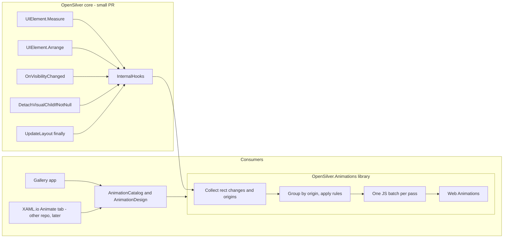

# OpenSilver.Animations: design

This is the full specification of the library for every phase, as agreed with the product owner. Phase 2 (MoveAndResize, plus Bouncy and Wave) is built. Everything else here is the plan.

- How the built part works in detail, including the rules refined while testing, is in [architecture.md](architecture.md). Where this file and the code disagree on built behavior, the code and architecture.md are right.
- What is done, verified and next is in [roadmap.md](roadmap.md).
- The XAML.io "Animate" tab specified below is built later, in the XAML.io repo. Only its library side (`AnimationCatalog`, `AnimationDesign`) belongs here.

## Split



## Core change 1: `InternalHooks` (C#, about 60 lines)

It costs a single null check when no observer is registered, and doesn't change behavior. It was first called `LayoutObserver`; the reviewer of the OpenSilver PR asked for a more generic name, because it also reports visibility changes, detached elements and `{Responsive}` switches. It's internal, and visible to this library only, through `[assembly: InternalsVisibleTo("OpenSilver.Animations")]` in OpenSilver's `AssemblyInfo.cs`: the OpenSilver owner asked for that while the API is not stable, so that OpenSilver doesn't commit to a public API. The library overrides its methods with `protected override`. It was merged into OpenSilver's `develop` in [#1112](https://github.com/OpenSilver/OpenSilver/pull/1112).

```csharp
internal abstract class InternalHooks
{
    public static void Register(InternalHooks observer); // the library registers once, for the lifetime of the app
    public static void Unregister(InternalHooks observer);

    protected virtual void OnMeasured(UIElement element, bool sameAvailableSize, Size previousDesiredSize, bool isFirstMeasure) { }
    protected virtual void OnArranging(UIElement element, Rect finalRect, Rect previousFinalRect, bool isFirstArrange) { }
    protected virtual void OnArranged(UIElement element, Rect previousVisualRect, Rect visualRect, bool rendered) { }
    protected virtual void OnVisibilityChanged(UIElement element, Visibility oldValue, Visibility newValue) { }
    protected virtual void OnDetaching(UIElement child, UIElement parent) { }
    protected virtual void OnResponsiveValueChanged(FrameworkElement element, DependencyObject target, DependencyProperty property) { }
    protected virtual void OnLayoutPassCompleted() { }
}
```

Call sites, each a guarded one-liner:
- [UIElement.Layout.cs](src/Runtime/Runtime/System.Windows/UIElement.Layout.cs), `Measure`: after `_desiredSize = desiredSize;`. It passes `isCloseToPreviousMeasure` as `sameAvailableSize` and `prevSize` as `previousDesiredSize`.
- `Arrange`: before `ArrangeCore(finalRect)`, and after the `RenderLayout()` block. The previous rect comes from the existing `oldOffset`/`oldSize` locals.
- [UIElement.cs](src/Runtime/Runtime/System.Windows/UIElement.cs), `OnVisibilityChanged`: at the very end, after `UpdateIsVisibleCache()`. The library may re-enter here, and an earlier call would let the outer callback overwrite the caches with a stale value.
- [INTERNAL_VisualTreeManager.cs](src/Runtime/Runtime/Core/Rendering/INTERNAL_VisualTreeManager.cs), `DetachVisualChildIfNotNull`: before `InternalDetachVisual(child)`. The DOM still exists at that point: `RemoveFromDom` either queues the removal to `ProcessRenderQueue` or appends it to the same JS buffer, so it always runs after the library's clone call.
- [PopupRoot.cs](src/Runtime/Runtime/System.Windows.Controls.Primitives/PopupRoot.cs), `Close`: before `DetachPopupRoot`, for the element that holds the popup's content, with the `PopupRoot` as its parent. `DetachPopupRoot` removes the popup from the page without detaching any child, so without this call the library wouldn't know that its content leaves.
- [LayoutManager.cs](src/Runtime/Runtime/System.Windows/LayoutManager.cs), the `finally` block of `UpdateLayout`: before `UIRenderer.ProcessRenderQueue(true)`. The library's JS goes into the same flush.
- [ResponsiveExpression.cs](src/Runtime/Runtime/System.Windows/ResponsiveExpression.cs), `OnSourceElementSizeChanged`: after the expression is applied again, when it had a value and the new one differs. It passes the mentor (the element, or the owner of a ColumnDefinition, for example), the target and the property. This runs in the `SizeChanged` of the watched element, inside `UpdateLayout`, between two layout rounds.

Measure and arrange hooks run inside `Dispatcher.DisableProcessing()`. The library only records data there; anything that needs the dispatcher is posted with `BeginInvoke`.

## Core change 2: insertion that tolerates extra DOM nodes (JS, about 10 lines)

`osjs.createVisual` inserted with `parent.insertBefore(element, parent.children[index])`, the only index-based insertion in `cshtml5.js`. It now skips children marked `data-os-foreign` when resolving the index; an index past the end appends without scanning. The marked children are ghosts, text overlays and Magic move clones (phases 3, 5 and 7).

## Validate first (spike)

- **XAML.**
  - String presets on attached properties, through `[TypeConverter]` on the value types; the compiler's inspector detects `TypeConverterAttribute` on types.
  - Markup-extension parameters such as `Duration=0.3s`.
  - Preset objects declared as resources.
  - Style Setter values, which `Setter` resolves at runtime.
  - Fallback: type the affected properties as `object` and parse at runtime.
- **Browsers.**
  - `composite: 'add'` on `translate`.
  - `clip-path: inset(0)` in an animation overriding an inline `clip-path: path(...)`.
  - CSS geometry properties on `<rect>`/`<ellipse>` in Safari.
  - `linear()`; the fallback bakes the curve into keyframe offsets.
- **XAML.io.** The library loads on the design surface, and `DesignerProperties.IsInDesignTool` is true there.

## API principles

- **Naming.**
  - The package and namespace are `OpenSilver.Animations`. The attached properties live on the verb `Animate` (`anim:Animate.Appear="Fade"`), and the settings class is `AnimationSettings`.
  - "Animate" is understood by everyone; Keynote and Canva use it for exactly this. It reads as an instruction that matches the "When it ..." sections.
  - Being a verb, it isn't mistaken for a type of OpenSilver's Storyboard system (`System.Windows.Media.Animation`).
  - "Reduce motion" keeps its name, because that's the label of the operating system setting.
- **Named after what the developer sees.** Every property reads as "When it ...".
- **The XAML names and the designer labels match**:
  - `Appear` is "When it appears", `Disappear` is "When it disappears", and `MoveAndResize` is "When it moves or changes size".
  - `ItemsAppear`, `ItemsDisappear` and `ItemsMoveAndResize` are "When an item appears / disappears / moves or changes size", and `ItemsCascade` is "Cascade".
  - `TextChange` is "When its text changes", and `MagicMove` is "Magic move".
  - `Hover` is "When the mouse is over it", and `Press` is "When it is pressed".
  - For parameters, the label is the XAML name split into words: `StartAfter` is "Start after", `OthersMove` is "Other elements move", `OnPageOpen` is "When the page opens", `ApplyTo` is "Apply to", and `AlsoOnWindowResize` is "Also when the browser window is resized". `BlinkFirst` is "Blink first". `From`, `To`, `Distance`, `Duration`, `Easing`, `Bounciness`, `Wave`, `Speed`, `Cursor` and `Travel` keep their names.
- **Off by default.** Choosing an effect is enough; every parameter has a good default.
- **Surrounding elements never overlap or jump.** When something animates, everything involved in the same change animates with it. That's not an option the developer has to understand.
- **Beginner vocabulary:** `From`/`To` (not Direction), `StartAfter` (not Delay), `Zoom` (not Scale), `Bouncy` (not Spring), `Cascade` (not Stagger), `Wave` (not Ripple).
- **One curve vocabulary everywhere:** `Smooth` (default, a soft start and a long, soft end), `Gentle` (ease-in-out), `Linear`, `Bouncy` (a spring, tuned by `Bounciness`), and the classic curves of WPF and Silverlight, for apps that come from them: `EaseOut`, `EaseIn` and `EaseInOut` (a `CubicEase`), and `Overshoot` (a `BackEase` ease-out, whose amplitude is `Bounciness`).
- **Readable times.** Time values accept `300` (milliseconds), `300ms` or `0.3s`. The designer shows and writes seconds.

## Library API

The NuGet package is `OpenSilver.Animations`, described as "Easy animations for OpenSilver" and tagged `animation` and `transition`. The XML namespace is `xmlns:anim="http://opensilver.net/animations"` (declared with `XmlnsDefinition`; the `clr-namespace:OpenSilver.Animations;assembly=OpenSilver.Animations` form also works). All properties are attached on `Animate` and are not inherited. The value types are `Movement` (the base of `Smooth`, `Bouncy` and `None`), `Transition` (the base of the Appear and Disappear presets, with `Transition.None`), `Reaction` (the base of the Hover and Press presets, with `Reaction.None`), `AnimationTime` for durations and `Distance` for Slide, Lift and Nudge. `From` and `To` take a `Side`, and `OthersMove` is an enum of the same name. The curves `Smooth`, `Gentle`, `Linear`, `Bouncy`, `EaseOut`, `EaseIn`, `EaseInOut` and `Overshoot` are on the `Easings` class.

- The base of the presets is named `Transition`, not `Effect`: every element already has an `Effect` property (`UIElement.Effect`), which would hide the type in code-behind.
- `Distance` is a struct with a type converter, not a `double` with named values: the OpenSilver XAML compiler only accepts numbers for `double` properties.

```xml
<!-- When it appears / disappears -->
<StackPanel anim:Animate.Appear="{anim:Slide From=Bottom}" anim:Animate.Disappear="Fade" />

<!-- When it moves or changes size -->
<Button Content="{Binding SaveLabel}" anim:Animate.MoveAndResize="Smooth" />
<Border x:Name="SettingsForm" anim:Animate.MoveAndResize="{anim:Smooth ApplyTo=EverythingInside}" />

<!-- When its items change (Panel or ItemsControl) -->
<ListBox anim:Animate.ItemsAppear="{anim:Slide From=Right}" anim:Animate.ItemsDisappear="Fade"
         anim:Animate.ItemsMoveAndResize="Smooth" anim:Animate.ItemsCascade="0.04s" />
<WrapPanel anim:Animate.ItemsMoveAndResize="{anim:Smooth AlsoOnWindowResize=True}" />

<!-- When the mouse is over it / when it is pressed -->
<Button Content="Buy now" anim:Animate.Hover="Grow" anim:Animate.Press="Shrink" />
<Border anim:Animate.Hover="{anim:Lift Distance=6}" />
<Border anim:Animate.Hover="Nudge" />

<!-- Text -->
<TextBlock Text="{Binding Count}" anim:Animate.TextChange="Roll" />
<TextBlock Text="Welcome" anim:Animate.Appear="{anim:Typewriter Speed=40, BlinkFirst=1.5s}" />

<!-- Magic move -->
<Border anim:Animate.MagicMove="SelectionPill" />
<Image anim:Animate.MagicMove="{Binding Id, StringFormat='photo-{0}'}" />

<!-- A reusable effect, and app-wide settings in App.xaml -->
<anim:Slide x:Key="Intro" From="Bottom" Duration="0.4s" />
<anim:AnimationSettings x:Key="AnimationSettings" Speed="1" />
```

```csharp
// Code-behind
Animate.SetAppear(card, "Fade");
Animate.Changes(() => details.Visibility = Visibility.Visible);
Animate.Skip(() => LoadInitialData());
```

- **Value forms.**
  - A preset name string: `"Fade"`, `"Smooth"`.
  - A preset object with parameters, as a markup extension (`{anim:Slide From=Bottom, Duration=0.4s}`) or as an element. Presets are classes deriving from `MarkupExtension` whose `ProvideValue` returns the preset itself, so they also work as resources (`{StaticResource Intro}`) and in Style Setters.
  - A parameter that doesn't apply to the chosen preset is ignored, with a warning in the debug log.
- **Animate.Appear and Animate.Disappear.**
  - **Presets:** `Fade`, `Slide`, `Zoom`, `Pop` (Appear only), `Wipe`, `Blur`, `Custom`, `None`. TextBlock only: `Typewriter` and `FadeLetters` (Appear), `Backspace` and `FadeLetters` (Disappear).
  - **Parameters**, with the presets that use them:
    - `From` (Appear) / `To` (Disappear): `Top`, `Bottom` (default), `Left`, `Right`. Used by Slide and Wipe. On Zoom, the size it grows from or shrinks to: 0 to 3, default 0.9.
    - `Distance`: `Short` (10 px), `Medium` (30 px, default), `Long` (100 px), a number of pixels, or a percent of the element's own size (`50%`, 0 to 1000%): of its width from the left or the right, of its height from the top or the bottom. Used by Slide. Lift and Nudge take pixels only: a percent warns and uses their default.
    - `Fade`: `True` (default) or `False`. Used by Slide and Zoom: `False` only moves or zooms, like a panel that slides in from beyond its edge with `Distance=100%`.
    - `Duration`: 0.05 to 3 s, default `AnimationSettings.DefaultDuration` (0.25 s). All presets except Typewriter and Backspace. Pop, and any preset with `Easing=Bouncy`, default to twice `DefaultDuration`, so that the bounce has time to settle. FadeLetters also defaults to twice `DefaultDuration` (0.5 s).
    - `OthersDuration`: 0.05 to 3 s, default the effect's `Duration`. How long the surrounding elements take to make room or to fill the space. All presets.
    - `StartAfter`: 0 to 10 s, default 0. All presets.
    - `Easing`: `Smooth` (default), `Gentle`, `Linear`, `Bouncy`, `EaseOut`, `EaseIn`, `EaseInOut`, `Overshoot`, or an `IEasingFunction` resource. All presets except the text ones.
    - `Bounciness`: 0.1 to 1, default 0.5. Pop, any preset with `Easing=Bouncy`, and `Easing=Overshoot`, where it's the amplitude of the `BackEase` (about 13% past the end at 0.5, 38% at 1).
    - Custom look: `Opacity` (0 to 1, default 0), `OffsetX`/`OffsetY` (px, default 0), `Zoom` (0 to 3, default 1), `Rotate` (degrees, default 0), `Blur` (px, default 0). Used by Custom. It's the start look for Appear and the end look for Disappear.
    - `Speed`: letters per second, 5 to 200, default 30. Typewriter and Backspace.
    - `Cursor`: default true. Typewriter and Backspace. `False` removes the cursor, and its blinking first.
    - `BlinkFirst`: 0 to 10 s, how long the cursor blinks before the letters change. Default 0.8 s on Typewriter, 0 on Backspace. It counts after `StartAfter`, during which nothing shows. With `Cursor=False`, it is ignored with a warning.
    - `OnPageOpen` (Appear only): `InPlace` (default), `PushOthers`, `Skip`.
    - `OthersMove`: `While` (default); `Before` for Appear only; `After` for Disappear only. Backspace defaults to `After`: it erases first, then the others close the gap.
  - **At runtime, surrounding elements always move smoothly** to make room or to fill the space. They use the effect's `Duration` (or its `OthersDuration`) and `Easing`, except that they never bounce or overshoot: a bouncy effect moves them with `Smooth`, and an overshooting one with `EaseOut`.
  - **The fade never bounces or overshoots either.** With `Bouncy` or `Pop`, the opacity plays `Smooth`; with `Overshoot`, `EaseOut`. The move, zoom and the rest of the look keep the effect's curve.
  - **An element that appears stays where it ends.** When it makes its container grow, and the container moves because of its alignment (half the growth when centered or stretched, all of it when aligned right or bottom), the element is moved back against that move. It grows or slides in at its final place on screen instead of drifting with its container. It still moves with containers that are pushed by other elements. A StackPanel along its stacking direction, and a Canvas, don't count as re-centering.
  - **OnPageOpen**: what happens when it appears together with its page or container (page load, a dialog opening, or inside a card that is itself appearing). `StartAfter` counts from the end of the layout pass that opened the page, when the effects of the rest of the page start.
    - `InPlace`: it animates in the space already reserved for it, after `StartAfter`.
    - `PushOthers`: the page opens without it, then it pushes the others aside after `StartAfter`. Its effect then plays at once. Under reduced motion, or when nothing animates, it acts like `InPlace`.
    - `Skip`: it simply shows, without its effect.
    - An element that appears on its own, after its page has opened, ignores `OnPageOpen`.
    - On a Disappear, `OnPageOpen` is ignored, with a warning.
  - **OthersMove**: when the surrounding elements move.
    - Appear: `While`, meaning the others make room while it appears; or `Before`, meaning they make room first and it appears in the empty space.
    - Disappear: `While`, meaning the others move into its place while it disappears; or `After`, meaning it disappears first and they move in afterwards.
    - When several elements appear or disappear in the same change and the same container, the first one gives the others their timing and its `OthersMove`. Each element still plays its own effect, with its own duration and curve.
  - **StartAfter at runtime** delays only the effect: the room opens at once, and the element stays invisible until its effect starts. Only `OnPageOpen=PushOthers` holds the element out of the layout (see the hold below).
    - On a Disappear, the others fill its place at once, and its copy waits before its effect.
    - With `OthersMove=Before`, the effect waits for the others' move, then for `StartAfter`. With `OthersMove=After`, the others wait for `StartAfter` and the effect.
    - It's divided by `AnimationSettings.Speed`, like durations, and it's clamped to 10 s.
  - **What the presets do.** `Fade` fades opacity. `Slide` fades while moving `Distance` from the `From` side. `Zoom` fades while zooming from `From` (90% by default). With `Fade=False`, Slide and Zoom don't fade. `Pop` zooms from 50% with a bounce. `Wipe` reveals from the `From` edge without fading. `Blur` fades from an 8 px blur.
    - Used as a Disappear, Pop zooms out to 90% like Zoom, with a warning.
  - **The text presets.** They play on the letters of a TextBlock; an emoji or a letter with its accents counts as one letter.
    - `Typewriter` types the letters one after the other, at `Speed` letters per second. A cursor blinks where the first letter goes for `BlinkFirst` (0.8 s: it shows, goes off once, and typing starts as it comes back), follows the letters, blinks twice in about 2 s after the last one, then fades away. A long text goes faster: the typing takes 10 s at most.
    - `Backspace` erases the letters from the last one, at `Speed`, with a cursor after the last letter. With `BlinkFirst`, the cursor blinks there first. The erasing takes 3 s at most.
    - **The cursor** is a tenth of the font size wide, in the color of the text. It is on for 0.4 s and off for 0.4 s when it blinks, divided by `AnimationSettings.Speed` like `BlinkFirst`.
    - `FadeLetters` fades the letters in from the first to the last, or out the same way. Each letter fades for half of the `Duration`, one after the other.
    - The others make room with `OthersDuration`, or the default duration, whatever the speed of the letters. With `OthersMove=After`, they wait for the last letter.
    - With `OthersMove=After`, the others also wait for `BlinkFirst`.
    - Typewriter as a Disappear erases like Backspace, and Backspace as an Appear types like Typewriter, with a warning. Both keep their cursor and their `BlinkFirst`. `Duration` on Typewriter or Backspace, and `Easing` on any text preset, are ignored with a warning.
    - On an element that is not a TextBlock, a text preset fades, with a warning. As an item effect, see "Items".
- **Animate.MoveAndResize**: `None` (default), `Smooth` or `Bouncy`.
  - **Parameters:**
    - `Duration`.
    - `Bounciness` (Bouncy, and Smooth with `Easing=Overshoot`).
    - `Easing` (Smooth only): `Smooth`, `Gentle`, `Linear`, `EaseOut`, `EaseIn`, `EaseInOut`, `Overshoot` or an `IEasingFunction`.
    - `Wave`: 0 to 2, default 0.
    - `ApplyTo`: `ThisElement` (default) or `EverythingInside`.
    - `AlsoOnWindowResize`: default false.
  - **ApplyTo=ThisElement.** Whenever this element moves or changes size, it animates. The exceptions are resizing the browser window, scrolling, dragging and typing (see "Never animates"). Everything that moves in the same change animates with it, even if the change started elsewhere.
  - **ApplyTo=EverythingInside.** Exactly as if every element inside, at any depth (including templates and items created later), had `MoveAndResize` with the same settings. Two additions:
    - Elements inside that appear or disappear without their own effect get an automatic one: Wipe when they push others or the others fill their place, Fade otherwise. It follows the curve of the sizes, so that the wiped part keeps up with the elements that move. Only the topmost element gets it, never on page open.
    - `Appear=None` or `Disappear=None` turns it off for an element. An element that becomes Hidden keeps its space, so it gets no automatic effect. At most 40 elements get an automatic Disappear in one change; the others vanish at once.
    - Lists inside track their items by data item, as with `ItemsMoveAndResize`.

    Nothing is copied to the elements inside: the area is found by a lookup when a change happens (see "Areas").
    - A nested `EverythingInside` starts a new area with its own settings.
    - `None` on a descendant carves it and everything inside it out of the area: changes starting there never animate, including the ones that push others.
    - A descendant with `ThisElement` doesn't carve anything out. It gives its own timing to the changes that move or resize it, including the ones that start inside it, because the nearest setting wins (see "One timing per group").
  - **AlsoOnWindowResize.** Normally, changes caused by resizing the browser window never animate, because animating a whole page while its edge is dragged feels laggy.
    - With this flag, only the elements that opted in animate, together with their content; everything else snaps to the new size, and brief overlaps are accepted.
    - Each resize event retargets from the current on-screen position, so elements keep following the window edge.
    - A `{Responsive}` value that switches when the window, or the element it watches, crosses a breakpoint animates without this flag, like a click (see "Window resizes" in "When things animate").
- **Items** (Panel or ItemsControl). Items are the containers of an ItemsControl, or the children of a Panel. Setting the properties on the items panel inside an ItemsControl's template also works.
  - `Animate.ItemsAppear` and `Animate.ItemsDisappear`: the same presets and parameters as Appear/Disappear. `OnPageOpen` accepts `InPlace` or `Skip`. The text presets play on the children of a Panel that are TextBlocks, and the others fade. The items of an ItemsControl are containers, so there a text preset fades them, with a warning.
  - `Animate.ItemsMoveAndResize`: `Smooth`, `Bouncy` or `None`, with the same parameters as `MoveAndResize` except `ApplyTo`. Each item moves and resizes smoothly, including when the list is re-sorted, filtered or refreshed. `None` carves each item out, like `MoveAndResize=None` on it: changes that start inside an item never animate.
  - `Animate.ItemsCascade`: the time between items that appear or disappear together, from 0 to 0.3 s (default 0, all together). The total is capped at 0.6 s: with many items, they come closer together.
    - The items follow the order in which the list arranges them. Those that appear and those that disappear in the same change make two cascades, which start together.
    - The time is divided by `Speed`, like durations.
  - An item's own `Appear`, `Disappear` or `MoveAndResize` wins.
  - A value that doesn't apply writes a warning, like the effects do: an item setting on an element that is not a Panel or an ItemsControl, `ApplyTo` on `ItemsMoveAndResize`, `OnPageOpen=PushOthers` on `ItemsAppear`, and a cascade longer than 0.3 s.
- **Animate.Hover and Animate.Press**: what an element does while the mouse is over it, and while it is pressed with the mouse, a finger or a pen. Any element can react, not only buttons.
  - **Presets:**
    - `Grow` (`Zoom`, 0.5 to 2, default 1.05) and `Shrink` (`Zoom`, default 0.96) zoom around the center.
    - `Lift` (`Distance`, default 4 px) rises.
    - `Nudge` (Hover only) pushes the element in the direction the mouse comes from, by up to `Distance` (0 to 20 px, default 3). It turns it like a lever by up to `Tilt` degrees (0 to 15, default 2), from where the mouse comes in, then springs it back. The push is in proportion to the speed of the mouse, at full strength from 1 pixel per millisecond. Nothing happens when the mouse is slower than 0.05 pixel per millisecond, while a mouse button is held, or while a nudge plays.
    - `None`.
  - **Parameters:** `Duration` (default `DefaultDuration`, twice that with `Easing=Bouncy`, and 0.4 s for Nudge), `Easing` (not used by Nudge), and `Bounciness` (Nudge, and `Easing=Bouncy`).
  - **Bouncy springs more on Hover and Press than on moves.** A reaction changes the element by a few pixels, and the spring of moves overshoots by a tenth of the change at the default bounciness: less than a pixel on a button. Reactions use a looser spring, which overshoots by about a third of the change (about a quarter at Bounciness 0.1, and a half at 1), rings once or twice, and comes back the same way when the pointer leaves.
  - **Grow, Lift and Shrink** play to their look while the mouse is over the element or while it is pressed, and back when it leaves or is released. An interruption goes on from where the element is. Hover and Press add up: `Grow` and `Shrink` together are about 1.008 while pressed.
  - **The pointer leaving the element only counts when it leaves where the element rests.** An element that rises or shrinks away from a still pointer doesn't come back under it again and again.
  - **No hover on touch screens.** A press is released when the pointer is released or cancelled, not when it leaves the element.
  - **Nothing happens** while the element is disabled (it goes back to rest), under reduced motion, or when `AnimationSettings.IsEnabled` is false. `Speed` divides the durations.
  - **Visual only.** The reaction plays on top of everything else, like the moves: it doesn't change `RenderTransform` or any other property, and the element keeps its place and size, so nothing around it moves.
  - **Warnings.** `Nudge` on Press, `Easing` on Nudge, and `Bounciness` without Nudge or `Easing=Bouncy` write a warning, and are ignored.
  - **No messages when they play.** Apart from these warnings, reactions don't write to the log: they happen too often to explain.
- **Animate.TextChange** (TextBlock), used when `Text` changes while the TextBlock is visible, from code or from a binding. Its type is `TextTransition`.
  - **Presets:**
    - `Roll`: the characters that change roll in, like on a counter; the others don't move. `From` is automatic by default: from the bottom when the number grows, from the top when it shrinks, and from the bottom for text. `From=Bottom` or `From=Top` forces a side; `Left` and `Right` are ignored with a warning. Numbers with the same text around them are aligned on their last digit, so that 9 to 10 rolls the 9 into a 0 and brings in a 1 on the left; other text is aligned on its first character. A character whose width changes makes its column grow or shrink smoothly.
    - `CrossFade`: the old text fades out while the new one fades in, in the same place.
    - `Scramble`: random characters of the same kind (digits, capitals, small letters) settle on the new text from left to right, 20 times a second. Spaces, punctuation, and the letters that are the same at the same place stay.
    - `Retype`: erases the old text down to the beginning it shares with the new one, then types the rest, at `Speed` letters per second (5 to 200, default 30). Erasing and typing take 3 s at most. A cursor follows the letters, then blinks twice and fades away, like Typewriter's. `Cursor` (default true) and `BlinkFirst` (0 to 10 s, default 0: the cursor blinks after the old text before erasing) work like on Typewriter.
    - `CountUp`: counts from the old number to the new one, fast at first, then slowing down, in the format of the new text: its text around the number, its group separator and its number of decimals. When the old text has no number, it counts from 0. When the new text has no number, it cross-fades.
    - `None`.
  - **Duration:** 0.05 to 3 s. `Roll` and `CrossFade` default to `DefaultDuration` (0.25 s); `Scramble` and `CountUp` to four times that (1 s). `Retype` uses `Speed` instead, and ignores `Duration` with a warning, and `BlinkFirst` with `Cursor=False`.
  - **Numbers.** A number is a run of digits, with an optional minus sign, and separators between groups of 3 digits. Its decimal separator is a last `.` or `,` that is different from the separators before it, or a single one that can't be a group separator: not followed by exactly 3 digits, or after a lone 0 or more than 3 digits. Otherwise the current culture decides. So "$12,480" is 12480, "4.2%" is 4.2, and in "Oct 28 2026" the number is 28.
  - **Fallbacks.** Roll on text that wraps to several lines, and any effect on a TextBlock whose content is not a single Run, cross-fade.
  - **A new change during an effect** waits for its layout pass while the effect goes on, then starts from what the effect shows: Roll and CrossFade from their new text, Scramble and Retype from their current letters, CountUp from the number it shows. The count never jumps back.
  - **Snaps.** With `IsEnabled` off, reduced motion, inside `Animate.Skip`, while dragging, or in the designer, the new text shows at once.
  - **Messages:** "The text of BadgeCount changed; it rolls up (0.25 s, from its TextChange)." or "The text of BadgeCount changed at once, because reduced motion is simulated (AnimationSettings.SimulateReducedMotion)."
  - **Around it.** The TextBlock gets its new size at once. To move what is around it smoothly, add `MoveAndResize` to the TextBlock or to its container; both play together.
- **Magic move.**
  - `Animate.MagicMove`: an id, which can be bound. Or `{anim:MagicMove Id=..., Travel=Automatic|Above|Behind, Duration=..., Easing=...}`. A markup extension can't hold a binding, so a bound id uses the default parameters.
    - When an element with an id disappears (collapsed or removed) and another one with the same id appears, the old one seems to travel to the new one's place and turn into it. Moving the same element to another parent works too.
    - `Duration`: 0.05 to 3 s. By default it depends on the distance: `DefaultDuration` up to 150 px, growing to 1.8 times that at 900 px and beyond (0.25 s to 0.45 s with the defaults), and twice that with Bouncy.
    - `Easing`: Smooth by default. With Bouncy, only the move bounces; the size changes Smooth.
    - `Travel`: see "Magic move" below.
    - The parameters of the element that appears are used; when it has none, those of the element that disappeared.
  - `Animate.MagicMoveByName` (bool) on a ContentControl or a Frame: when its content changes, the elements with the same `x:Name` in the old and new content travel, while the old content fades out and the new one fades in. An element with its own `MagicMove` travels by its id instead, and the parts of control templates don't count, because their names are the same in every control. An old content with its own Disappear, or a new one with its own Appear, plays it instead of the fade.
  - **Messages:** "Pill of RadioButton "Month" appeared as Pill of RadioButton "Week" disappeared, with the same Magic move "SelectionPill"; it travels from where that one was, behind the elements around it (Strong EaseInOut, 0.5 s for the distance)." and "The content of WizardHost changed (MagicMoveByName): 3 elements with the same x:Name in both travel to their new places, like Avatar (…), while the old content fades out and the new one fades in (…)."
  - **Snaps.** With `IsEnabled` off, inside `Animate.Skip`, while dragging, or in the designer, the new element appears at once.
- **Globals.**
  - `AnimationSettings`:
    - `IsEnabled` (true) and `RespectReducedMotion` (true).
    - `Speed` (1; 2 means twice as fast, 0.5 half as fast).
    - `DefaultDuration` (0.25 s).
    - `LogForDebugging` (false). It logs why each change animated or not, in plain language (for example "DetailsPanel appeared; 5 elements moved with it; timing from its Fade, 0.25 s"). The same messages are raised as the static `AnimationSettings.Logged` event, whether or not `LogForDebugging` is on.
      - Only changes that involve a setting (or `Animate.Changes`) are explained. A repeated snap message is logged at most once per second, and window-resize messages at most once per second.
      - Changes that start in scroll bars or scroll viewer parts, or right after an element appeared, snap silently.
      - Messages name an element from the page rather than a part of a control template when they can, and the timing source names the element that carries the setting.
    - `SimulateReducedMotion` (false). Behaves as if the device asked for reduced motion; the gallery's "Reduce motion" switch sets it.
    - `ShowWhatAnimates` (false). A debugging overlay that outlines the elements of each animated group while they animate, with the origin highlighted.
  - Set them in code (`AnimationSettings.Current`), or declare `<anim:AnimationSettings x:Key="AnimationSettings" .../>` in the App.xaml resources, which is read at startup.
  - **From the browser console**, to look closely at how things move without changing the app. This works in every app, published ones too.
    - `osAnimations.slowMotion(4)` plays every animation 4 times slower: it sets `Speed` to 1/4. `slowMotion(1)` brings back the normal speed, and a value below 1 makes them faster.
    - `osAnimations.showWhatAnimates(true)`, `logForDebugging(true)`, `simulateReducedMotion(true)` and `isEnabled(false)` set the setting with the same name.
    - Each one answers in the console in a plain sentence, like "Animations play 4 times slower, until the page is reloaded. osAnimations.slowMotion(1) brings back their normal speed." Without a value, it says what the setting is. A wrong value says what to type instead.
    - A change lasts until the page is reloaded. The app can still change the same settings, and the last change wins.
    - `osAnimations` exists once the app has used the library, like when the first element with an animation is created.
  - `Animate.Changes(Action, duration?)` animates every change made in the action, even without any property set. `Animate.Skip(Action)` makes those changes instant.
    - Both apply to the layout pass that contains the changes made in the action.
    - The library calls `UpdateLayout()` right after the action when it isn't already inside a layout pass.
- **Reduced motion.** When the user prefers reduced motion and `RespectReducedMotion` is on:
  - moves and resizes snap;
  - appear and disappear effects become a 0.15 s fade;
  - hover and press reactions don't play;
  - text changes show the new text at once, and Typewriter, Backspace and FadeLetters become the 0.15 s fade;
  - Magic move becomes a 0.15 s cross-fade in place: the old element fades out where it was, and the new one fades in where it is.
- **No compatibility layer.** The Showcase's own `OpenSilver.Animations` project will be removed. The Showcase is ported to this API.

## Designer panel (XAML.io)

This section is the specification for the XAML.io repo. It is not implemented in this plan. The library side it depends on (`AnimationCatalog`, `AnimationDesign`) is, because the gallery playgrounds use it too.

### Where it lives

- **An Animate tab** next to Properties and Events. Its tooltip is "Animations: how it appears, disappears, moves and changes".
- **Selection.**
  - **One element:** its sections.
  - **Several elements:** only the sections that apply to all of them. Different values show "Mixed", and an edit applies to all of them.
  - **No selection, or the page root:** the page view (page intro timeline and app animation settings).
- **Design mode is passive.** The library sees `DesignerProperties.IsInDesignTool` and never animates by itself on the canvas, so editing never lags or replays intros. Held elements are shown, and text shows its final value. Only the Play buttons animate.
- **First use.** The first time an animation value is set, XAML.io adds the `OpenSilver.Animations` package reference and the `xmlns:anim` declaration on the root element.

### Tab layout, top to bottom

1. **"What do you want to animate?"** A row of recipe buttons. Once the element has an animation value, it collapses to a single "Recipes" button. Recipes that don't apply are greyed, with the reason as a tooltip.
   - **"Show or hide it with an effect":** `Appear=Fade` and `Disappear=Fade`; opens both sections.
   - **"Animate its size and position changes":** `MoveAndResize=Smooth`.
   - **"Animate every change inside it":** `MoveAndResize={anim:Smooth ApplyTo=EverythingInside}`.
   - **"Animate list items":** on a Panel or ItemsControl, `ItemsAppear=Fade`, `ItemsDisappear=Fade` and `ItemsMoveAndResize=Smooth`. On anything else it shows "Select the list first" and a "Select the nearest list" button.
   - **"Animate text changes"** (TextBlock): `TextChange=Roll` when the current text is a number, `CrossFade` otherwise.
   - **"Page intro":** `Appear={anim:Slide From=Bottom}` on the selected elements, with Start after spread by 0.1 s in reading order; opens the page intro timeline.
   - **"Move between two elements (Magic move)":** sets `MagicMove` to an id suggested from `x:Name`, and shows "Give the same id to the other element".
2. **Sections**, in this order, each shown only when it applies:
   - "When it appears" and "When it disappears": any element.
   - "When it moves or changes size": any FrameworkElement.
   - "When its items change": Panel or ItemsControl.
   - "When its text changes": TextBlock.
   - "Magic move": any FrameworkElement.
3. **Footer:** a "Preview as someone who prefers less motion" toggle.

### Section header

- Each header shows the title, a status, a Play button and a Reset button.
  - The status is "Off", or the short summary, for example "Slide from bottom, 0.25 s".
  - Reset removes every attribute of that section from the XAML.
- Sections with no value are collapsed. Sections with a value, or a value from a style or an area, are expanded.

### Controls shared by all sections

- **Effect gallery.**
  - Tiles with an icon and a name, "None" first.
  - Hovering a tile plays a looping one-second preview on a sample card inside the tile; the real element isn't touched.
  - Clicking a tile selects it. Presets that don't apply to this element type aren't shown.
- **Only the fields that the chosen effect uses** appear under the gallery, in this order:
  - direction ("From" or "To");
  - Distance;
  - Duration;
  - Start after;
  - Easing;
  - Bounciness;
  - the effect-specific fields.
- **Direction picker:** four arrows around a square, labelled "From" in Appear and "To" in Disappear.
- **Distance:** Short, Medium, Long, Custom, which reveals a pixel box from 0 to 1000, or "Its size", which reveals a percent box from 0 to 1000% (100% by default).
- **Time fields:** a slider plus a number box in seconds.
  - Typing `300ms` is accepted and converted to seconds.
  - Out-of-range values are clamped, with a short message.
  - Ranges: Duration 0.05 to 3 s in 0.05 s steps; Start after 0 to 10 s in 0.05 s steps; Cascade 0 to 0.3 s in 0.01 s steps.
- **Easing:** four buttons with curve icons (Smooth, Gentle, Linear, Bouncy), under the line "How it speeds up and slows down", and a "Classic curves" row under them (EaseOut, EaseIn, EaseInOut, Overshoot). Choosing Bouncy or Overshoot reveals the Bounciness slider, labelled "A little" to "A lot".
- **Example line:** grey text under each field, listed per section below.
- **Advanced:** an expander at the bottom of a section, closed by default. It opens by itself when it holds a non-default value.
- **Values that don't apply.**
  - A field that doesn't apply to the chosen effect is hidden, unless the XAML sets it. In that case it's shown disabled, with "No effect with this effect" and a Remove link.
  - The same applies to a wrong `OthersMove` value, a wrong `OnPageOpen` for items, and `ApplyTo` on items.
- **Values the panel can't edit:** bindings (except the Magic move id), a `StaticResource` preset, an `IEasingFunction`.
  - The field shows "Set in XAML: {StaticResource Intro}" with "Edit in XAML" and "Replace" buttons.
  - A resource preset also shows its resolved values, read-only, with "Edit the resource".
- **Values from a style:** "(from style PrimaryButton)" with a link to the style. Editing creates a local value, with the note "This overrides the style".
- **Undo:** every edit is one undo step. The XAML updates immediately, and editing the XAML updates the panel.

### "When it appears"

- **Gallery:** None, Fade, Slide, Zoom, Pop, Wipe, Blur, Custom. For a TextBlock, also Typewriter and Fade letters.
- **Fields per effect:**
  - Fade, Blur: Duration, Start after, Easing.
  - Zoom: Size, "Fade while it zooms" (checked by default), Duration, Start after, Easing.
  - Slide: From, Distance, "Fade while it slides" (checked by default), Duration, Start after, Easing.
  - Pop: Duration, Start after, Bounciness.
  - Wipe: From, Duration, Start after, Easing.
  - Custom: "Start look" (Opacity %, Move X px, Move Y px, Zoom %, Rotate °, Blur px), then Duration, Start after, Easing.
  - Typewriter: Speed (letters per second), "Show a blinking cursor" (checked by default), Blink first (shown with the cursor), Start after.
  - Fade letters: Duration, Start after.
- **"Other elements move"** radio:
  - "While it appears" (default);
  - "Before it appears (it then appears in the empty space)".

  It's shown only when `AnimationDesign.WouldPushOthers(element)` is true, meaning that hiding the element moves something in the current layout.
- **"When the page opens"** radio:
  - "Play the effect in its place" (default);
  - "Show it after the page has opened, pushing the others aside";
  - "Just show it, without the effect".

  Example line: "The page opens when it loads, when a dialog opens, or when a container around it appears."
- **Example lines:**
  - Start after: "Counted from when the page opens, or from when it's shown."
  - Section: "It appears when the page opens, when it's made visible, or when it's added."

### "When it disappears"

- **Gallery:** None, Fade, Slide, Zoom, Wipe, Blur, Custom ("End look"). For a TextBlock, also Backspace and Fade letters.
- **Fields:** the same as for appearing, with "To" instead of "From". Backspace has Speed, "Show a blinking cursor" and Blink first, like Typewriter.
- **"Other elements move"** radio, shown when the element pushes something:
  - "While it disappears" (default);
  - "After it has disappeared".
- **Example line:** "It disappears when it's hidden (Visibility Collapsed or Hidden) or removed."

### "When it moves or changes size"

- **Choice:** a segmented control with "Don't animate", "Smooth" and "Bouncy".
  - Outside an area, "Don't animate" removes the attribute.
  - Inside an area, it becomes "Exclude from the area" and writes `None`.
- **Fields:**
  - Duration.
  - Bounciness (Bouncy only).
  - "Also when the browser window is resized". Example: "For example, tiles that glide to their new rows while the window edge is dragged."
- **Advanced:**
  - **"Apply to"**: "This element only" (default) or "This element and everything inside it". Example: "Everything inside: any change in it animates, including items and elements that appear."
  - **Wave**: a slider from Off to Strong (0 to 2). Example: "Farther elements start a bit later, like a wave."
  - **Easing** (Smooth only): Smooth, Gentle, Linear, or a classic curve (EaseOut, EaseIn, EaseInOut, Overshoot).
- **Example line:** "For example when its text, content or size changes, or when an element next to it appears, disappears or grows."
- **Inside an area**, when the element has no value of its own:
  - The section shows "Smooth (from SettingsForm)", with a link that selects the area.
  - Two buttons: "Change for this element" creates a local value; "Exclude this element" writes `None`.

### "When its items change"

- **Three rows**, each with its own gallery or segmented control:
  - "When an item appears": the Appear gallery without text presets. Its "When the page opens" radio has only "Play the effect in its place" and "Just show it".
  - "When an item disappears": the Disappear gallery without text presets.
  - "When an item moves or changes size": "Don't animate", "Smooth" or "Bouncy", with Duration, Bounciness and "Also when the browser window is resized". Advanced holds Wave and Easing.
- **"Cascade: time between items"**, shown when an appear or disappear effect is set. Example: "0 means all together."
- **"Other elements move"** on the appear and disappear rows: the same radios as above.
- **Example line** under "moves or changes size": "For example when the list is sorted or filtered, or when an item above it appears, disappears or grows."

### "When its text changes" (TextBlock)

- **Gallery:** None, Roll, Cross-fade, Scramble, Retype, Count up.
- **Fields:**
  - Roll: "From" (Automatic, Bottom or Top) and Duration.
  - Cross-fade, Scramble and Count up: Duration.
  - Retype: Speed, "Show a blinking cursor" (checked by default) and Blink first.
- **Example line:** "For example when a bound value changes. Count up needs a number."

### "Magic move"

- **Id** text box, with suggestions from the ids already used on the page.
  - Under it: "Used by 3 elements", with "Select them".
  - A bound id shows "Bound to Id (photo-{0})" and "Edit binding".
- **Travel:** "Automatic" (default), "Above everything" or "Behind other elements". Under it, the current result, for example "Automatic: behind, because it's a background".
- **Duration and Easing.**
- **On a Frame or ContentControl**, a checkbox "Move elements with the same name between pages" (`MagicMoveByName`).
- **Example line:** "When this element disappears and another element with the same id appears, it travels to the new place."

### Summary sentence

Each section shows a plain-language sentence under it, generated by `AnimationDesign.Describe`. The same text is used for the header status and the canvas badge tooltip. Examples:
- Appear: "Slides in from the bottom in 0.3 s, 0.2 s after the page opens. The elements below slide down to make room."
- Disappear: "Fades out in 0.25 s. The elements below move up after it has disappeared."
- Moves: "Moves and resizes smoothly in 0.25 s, also when the window is resized. Everything inside it too."
- Items: "New items slide in from the right, one every 0.04 s. Removed items fade out. Items glide to their new places."
- Text: "When the text changes, the characters roll up in 0.25 s."
- Magic move: "Travels from the other 'SelectionPill' element to here, behind the other elements, in 0.5 s."

### Hints

A hint is an info line inside its section, with an optional action button and "Don't show again". Hints never block anything.
- **MoveAndResize on an item container or inside an ItemTemplate:** "To animate list items, use 'When its items change' on the list." [Select the list]
- **Item properties on an items panel inside an ItemsControl:** "You can also set this on the list itself." [Move to the list]
- **Start after on elements inside an ItemTemplate:** "To make items appear one after another, use Cascade on the list." [Select the list]
- **Everything inside on the page root, or on a Frame's page:** "Every size change on the page will animate. Consider a smaller area."
- **Everything inside with "Also when the browser window is resized":** "The whole area will follow the window edge with a delay, which can feel laggy. Prefer turning it on only for the items that should glide."
- **The same MoveAndResize settings as the surrounding area:** "Already animated by SettingsForm. You can remove this." [Remove]
- **"Show it after the page has opened" on an element that pushes nothing:** "Nothing moves around it, so it will simply appear after the page."
- **Blur on an element larger than a quarter of the page:** "Blur can be slow on large areas. Consider Fade."
- **A TextBox or PasswordBox with MoveAndResize:** "Typing never animates; other size changes do."
- **Text effects on a TextBlock with rich inlines:** "Rich text uses Cross-fade."
- **Roll on text that wraps to several lines:** "Roll works on one line; Cross-fade is used otherwise."
- **A Magic move id used by one element only:** "No other element uses this id yet."
- **Magic move inside a template whose states use Opacity instead of Visibility:** "Magic move needs this element to be hidden with Visibility, but its template uses Opacity." [Show the state]
- **An element inside a popup or dialog, with an area set outside it:** "Dialogs and dropdowns are separate areas. Set it on the dialog." [Select the dialog]

### Page view (no selection, or the page root)

- **Page intro timeline.**
  - One row per element with an Appear effect that plays when the page opens. Elements inside templates aren't listed.
  - Rows are ordered by Start after. Each is labelled with its `x:Name`, or its type plus a text snippet.
  - A bar starts at Start after and is as long as Duration. Dragging the bar changes Start after; dragging its right edge changes Duration. It snaps to 0.05 s; Shift disables snapping.
  - Rows with "Show it after the page has opened" get a push icon. Rows with "Just show it" are greyed.
  - "Spread evenly" sets Start after to row index x 0.1 s for the selected rows.
  - "Play page intro" replays the page open on the canvas.
- **App animation settings.** This edits the `AnimationSettings` resource in App.xaml and creates it on first edit:
  - "Turn on animations" (IsEnabled);
  - "Respect 'reduce motion' on the user's device";
  - "Speed" (0.5x to 2x);
  - "Default duration";
  - "Log why things animate (for debugging)".

### Canvas

- **Badges.** A small animation icon at the top-right of each element that has an animation value.
  - Hovering shows the summary; clicking selects the element and opens the Animate tab.
  - A canvas toolbar toggle, "Show animation badges", is on by default.
- **Area outline.** When the selected element is an area, or is inside one, the area gets a dashed outline.
- **Magic move links.** When the selected element has a Magic move id, dotted lines join it to the other elements with the same id.

### Previews

All previews run on the live canvas through `AnimationDesign.Play(element, section)`. Afterwards the exact prior state is restored, without animation. Any edit or canvas click stops a preview. The reduced-motion toggle applies to previews.
- **Appear:** hide the element instantly, then show it with its effect; the neighbors react.
- **Disappear:** hide it with its effect, then show it again instantly after 0.8 s.
- **Moves or changes size:** grow the element by 25% (at least 40 px), wait 0.6 s, then shrink it back, both animated. For an area, the same is done to its first child.
- **Items:** hide the second visible item and show it again. With no items, it shows "Add items (or sample data) to preview".
- **Text change:**
  - numbers go from the value minus 1 to the value (Count up counts from 0);
  - other text goes from the text without its last word to the full text.
- **Magic move:** when the id belongs to a template of a RadioButton, TabItem, ListBoxItem or ToggleButton, select the next sibling item, then restore. Otherwise, animate a clone between two visible elements with the same id. Otherwise, show "Preview needs two elements with this id".
- **Page intro:** re-create the page's visual tree and play the page open.

### What the library provides to XAML.io

- **AnimationCatalog:**
  - sections (id, title, applicability);
  - presets (id, label, icon id, tile-preview id, applicable element types);
  - parameters (XAML name, label, type, unit, range, step, default, which presets use it, example line, visibility rule).
- **AnimationDesign:**
  - `Parse` and `Write` for attribute values. Writing always produces the shortest form:
    - the plain string when every parameter is default;
    - otherwise the markup extension with only the non-default parameters, in catalog order;
    - times in seconds with the `s` suffix.
  - `GetValues(element)`: per section, the value and where it comes from (local, style, area or XAML-only).
  - `Describe`, `GetHints`, `WouldPushOthers`, `GetArea`, `GetMagicMoveGroup`, `Play`, `PlayPageIntro`, `StopPreview`.
- **Localization.** All labels, example lines and hint texts come from the catalog, so they can be translated.

## Gallery app: "OpenSilver.Animations library: a guided tour"

A standalone OpenSilver app in the library repo that tells the story of the system, from the simplest thing to the most advanced one. The name keeps the dot, and says "library", so that it isn't mistaken for OpenSilver's storyboard animations. The logo, in the top bar and as the browser tab's icon (`favicon.svg`), is a rounded box that moves to the right, leaving a fading trail. Each chapter introduces one idea, and every idea comes with something to click. It is also the manual test suite: every acceptance scenario below lives in a chapter.

### Every chapter page

- **Explanation.** Two to four sentences in plain language, using the same words as the API and the future designer.
- **Live demo.** The demo, with its action buttons ("Show details", "Add item", "Sort") and a Replay button.
- **Playground.** A compact panel next to the demo, generated from `AnimationCatalog`, with the same labels, ranges and example lines as the future designer. Changing a value applies it to the demo immediately. It is not the XAML.io tab, just a small reuse of the same metadata, which also validates the catalog early.
- **Live XAML.** The attributes produced by `AnimationDesign.Write` for the current playground values, with a Copy button.
- **Summary.** The sentence from `AnimationDesign.Describe`.
- **"What just happened".** The last messages from `AnimationSettings.Logged`, so the reader sees why things moved.
- **"Good to know".** One tip or pitfall.
- **"What should happen".** A collapsible box with the chapter's acceptance lines, for manual testing. Its header is a two-sided chevron that points right when closed and down when open, so it reads as an expander, not as an option.
- **Navigation.** Previous and Next.

### Global toolbar

- **Slow motion:** `Speed` 0.25.
- **Show what animates:** `ShowWhatAnimates`.
- **Reduce motion:** simulates the user preference.
- **Replay page:** replays the current chapter's page open.
- **Chapters sidebar:** progress, and one URL per chapter for deep links.
- All the options are off at start.

### Phones and tablets

The tour works from a phone to a desktop, with the breakpoints of `ResponsiveThreshold.Default` (960 and 1280 px):

- **Desktop:** the chapters, the page and the log are three columns; the options are in the top bar.
- **Tablet:** the log becomes a drawer, opened by a Log button with a dot for new messages.
- **Phone:** the chapters and the options become a drawer too, opened by a menu button. Margins, fonts and the demos' sizes are smaller, so that every demo fits and still animates.

### The shell's own animations

The tour uses the Modern theme and its loading indicator, and its shell animates with the library:

- **Drawers:** the chapters and the log slide in from beyond their edge, and the scrim fades. On a desktop, the two columns slide in when the app opens; on a phone, the shell is laid out before the first pass, so the drawers start hidden.
- **The log:** a new message pops in, and pushes the older ones down in a wave (`Wave=1.2`).
- **The chapters:** the hover background and the selected chapter's background glide to the new chapter (Magic move, behind the chapters).
- **Pages:** each new page slides in a little, set in code on the Frame's new content.
- **Not in the log:** the shell's own messages stay out of "What just happened". A message about the log list would add an entry, which would animate and log again.

### Chapters

The chapters start with what shows the library best, so that a visitor who reads only the first three sees the main ideas: elements that appear and disappear, Magic move, and moves and resizes. The next chapters show the other features, and the last ones go into the details.

1. **Your first animation.** `Appear` and `Disappear` set to Fade on a details panel toggled by a button. The key idea: nothing jumps, and the elements below slide by themselves.
2. **Magic move.** A wizard with `MagicMoveByName`, a text box that opens into a card in a Popup, like XAML.io's AI input, toppings that move between two lists, a segmented control with a selection pill, and a list-to-detail photo. The tab underline is in chapter 7: it's one element that moves, which `MoveAndResize` does.
3. **Smooth moves and resizes.** `MoveAndResize` on:
   - a "Save" to "Saving..." button;
   - a badge;
   - a settings form, with `ApplyTo=EverythingInside`;
   - a column of cards pushed by a growing card, with a Wave slider;
   - a profile panel resized with a GridSplitter, whose content switches layout with `{Responsive ElementName=...}` while it's dragged.

   The intro suggests turning on Show what animates, to see that everything involved moves together.
4. **Page intros.** `StartAfter` and `OnPageOpen` (InPlace, PushOthers, Skip), with Replay page. The title uses Typewriter.
5. **Hover and press.** Icons that the mouse nudges, with Distance and Tilt sliders, `Hover` and `Press` on buttons (Grow and Shrink, Lift, Shrink alone, a bouncy Grow), cards that lift, and a button that doesn't react while it's disabled.
6. **Lists.** `ItemsAppear`, `ItemsDisappear`, `ItemsMoveAndResize` and `ItemsCascade`. Demos:
   - a to-do list (add and remove);
   - sort and filter;
   - drag to reorder;
   - toasts;
   - a streaming chat;
   - a virtualized list where scrolling plays no effects.
7. **More moves and resizes.** A responsive layout that switches from 2 columns to 1 with a button, a tab underline with Bouncy, a collapsible sidebar, a ChildWindow going from 300 to 600, a card whose image loads, a search box that widens on focus, and a nested `None` that carves out a chart. Its tips are about the nearest setting and the popup boundary.
8. **Text that moves.** Roll on a badge, Retype, Cross-fade and Scramble on a tagline, Typewriter, Backspace and FadeLetters on a message, Count up on a dashboard, and a clock that rolls. The title uses Typewriter, with its cursor blinking first. The message has Speed, Cursor and Blink first choices.
9. **Pick an effect.** Every Appear and Disappear preset, with From, Distance, Duration, Start after and Easing in the playground. Demo: a validation message under a field.
   - **Every effect.** Each effect is a tile with a still drawing that tells what it does, like arrows from the corners for Zoom or a blurry card for Blur. Half a second after the mouse enters a tile, its little card plays the effect again and again, slower and bigger than the real one on purpose, until the mouse leaves. Storyboards play these loops, not the library, so that each one shows its own effect clearly. The same previews are meant for a XAML.io panel where users pick the animations of their apps.
   - **Each change plays the card again:** it disappears with the new choice, then appears with it, once the text below has filled its space. A click on the option that is already chosen plays it again too.
   - **Slow enough to see:** the duration starts at 0.5 s, as the default, 0.25 s, is too quick to tell the effects apart.
   - **The layout:** on a wide stage, the options are on the left and the card on the right, beside a vertical line, so that the card stays in sight. On a narrow one, the card is below the effects, and the other options below it.
10. **Putting it together.** The Showcase as the real-world example:
    - a small copy of its window, with the names and values of its XAML: the welcome intro, the tabs that drop in, the menu that pushes the page, Nudge, two samples (one loads quickly, the other shows the loading popup over its page), the source code pane, and a Phone size switch for the menu that becomes a drawer. It also tries three ideas that the Showcase doesn't have yet: the page shows at once under the popup, the menu slides out on small screens, and the pages have a transition;
    - then each of its animations, with its code and links to the chapters that explain it;
    - links to the live Showcase and its source code.
11. **When the others move.** `OthersMove` While, Before and After. Demos: an accordion, then the three side by side.
12. **When the window is resized.** A WrapPanel of tiles with and without `AlsoOnWindowResize`, with the instruction "resize your browser window", and cards that switch from a row to a column with the window. The panel resized with a GridSplitter is in chapter 3.
13. **From code.** `Animate.Changes`, `Animate.Skip`, `AnimationSettings` (Speed, DefaultDuration, the App.xaml resource), the functions of the browser console, and reduced motion.
14. **What never animates, and why.** Live proof that the following stay instant:
    - scrolling;
    - dragging a GridSplitter or a Slider;
    - typing;
    - window resizing, except the values that switch with `{Responsive}` (the shapes switch size at 960 px).

    Also the performance budget, and the known limitations shown live (text re-wrapping, `Path` shapes).

### When chapters are built

Each chapter was added in the phase that implemented its feature, so the gallery grew with the library and each phase ended with a working, testable story. Every chapter is built; the playgrounds, the live XAML and the summaries come with phase 4. Their exact status is in [roadmap.md](roadmap.md).

## Acceptance scenarios (covered by the gallery chapters)

Each line is what the developer sets, and what must happen.

- **Show more details in a card:** `Appear=Fade` on the details panel. The card grows and the content below slides down.
- **Validation message under a field:** `Appear` Slide from Top, `Disappear=Fade`. The fields below slide.
- **Button label "Save" to "Saving...":** `MoveAndResize=Smooth` on the button. It widens, and the toolbar buttons to its right slide.
- **Badge "3" to "12":** `MoveAndResize=Smooth` and `TextChange=Roll`.
- **Collapsible sidebar (Width 240 to 64):** `MoveAndResize=Smooth` on the sidebar. The content area resizes with it.
- **ChildWindow Width 300 to 600:** `MoveAndResize=Smooth` on the ChildWindow. It grows and re-centers, and its stretched content grows in sync without overflowing.
- **Tab underline** (one element whose Grid.Column changes): `MoveAndResize=Bouncy`.
- **Bar chart** (Width bound to data): `MoveAndResize=Smooth` in the bar template.
- **Image loads, card grows:** `MoveAndResize=Smooth` on the card.
- **Search box widens on focus:** `MoveAndResize=Smooth` on the TextBox. Typing inside it never animates.
- **AI chat, streaming answer:** `ItemsMoveAndResize=Smooth` and `ItemsAppear` Slide from Bottom on the message list. The growing bubble pushes what is below it smoothly while text streams in.
- **Toasts:** on the toast StackPanel, `ItemsAppear` Slide from Right, `ItemsDisappear=Fade`, `ItemsMoveAndResize=Smooth`.
- **Sortable, filterable list:** `ItemsMoveAndResize=Smooth`. Items glide to their new places, also with recycling virtualization.
- **Drag to reorder:** `ItemsMoveAndResize=Smooth`. While dragging, the other items glide out of the way; the dragged item follows the pointer without lag.
- **GridSplitter and Slider drags:** nothing lags behind the pointer, even inside an `EverythingInside` area.
- **Scrolling a virtualized ListBox with ItemsAppear:** no effects play while scrolling.
- **WrapPanel of tiles that re-flow when the browser window is resized:** `ItemsMoveAndResize` Smooth with `AlsoOnWindowResize=True` on the WrapPanel. Tiles glide to their new rows while the edge is dragged; the rest of the page snaps.
- **Accordion that expands its content only after the space has opened:** `Appear` Fade with `OthersMove=Before`.
- **Responsive page** (breakpoint switches from 2 columns to 1): `MoveAndResize` Smooth with `ApplyTo=EverythingInside` on the page root. The rearrangement animates; the window resize itself doesn't.
- **A side panel whose content switches layout while its edge is dragged:** `Orientation="{Responsive ElementName=Panel, Threshold=220, ...}"` on its content, and `ApplyTo=EverythingInside` on the panel. The edge follows the pointer; at the breakpoint, the content glides into its new layout while the drag goes on.
- **Settings form with toggles that show sub-options:** `ApplyTo=EverythingInside` on the form.
- **Page intro:** `Appear` with `StartAfter` on each element; the subtitle has `OnPageOpen=PushOthers`; the title uses `Typewriter`.
- **Selection pill across radio buttons:** `MagicMove=SelectionPill` on the template background. Travel is automatic, and resolves to Behind, whichever direction it travels: the pill slides under the labels.
- **Chips that move between two lists:** the same `MagicMove` id on the chip in each list, and `ItemsMoveAndResize` on both lists. The chip travels above the page while the chips around it make room.
- **Wizard pages:** `MagicMoveByName` on the Frame or ContentControl. The elements that both steps have travel, the rest cross-fades.
- **List to detail photo:** a bound `MagicMove` id on the thumbnail and on the detail image, and on their titles. The photo and its title leave together, also while the detail image is still loading; going back, the other thumbnails show at once.

## When things animate (library logic)

- **Origins** (where a change starts):
  - An element re-measured with the same available size, on its first measure of the pass. A later measure in the same pass is the layout settling (for example a scroll viewer measuring again after showing a scroll bar) and doesn't count. It also doesn't count when one of its children was re-measured with the same available size in this pass and changed its desired size; then it's only carrying that child's change upward.
    - Children re-measured with a new available size are consequences, not causes. Example: when a ChildWindow's Width changes, its template's `ContentRoot` is re-measured at the new size, so the ChildWindow itself is the origin.
    - Implementation: when a child reports "same available size, desired size changed", its layout parent goes into a per-pass set. An element in that set isn't an origin.
  - An element re-arranged with an unchanged final rect because something inside it invalidated its arrange (for example Canvas.Left, or an alignment change).
  - An element appearing or disappearing.
  - An element where a `{Responsive}` value switched, and its parent.
- **Collecting.** During arrange the library keeps a stack and records, for each re-arranged element, its old and new rectangles (relative and absolute) and its origin.
  - The old rectangle is the one before the first change in this `UpdateLayout` call, so changes made in `SizeChanged` handlers (second loop) animate from what was on screen.
  - An element is affected if it's on the origin's ancestor chain, or if its parent is affected and its slot changed.
  - Elements arranged directly from the arrange queue get their absolute position by walking up the visual offsets.
- **Areas (how `EverythingInside` reaches the elements inside).** It is not an inherited property. When a change needs a decision, the library walks up the visual parents (`VisualTreeHelper.GetParent`) from the element in question. It stops at the first element whose `MoveAndResize` is `EverythingInside` (inside that area) or `None` (carved out), and passes over `ThisElement` settings.
  - Templates, items created later, and content swapped in later (Frame navigation, ContentControl content, DataTemplates) are covered automatically, because they're in the visual tree when the change happens.
  - Changing the setting at runtime takes effect on the next change.
  - Nothing is stored per element. Results are memoized per pass for every element on the walked path, so each element is visited at most once per pass. When no `EverythingInside` is set anywhere, the walk is skipped.
  - Popups are boundaries: `GetParent` returns null at a popup's root. A dropdown, tooltip, context menu or ChildWindow opened from inside the area isn't part of it. Set the property inside it instead; for example on the ChildWindow, which is its popup's `Child`.
  - The lookup is used both for origins ("does this change start inside an area?") and for affected elements ("does this element count as having `MoveAndResize`?"). So a change that starts outside the area but moves or resizes something inside it also animates.
- **Deciding, per origin at `OnLayoutPassCompleted`.** The whole group (the origin chain plus every affected element) animates when any of these holds:
  - it starts inside an `EverythingInside` area;
  - it moves or resizes an element with `MoveAndResize`, or an item of a list with `ItemsMoveAndResize`;
  - it's a runtime appearance or disappearance of an element that has an effect (its own, an item effect, or an automatic one).
- **One timing per group** (Duration and curve), which keeps the containment guarantee. **The nearest setting wins:** going up from where the change starts, the timing comes from the first of:
  - the setting of the element where the change starts, even when its own box stays the same: an effect gives its Duration (or its OthersDuration) and Easing, a bouncy effect moves the others with Smooth, and an overshooting one with EaseOut;
  - an ancestor with `EverythingInside`;
  - an ancestor with another setting that moved or changed size in the same change. An ancestor that stays in place doesn't count: its setting is about its own box.

  When several changes start in the same group, the setting found the fewest levels up wins. Otherwise the timing comes from the nearest affected element with a setting (fewest tree hops, then document order), and otherwise from the defaults.
- **Page open.** An element appears together with its container when it isn't the topmost element appearing in that pass. Such appearances follow `OnPageOpen` and never push others unless it's `PushOthers`. A container that is shown at runtime is a page that opens, for the elements inside it.
- **Items re-sorted, filtered or refreshed.** For each list with item settings, and each items panel inside an area, the library keeps the data item of each container (`ItemContainerGenerator.ItemFromContainer`, public), and where each item was at the end of the last pass. Both are updated every time a container is arranged. For the children of a Panel, the child is its own item.
  - **Pairing.** A container arranged for the first time, for an item that the list showed in another container that is gone since then, glides from where that item was, instead of playing the appear effect; the old container doesn't play its disappear effect. This covers sorts, filters, `Reset` notifications, `Move`, and recycling, with no subscription to the collection: a `Reset` removes every container and creates new ones, and pairing finds the items that stayed.
  - **From where it is on screen.** When the old container was still moving, its copy keeps where it was on screen (without an effect), and the new container's move starts from there. So a second sort, during the first one, doesn't jump.
  - **No empty frames.** A `Reset` empties every container (its `DataContext`) before it removes them, and the new containers are only shown at the next layout pass. So the library copies the containers on screen, with their content, as soon as the first one is emptied. The copies stay until that pass, whose moves start from them and whose disappear effects play on them. The list never looks empty, and the items filtered out fade with their content.
  - Containers that virtualization removes while their item is still in the list play no effect: they were scrolled out of view, not removed.
- **Never animates:**
  - **Window resizes** (new constraints on the roots), except for the elements that set `AlsoOnWindowResize` and their content. The rest of that group snaps.
    - A pass is a window-resize pass when `Application.Current.Host.Content` has a different size than at the previous pass. Such a pass has no origins at all: scroll bar parts and other elements that measure again would otherwise look like changes, and their group would climb to the root and take the whole page with it.
    - Groups that follow the window never join their containers, even when an element is arranged again later in the same pass.
    - **`{Responsive}` switches** are the exception, in a window resize and during a drag. A switch is a change, like a click: what was arranged before it follows the resize, and the rest of the pass only has the switches as origins. Each setting found going up from a switch animates what is inside it, with its own timing and its own message; the rest snaps with the resize. While the resize goes on, their animations go on too, and follow the new sizes.
  - **Settling after appearing.** For 0.5 s after an element is first arranged (a page, a dialog, new items), changes that start inside it snap silently: scroll bars showing up, fonts and images loading. An element released by `OnPageOpen=PushOthers` is the exception: it pushes the others even with a short `StartAfter`. So a new item whose content grows at once, like a chat answer that starts streaming as soon as it's added, snaps for that time; the gallery's chat waits 0.7 s with "…" before the words come.
  - **Hidden right after appearing.** For the same 0.5 s, an element inside one that appeared disappears at once, silently, without its `Disappear` or its Magic move. It was meant to be hidden from the start, like a drawer that the layout for phones hides when the page opens.
  - **Scroll chrome.** Changes that start in a scroll bar or in a part of a scroll viewer's template snap silently; they're consequences of a content change.
  - **Scrolling.** An arrange-only change of an `IScrollInfo` whose offset changed (OpenSilver scrolls by arranging, through `ScrollContentPresenter`). Items that virtualization realizes or removes in that pass get no effects either. A virtualizing panel removes its containers while it measures, before it reports its new offset, so the decision for a removed container waits for the end of the pass.
  - **Dragging.** A dragging state is on while a pointer button is held and the pointer has moved more than 4 px. A small JS pointer tracker notifies C# only when a drag starts and ends. During a drag, everything snaps except list items that move because the list order changed (drag-to-reorder: a change with containers paired by item), and `{Responsive}` switches. The element holding the mouse capture, its containers and everything inside it always snap, so the dragged item follows the pointer.
  - **Typing.** Changes that start inside the content of the focused text box (`FocusManager.GetFocusedElement()`). The text box's own Width and similar properties still animate.
  - Reduced motion (see the API), design mode, `AnimationSettings.IsEnabled = false`, `Animate.Skip`, and origins under `MoveAndResize=None`.
- **Performance:**
  - **Fast path.** An element with no animation value, outside any area and outside a group, costs one hash lookup per hook, with no allocations.
  - **Only changed rectangles** get animated. Children riding inside a moving parent don't get animations of their own.
  - **Off-screen culling.** An element is culled when both its old and new absolute rectangles are outside the window. Absolute rectangles include the offsets of `IScrollInfo` ancestors.
  - **Budget.** If more than about 300 elements remain in a group after culling, the whole group snaps (and the log says so), rather than risking overlaps.
  - **Bulk appearances** animate only the items in view, with the cascade capped at 0.6 s.

## Rendering: Web Animations

- **Moves and resizes.**
  - Position animates `translate` from the delta (old minus new) back to 0, with `composite: 'add'`, so it combines with a running effect or a previous move.
  - Size animates `width` and `height`.
  - The core's inline `left/top/width/height` are already the final values and show when the animation ends.
  - Start delays use `fill: 'backwards'`.
- **One JS call per pass**, addressing elements by `Interop.GetDiv(e).Uid`, with a shared start time: a later frame that comes on time, not the time of the frame the call runs in, which can be long gone after a big layout pass. Until then, the animations wait at their start, so that a long task right after the call doesn't let the browser play them unseen. It goes into the same flush as the core's arrange writes. The core removes `uielement-unarranged` in `osjs.arrange`, earlier in the same batch.
- **Curves.** They're passed as CSS `linear()`. On browsers without it, the curve is baked into keyframe offsets.
- **Containment guarantee.** All elements of a group share start time, duration and curve, and every edge is interpolated with the same progress value. Being inside the parent is a set of linear inequalities, so a child that is inside its parent before and after stays inside at every frame.
  - For layouts that are linear in the parent size (stretch, alignment, margins, star columns without Min/Max), the in-between frames equal the real layout at that size.
  - For non-linear ones (wrap re-flow, Min/Max kicking in), elements glide from the old place to the new one, still inside the parent, and siblings may cross paths briefly.
  - Wave delays never apply to the origin's descendants. Elements inside a delayed member share its delay, but the containers of the origin pass nothing down, so the siblings of the origin each get their own delay. Delays are divided by `Speed`.
- **Interruptions.** A new animation of an element that is already animating starts from its computed current `translate`, `width` and `height`, so continuous updates such as streaming text stay fluid. The library tracks running animations in C#; a non-animated arrange of such an element cancels its animation.
- **Clips.** Layout clips are written as `clip-path: path(...)` in pixels (`EnsureClip` and `SetClipPath`), so they don't follow a resizing box on their own.
  - When an element's clip is exactly its own box (`LayoutInformation.GetLayoutClip` is the rectangle of its RenderSize, with no `Clip` set), the animation holds `clip-path: inset(0)`, which follows the animated box. `ScrollContentPresenter` and `ClipToBounds` are like that.
  - Other clips snap to their final value.
- **Shapes.** The core writes `Rectangle` and `Ellipse` SVG geometry straight to its final size, and `.opensilver-shape` is `overflow: visible`.
  - For shapes that fill their box, the geometry differs from the box by a constant stroke inset. So the library animates the SVG geometry CSS properties (`x/y/width/height`, `rx/ry/cx/cy`) from the final values plus the box delta, in the same animation.
  - Where a browser lacks these properties, the geometry snaps. `Path` geometry always snaps.
- **Effects** animate only `opacity`, `translate`, `scale`, `rotate`, `filter`, `clip-path` and a temporary `z-index`. They never touch dependency properties.
  - Opacity ends at the element's own opacity.
  - `filter` keyframes keep the element's existing filter and add `blur()`.
  - Every element has `transform-origin: 0 0`, so Zoom, Pop and Rotate add a compensating `translate` to pivot around the center. Rotation is sampled in several keyframes, because the compensation isn't linear.
- **Stacking.** Every element div is `position: absolute; z-index: 0`, which makes it a stacking context painted in DOM order. Raising an element's `z-index` above 0 therefore puts it above its siblings. Nothing can pass behind an element outside its own parent, which is why Magic move uses clones.

## Appear and disappear mechanics

- **Triggers.**
  - Appear: first arrange after attach, and Collapsed/Hidden to Visible.
  - Disappear: detach of a visible element, and Visible to Collapsed/Hidden.
  - Only the topmost element appearing or disappearing gets automatic effects.
  - Explicit Appear effects always run, also inside an element that appears: they play with their container, without making room.
  - Explicit Disappear effects run for the topmost element that disappears only. The elements inside it are part of its ghost: the core notifies the detach of the removed element, not of its descendants, and a collapsed parent hides them without changing their own Visibility.
  - The hooks ignore the Visibility changes made by the library's own holds.
  - **Until the layout pass.** An element that becomes Visible again with an explicit Appear, or inside an area, is kept invisible by the script from the Visibility change to the batch, so that it never shows for a frame before its effect. Hidden to Visible needs no layout pass, so its effect plays at once.
- **Start delays.** `StartAfter` with the `backwards` fill keeps the element hidden until its effect starts.
- **The hold (validated against the runtime code).** It is used for `OnPageOpen=PushOthers` only, even with no delay. A runtime appearance with `StartAfter` doesn't use it: the room opens at once, and only the effect waits.
  - **Mechanism.** A `Storyboard` with one `ObjectAnimationUsingKeyFrames` (a `DiscreteObjectKeyFrame` at `KeyTime=0`, value `Collapsed`), targeted with `Storyboard.SetTarget` and `new PropertyPath(UIElement.VisibilityProperty)`. Its `Duration` is zero, not `Forever`: it holds its value at the end (`HoldEnd`), and its clock is completed, so it asks for no frames, and an element that is never added doesn't keep a clock running.
  - **Apply it synchronously.** `Begin()` followed immediately by `SeekAlignedToLastTick(TimeSpan.Zero)`. A plain `Begin()` is too late for templates created during Measure, changes in `SizeChanged` handlers, and explicit `UpdateLayout()` calls.
  - **Trigger points.** For page open, the hold starts from the property-changed callback, when the element isn't loaded yet; an Appear set on an element already on the page is for its next appearance. When the container appears at runtime, it starts re-entrantly from the `OnVisibilityChanged` hook; this is safe because the store commits the value before notifying, and both DOM class writes land in the same batch. There's no hold when a global snap reason applies, except dragging.
  - **Page open or not.** At the end of the first layout pass after `Loaded`, the nearest ancestor arranged in that pass decides: if it appeared, the element opened with its page. Otherwise it was added on its own: it's released at once, and appears like any element added at runtime.
  - **Release.** `StartAfter` after the end of that pass. Releases less than 20 ms apart happen together, in the same layout pass. It is posted with `Dispatcher.BeginInvoke`, or a `DispatcherTimer`, and done with `Stop()`. The app's own Visibility value wins at release. A container hidden and shown again before the release starts the wait again.
  - **Side effect to document.** When a hold starts on an element that was just shown, `IsVisibleChanged` fires true, then false, then true.
- **OthersMove=Before / After.**
  - For Appear, the element's effect gets a delay equal to the others' move duration, plus its `StartAfter`.
  - For Disappear, the rest of the group (neighbors and containers) gets a delay equal to the ghost's `StartAfter` and duration.
- **Stacking.** While an appear effect pushes others, the element is raised above its siblings by a `z-index` inside the animation.
- **Ghosts.**
  - **Capture.** At `OnDetaching`, or in the `OnVisibilityChanged` hook, the library deep-clones the element's DOM.
    - It strips ids, sets `pointer-events: none` and `data-os-foreign`, and copies canvas bitmaps.
    - Inside an SVG, it renames the ids instead, with the references to them, so that a shape painted with a gradient, like the outline of a gradient border, is still painted once the element is hidden.
    - It copies open shadow roots, which a plain clone leaves out, like the content of an `HtmlPresenter` with `UseShadowDom`.
    - It removes the `uielement-collapsed` class (`display: none !important`, which no animation can override) and the `uielement-hidden` class.
    - The clone stays in the parent at the element's old DOM position, so its stacking among siblings doesn't change, and at its last arranged rectangle.
  - **Starting look.** The clone starts from the element's computed look at capture time (opacity, translate, scale), so an element that disappears while still appearing doesn't jump.
  - **Animate.** It animates at `OnLayoutPassCompleted`, then is removed. An element that becomes Hidden keeps its space, so there is no layout pass: its ghost plays at once. A ghost that no batch plays is removed after 1.5 s.
  - **Toggling back.** If the element appears again while its ghost is animating, the ghost is removed and the appear effect starts from the ghost's current look.
  - **Fidelity limits.** Video, audio, iframes and plugins become an empty box of the same size in the clone, so that they don't load or play again, and the ghost fades out in 0.15 s instead of playing its effect. An element that is itself a video or an iframe gets no ghost. A shadow root that holds media stays empty, and a closed shadow root can't be read, so it stays empty too.

## Bouncy and Wave

- **Bouncy.** A damped-spring curve sampled into CSS `linear()`. Only moves bounce; sizes use Smooth with the same duration, to avoid wobbly content. The containment guarantee can be exceeded by the bounce amount.
- **Wave.** Each affected element starts later the farther it is from where the change started.
  - The distance is Euclidean between absolute rectangles: `delay = Wave x 200 ms x min(1, distance / 600 px)`.
  - The bounce also decreases with distance.
  - Descendants share their nearest delayed ancestor's delay, and the origin's descendants get none.
  - When an element appears with an effect, the wave starts from it, and the others move with the timing of its effect and the `Wave` of their own setting. So a list with `ItemsAppear="Pop"` and `ItemsMoveAndResize="{anim:Smooth Wave=1.2}"` pops its new item and pushes the ones below in a wave.

## Magic move

- **Pairing.**
  - An element with id K disappears and another with K appears in the same pass. Or the disappearing one comes first and the appearing one follows within 0.3 s; meanwhile the disappearing one's copy stays where it was. If nothing arrives, it plays its own Disappear, or disappears at once. An element that appears waits for nothing: with no partner that disappeared, it plays its own Appear. But when its partner disappears right after it, before the browser paints, they still pair. That's what happens when a popup opens, because it's laid out at once, before a binding to its `IsOpen` collapses the element it replaces.
  - The same element first, when it moved to a new parent. Then, when several candidates exist, the pair with the closest common ancestor wins, so templates can share ids safely.
  - A pair replaces both elements' Appear and Disappear effects. Unpaired elements run their normal effects.
  - A pair inside another pair travels with it, inside its copy.
- **What disappears.** An element that is collapsed or removed itself is copied in its parent, like a ghost. An element inside a container that is collapsed or removed is copied with where it is on screen, before the browser hides it, at most 100 per container; the container plays its own effect, with that element's copy hidden once it travels. Only `Collapsed` and removed elements travel: a `Hidden` one keeps its space and plays its own effects. An element inside a container that disappears travels only if it is in view.
- **Geometry.** Measured in JS (`getBoundingClientRect`), which includes transforms, scrolling and in-flight animations. The distance that sets the default duration is the largest move of the left or right edge, and of the top or bottom edge, so a growth counts too.
- **Travel.** A travelling layer (a copy of the old element under a copy of the new one, cross-fading) moves from the old rectangle to the new one. The real new element stays invisible until the layer arrives; then the layer is removed.
  - `Above`: the layer goes in an overlay above everything on the page, which escapes clipping.
  - `Behind`: the layer is inserted as the first child of the common ancestor's div. It's painted above the ancestor's own background but below all its children, whichever direction it travels. Without a common ancestor, it travels Above.
  - `Automatic`: Behind when both elements are backgrounds, the first of several children and at least 90% of their parent's width and height, like a selection pill; otherwise Above.
- **Look.**
  - **A box** fills the layer, which changes width and height, so it changes size like the element would. Its corners and its borders go from the old element's to the new one's, in both copies, so that the two copies keep the same shape on the way: a round avatar stays round at every size, and a card with small corners can become a pill.
  - **Its frame** changes size with it too: the panels and the plain shapes (rectangles and ellipses) that fill it, like the Border in the template of a control, or the rectangle that draws a gradient outline. A panel that holds a text or an image itself is part of what is inside instead.
  - **What is inside a box** goes from where it is in the old box to where it is in the new one, and zooms as much as its largest letters change size, or, without letters, as much as its content does. When it is centered in both boxes, it is held on the part of the box that moves the least: its middle, like the label of a badge that grows, or its top, like what is inside a field that becomes a card below it. It keeps its top-left corner otherwise. It travels as one picture: its parts don't go to their own new places, unless they have a Magic move of their own.
  - **What doesn't fit.** When what is inside one box is too large for the other, like the content of a card that shrinks into a field, it is cut off at the edges of the box on the way, inside its corners.
  - **A TextBlock's copy** keeps its own size and is scaled instead, so that its letters don't wrap differently on the way (chosen by the product owner). It travels by its letters, not by its box: they go from where the old letters are to where the new ones are, so a short title in a wide box isn't scaled by the box. The same text at both ends also stretches a little (at most 15%), so that its two copies cover each other exactly.
  - **The cross-fade.** The two copies add up, where the browser can (`mix-blend-mode: plus-lighter`): the old one fades out while the new one fades in, so wherever they are the same, the picture stays as it is. A color, a gradient, an image or a shadow that changes between the two elements changes like a color animation, and a text that fades into itself doesn't look bolder halfway. Where the browser can't add them, the old copy stays until halfway and the new one is complete by halfway, so two identical elements still look like one that moves.
  - Two different texts take turns instead, so that their letters don't mix: the old one is gone by 60% of the way and the new one starts at 40%.
- **Waiting for a size.** When an element that arrives has no size yet, like an image that is still loading, all the travels of the pass wait for it, at most 0.3 s, with the old copies where they were. Then they leave together, measured again; one that still has no size appears at once.
- **Interruptions.** When the element a layer goes to disappears again during the travel, the layer stops where it is and becomes the copy of that element, which travels on from there, or disappears.
- **Templates.** Visibility changes from the VisualStateManager are detected. Templates whose states use Opacity need to switch to Visibility (the designer hints this).
- **MagicMoveByName.** When the content is swapped, the library collects the named elements of the old content (walking its visual tree) and copies them with where they are on screen, before removal. At the end of the pass where the new content shows, it collects the named elements of the new content the same way, and pairs them by name. The old content fades out and the new one fades in, Smooth, for as long as the longest travel. When no new content comes within 0.3 s, the old content fades out.
- **Reduced motion.** Each pair becomes a 0.15 s cross-fade in place.
- **Show what animates** outlines the element that arrives, for the time of its travel.

## Text animations

- **Detecting changes.** `TextBlock.Text` is mirrored through a private attached property binding, which gives old and new values. OpenSilver writes the new text to the page before the binding updates, so the old text is held right away: the library shows it in the overlay until the layout pass plays the change.
- **Overlay.** A library overlay (`data-os-foreign`) inside the TextBlock's div renders the animated characters.
  - During the effect, the TextBlock's div gets `visibility: hidden` and `overflow: visible`, and the overlay `visibility: visible`.
  - OpenSilver measures a TextBlock by copying its HTML into a measuring element, overlay included. So the overlay is out of the flow (`position: absolute` over the whole TextBlock, with its padding), and doesn't change the measure.
  - Inlines inserted by `createVisual` skip the overlay (core change 2).
  - When the app changes the content in another way, the real text shows at once.
- **Effects.**
  - Typewriter, FadeLetters and Backspace use spans that only animate opacity, so wrapping matches exactly.
  - Roll uses a character diff, and works on single-line text only in v1. Each column clips its own characters.
  - Rich inlines fall back to CrossFade.

## Showcase parity (reference demo)

- **Straight swaps.** The effects map to `Appear` with `StartAfter`.
- **AnimatedContentControl** becomes `OnPageOpen=PushOthers`.
- **SpringEffect.IsEnabled** becomes `Hover=Nudge`, with the same defaults: 3 px, 2 degrees, 0.4 s, and the same spring back.
- **Source-code pane.** The `PropertyAnimator` row code becomes `MoveAndResize` Smooth on the pane's row content.
- **Known differences:**
  - The neighbors move with the effect's duration, instead of 1.5 times it.
  - Text re-wraps live while its container animates.
  - Appearing elements sit at their final position rather than centered in the growing slot.

## Known limitations

- `Path` geometry (and Rectangle/Ellipse where browsers lack CSS geometry properties) snaps inside animated boxes.
- Text wraps at the current box width during the animation, clipped to its box by the core's `overflow: clip`. The interpolated height is normally enough, because the needed height shrinks roughly as 1/width, which lies below the straight line between the two sizes. Near a line-count step, the last line can be cut for a few frames.
- Clips other than the element's own box snap to their final value.
- Anything positioned by app code from `ActualWidth` or `SizeChanged` jumps to its final value. `TransformToVisual` and `ActualWidth` report final values immediately.
- The `RenderTransformOrigin` offset snaps.
- Ghost clones don't carry the animations running inside them; inner elements show their final look.
- Storyboards that animate layout properties of animated elements get smoothed twice.
- If the app's own storyboard animates Visibility during a hold, the app wins.
- Items are told apart with `Equals`. With equal items in the same list, like the same string twice, removing one while an equal one stays plays no disappear effect, and after a sort one of them can glide from the other's old place while the other appears like a new item.
- An item shown again in a new place goes on from where its old container was on screen, but not from its size or opacity at that moment.
- An element whose layout clip isn't its own box, like an items panel that overflows its list, moves its clip with it when it animates.
- An element without a `Background` only reacts to Hover and Press while the pointer is over its content.
- An Appear effect with an offset, a zoom or a rotation hides the element's hover or press until it ends, and a ghost starts from the element at rest.
- In a Magic move, what is inside a box travels as one picture: when the old and the new contents differ, like a card's two lines and a pill's label, they cross-fade on the way rather than each part going to its new place.
- A Magic move that stops halfway and goes on from there keeps the corners and the zoom of its content where they stopped.
- In a Magic move, the frame of a box that is scaled on screen, like an element in a Viewbox, zooms with what is inside it rather than changing its size. So does a frame drawn by a `Path`, or by a shape in a browser without CSS geometry properties.
- An element with a Magic move that disappears without a partner plays its Disappear 0.3 s later, and the elements around it don't wait for it: they move with their own settings, or snap.
- When the travels wait for a size, their ends are measured after the wait, including what the other animations of the pass have moved by then.
- In the Simulator, JS batches can arrive a frame apart.

## Phases

- **Phase 0:** spike (the "Validate first" list).
- **Phase 1:** core PR.
- **Phase 2:** MoveAndResize (Smooth) with the grouping rules, the exclusions, the performance guards and the diagnostics; the gallery app shell with chapter 5.
- **Phase 3:** Appear/Disappear, OnPageOpen and OthersMove, Items, and Hover and Press, with their gallery chapters; then the Showcase port.
- **Phase 4:** `AnimationCatalog` and `AnimationDesign` (library side), and the gallery playgrounds built on them.
- **Phase 5:** text.
- **Phase 6:** Bouncy and Wave (done early, together with phase 2).
- **Phase 7:** Magic move.
- **Later:** ContentTransition.

Not in these phases: the XAML.io Animate tab, which is built in the XAML.io repo from the "Designer panel" specification and the library's `AnimationCatalog`/`AnimationDesign`.
